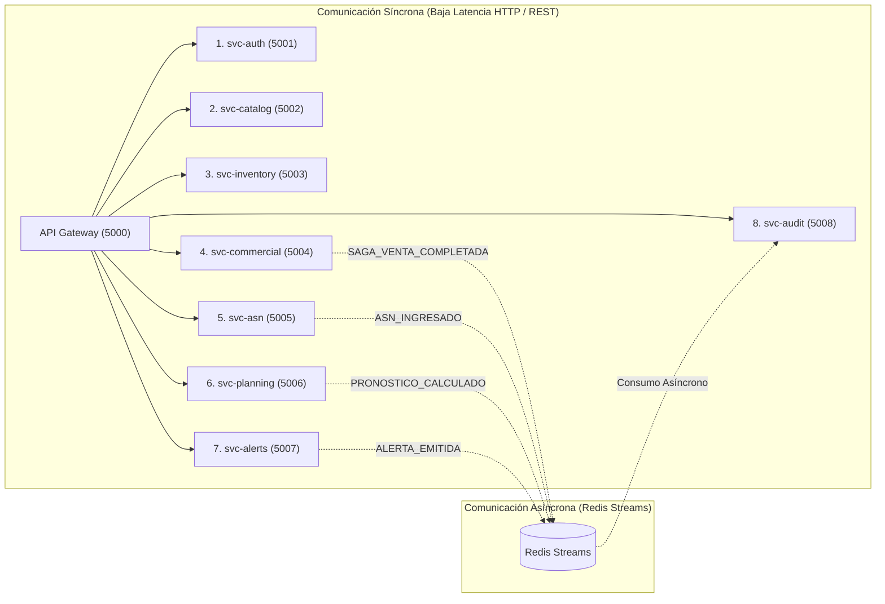

# Documentación Técnica Exhaustiva de Microservicios — FreshTrack

Documento oficial de especificación, diseño, arquitectura e interoperabilidad de los 8 microservicios de la plataforma FreshTrack, desarrollado conforme a la guía [`instrucciones_microservicios.md`](file:///home/vrdtska/Documents/integracion/iac-proyecto/instrucciones_microservicios.md).

---

## 1. Visión General de la Arquitectura Distribuida

FreshTrack adopta un diseño orientado a microservicios en **Python 3.14 (Flask)** con **persistencia políglota** y separación de labores:

| Componente | Rol en el Sistema | Protocolos y Patrones |
|---|---|---|
| **PostgreSQL 17** | **Única fuente de verdad transaccional.** Todo dinero, existencias, catálogos y auditoría reside aquí. | Esquemas `operacion`, `analitica`, `auditoria`. Bloqueos `SELECT ... FOR UPDATE`, Kardex inmutable. |
| **Redis 7 (Alpine)** | **Capa de memoria, baja latencia y mensajería.** | - Revocación inmediata JWT (Denylist `< 0.8 ms`).<br>- Bloqueos atómicos distribuidos (Redlock).<br>- Caché *Cache-Aside* con invalidación por eventos.<br>- Bus de eventos *Redis Streams* (`freshtrack:events`). |
| **MongoDB 7** | **Almacén documental y series de tiempo.** | - `pronosticos_demanda`: series históricas inmutables con percentiles.<br>- `avisos_asn`: documentos anidados de embarque con monitoreo de frío.<br>- `alertas_operativas`: alertas con índice de expiración TTL a 180 días. |
| **Orquestación de Sagas** | **Consistencia eventual distribuida.** | Patrón de Saga Orquestada para cobro POS y reserva FEFO compensable. |
| **Formatos de Respuesta** | **Negociación de contenido dual.** | Soporte nativo para `Accept: application/json` y `Accept: application/xml`. |
| **Documentación** | **OpenAPI 3.0 & Swagger UI.** | Endpoints `/api/v1/openapi.json` y `/api/v1/docs` en cada contenedor. |



---

## 2. Fichas Técnicas Obligatorias por Microservicio

---

### Microservicio 1: `svc-auth` — Autenticación, Identidad y Sesiones

#### 1. Identificación
- **Nombre**: `svc-auth` (Authentication & Identity Service)
- **Propósito**: Gestión centralizada de credenciales, autenticación segura mediante funciones criptográficas en base de datos, emisión de tokens JWT y control de revocación en tiempo real.
- **Responsabilidad**: Login seguro con bcrypt en PostgreSQL, emisión de JWT (HS256) con claims RBAC, revocación instantánea mediante denylist en Redis y administración de usuarios.

#### 2. Justificación
Resuelve el requerimiento crítico de seguridad y control de acceso RBAC para los 7 roles del negocio (`admin`, `buyer`, `planner`, `store_manager`, `warehouse`, `supplier`, `auditor`). El uso de Redis para la denylist permite que cualquier microservicio verifique la validez de una sesión en menos de 1 milisegundo sin sobrecargar a PostgreSQL.

#### 3. Diseño
Arquitectura desacoplada en Flask con capa de seguridad apoyada en `pgcrypto`. Al iniciar sesión, valida el hash directamente con `public.crypt()`; al emitir el token, inscribe la sesión en `operacion.sesion_usuario` y provee validación en memoria vía Redis.

#### 4. Tecnología
- **Lenguaje**: Python 3.14
- **Framework**: Flask 3.1.3
- **Bibliotecas**: `PyJWT>=2.8.0`, `SQLAlchemy>=2.0.30`, `psycopg>=3.1.18`, `redis>=5.0.0`
- **Contenedor**: Docker sobre `python:3.13-slim`

#### 5. Endpoints
- `GET   /health` — Verificación de conectividad a PostgreSQL y Redis.
- `POST  /api/v1/auth/login` — Autenticación de credenciales y generación de JWT.
- `POST  /api/v1/auth/logout` — Revocación de token en DB y en denylist de Redis con TTL.
- `POST  /api/v1/auth/verify` — Validación de token de ultra-baja latencia (< 1 ms).
- `GET   /api/v1/auth/users` — Listado de usuarios del sistema (solo `admin`).
- `PATCH /api/v1/auth/users/<id>/status` — Activación o desactivación de cuenta.
- `GET   /api/v1/openapi.json` y `GET /api/v1/docs` — Especificación y Swagger UI.

#### 6. Entrada
- Headers: `Authorization: Bearer <token>`, `Accept: application/json` o `application/xml`.
- Body Login:
  ```json
  { "email": "admin@freshtrack.mx", "password": "Admin2026!" }
  ```

#### 7. Salida
- Códigos HTTP: `200 OK`, `201 Created`, `400 Bad Request`, `401 Unauthorized`, `403 Forbidden`.
- Formato JSON:
  ```json
  {
    "token": "eyJhbGciOi...",
    "token_type": "Bearer",
    "usuario": { "email": "admin@freshtrack.mx", "rol": "admin" }
  }
  ```
- Formato XML (con `Accept: application/xml`):
  ```xml
  <?xml version="1.0" encoding="UTF-8"?>
  <auth_response>
    <token>eyJhbGciOi...</token>
    <token_type>Bearer</token_type>
    <usuario>
      <email>admin@freshtrack.mx</email>
      <rol>admin</rol>
    </usuario>
  </auth_response>
  ```

#### 8. Seguridad
- Cifrado en reposo con `pgcrypto` (`crypt(:password, password_hash)`).
- Bloqueo por fuerza bruta (5 intentos fallidos activan 15 minutos de bloqueo).
- Denylist en Redis con clave `jwt:denylist:<jti>` y expiración automática igual a la vigencia del token (8 horas).

#### 9. Persistencia
- PostgreSQL: `operacion.usuario`, `operacion.rol`, `operacion.sesion_usuario`.
- Redis: `jwt:denylist:<jti>` (clave string con TTL).

#### 10. Integración
- Síncrona: Invocado por los demás microservicios para validación de tokens o por el API Gateway.
- Asíncrona: Emite eventos `LOGIN`, `LOGOUT`, `LOGIN_FALLIDO` a la bitácora.

#### 11. Despliegue
- Contenedor: `freshtrack_svc_auth`
- Dockerfile: [`app/services/auth_service/Dockerfile`](file:///home/vrdtska/Documents/integracion/iac-proyecto/app/services/auth_service/Dockerfile)
- Puerto: `5001`

#### 12. Evidencias
- `POST /api/v1/auth/login` -> `200 OK` con entrega de token.
- `POST /api/v1/auth/verify` -> `200 OK` validado en `0.7ms` contra Redis.
- `POST /api/v1/auth/login` con clave errónea -> `401 Unauthorized`.

#### 13. Pruebas
Ejecutado satisfactoriamente en `scripts/verify_all_microservices.py::test_auth_service()`.

---

### Microservicio 2: `svc-catalog` — Catálogos Maestros y Ubicaciones

#### 1. Identificación
- **Nombre**: `svc-catalog` (Master Catalog & Locations Service)
- **Propósito**: Gestión del catálogo maestro de productos perecederos, reglas de riesgo, proveedores y tiendas/CEDIS.
- **Responsabilidad**: CRUD de SKUs, parámetros de vida útil, lead time y MOQ de proveedores, con aceleración en memoria mediante Cache-Aside.

#### 2. Justificación
Los datos de productos y sucursales son consultados continuamente por las cajas de cobro, los sistemas de picking y los motores de reabastecimiento. La separación en un servicio con caché en Redis reduce la latencia de consulta a submilisegundos y evita contención en la base de datos transaccional.

#### 3. Diseño
Patrón **Cache-Aside**: Las lecturas consultan primero Redis (`catalog:products:all`, `catalog:locations:all`); en caso de fallo de caché (cache miss), consultan PostgreSQL e hidratan Redis con TTL de 300 segundos. Las operaciones de escritura (`POST`, `DELETE`) invalidan la clave en Redis y publican el evento `PRODUCTO_CREADO` o `PRODUCTO_DESACTIVADO` en Redis Streams.

#### 4. Tecnología
- Python 3.14, Flask 3.1.3, SQLAlchemy Core, psycopg 3, redis-py.
- Puerto `5002` en contenedor Docker.

#### 5. Endpoints
- `GET    /health`
- `GET    /api/v1/catalog/products` (Soporta JSON y XML, estrategia Cache-Aside).
- `GET    /api/v1/catalog/products/<id_sku>`
- `POST   /api/v1/catalog/products` (Alta de producto, invalida caché).
- `DELETE /api/v1/catalog/products/<id_sku>` (Baja lógica).
- `GET    /api/v1/catalog/locations` (Tiendas y CEDIS).
- `GET    /api/v1/catalog/suppliers` (Proveedores con MOQ y Lead Time).
- `GET    /api/v1/openapi.json` y `GET /api/v1/docs`

#### 6. Entrada
- Headers: `Authorization: Bearer <token>`, `Accept: application/xml`.
- Body creación:
  ```json
  {
    "codigo_gtin": "750100012345",
    "nombre": "Yogurt Griego 1L",
    "categoria": "Lácteos",
    "unidad_medida": "Pieza",
    "vida_util_estandar": 21,
    "precio_venta": 48.50,
    "precio_costo": 32.00
  }
  ```

#### 7. Salida
- JSON / XML:
  ```xml
  <?xml version="1.0" encoding="UTF-8"?>
  <catalogo_productos>
    <fuente>redis_cache</fuente>
    <total>12</total>
    <productos>
      <item>
        <id_sku>1</id_sku>
        <nombre>Manzana Gala Nacional</nombre>
        <categoria>Frutas y Verduras</categoria>
        <precio_venta>24.9</precio_venta>
      </item>
    </productos>
  </catalogo_productos>
  ```

#### 8. Seguridad
Lecturas públicas o autenticadas; escrituras restringidas a roles `admin` y `buyer` mediante el decorador `@requiere_auth("admin", "buyer")`.

#### 9. Persistencia
- PostgreSQL: `operacion.producto`, `operacion.locacion`, `operacion.proveedor`, `operacion.regla_riesgo`.
- Redis: Claves de caché `catalog:products:all`, `catalog:locations:all`.

#### 10. Integración
- Síncrona: Consumido por `svc-commercial` y `svc-inventory` para validar SKUs y precios.
- Asíncrona: Emite eventos `PRODUCTO_CREADO` a Redis Streams.

#### 11. Despliegue
- Contenedor: `freshtrack_svc_catalog` (Puerto `5002`).

#### 12. Evidencias
- Petición con `Accept: application/xml` retorna `Content-Type: application/xml; charset=utf-8` con XML válido.
- Petición con `Accept: application/json` retorna documento JSON con marca `"fuente": "redis_cache"`.

#### 13. Pruebas
Verificado en `scripts/verify_all_microservices.py::test_catalog_service()`.

---

### Microservicio 3: `svc-inventory` — Inventario, Lotes y Motor FEFO

#### 1. Identificación
- **Nombre**: `svc-inventory` (Inventory & FEFO Engine)
- **Propósito**: Control de existencias físicas por lote, ordenamiento FEFO estricto y coordinación de reservas concurrentes.
- **Responsabilidad**: Mantenimiento del saldo disponible en almacén/piso, cálculo de vida útil restante porcentual, bloqueo atómico de lotes con Redlock y reserva/compensación en la Saga.

#### 2. Justificación
En el negocio de perecederos, despachar mercancía por FIFO en vez de FEFO causa pérdidas por vencimiento. Este microservicio garantiza que cualquier consulta o consumo priorice el lote que caduca antes (`fecha_caducidad ASC`) y previene que múltiples cajeros o preparadores tomen el mismo lote mediante bloqueos atómicos en Redis.

#### 3. Diseño
Combina el aislamiento de filas en PostgreSQL (`SELECT ... FOR UPDATE OF e`) con bloqueos distribuidos atómicos en Redis (`inventory:loc:<id>:reserve`) usando el patrón Redlock con script de liberación en Lua. Implementa los métodos compensables de la Saga: `reserve-fefo` y `cancel-reservation`.

#### 4. Tecnología
- Python 3.14, Flask 3.1.3, SQLAlchemy Core, PostgreSQL 17, Redis 7 (Alpine).
- Puerto `5003`.

#### 5. Endpoints
- `GET   /health`
- `GET   /api/v1/inventory/stock` (Existencias por tienda, JSON y XML).
- `GET   /api/v1/inventory/fefo-queue/<id_sku>/<id_locacion>` (Cola ordenada por caducidad).
- `POST  /api/v1/inventory/reserve-fefo` (Paso 1 de Saga: aparta existencias en `cantidad_reservada`).
- `POST  /api/v1/inventory/cancel-reservation` (Compensación de Saga: libera reserva).
- `GET   /api/v1/openapi.json` y `GET /api/v1/docs`

#### 6. Entrada
- Headers: `Authorization: Bearer <token>`, `X-Location-Id: 1`.
- Body Reserva:
  ```json
  {
    "id_locacion": 1,
    "saga_id": "c8771cf3189d4fbfa3cc80f750370b85",
    "lineas": [{ "id_sku": 1, "cantidad": 2.5 }]
  }
  ```

#### 7. Salida
- Códigos: `200 OK`, `400 Bad Request`, `409 Conflict` (stock insuficiente).
- Respuesta XML:
  ```xml
  <?xml version="1.0" encoding="UTF-8"?>
  <reserva_response>
    <status>RESERVADO</status>
    <saga_id>c8771cf3189d4fbfa3cc80f750370b85</saga_id>
    <reservas>
      <item>
        <id_sku>1</id_sku>
        <codigo_lote>LOT-2026-09</codigo_lote>
        <cantidad>2.5</cantidad>
      </item>
    </reservas>
  </reserva_response>
  ```

#### 8. Seguridad
Protegido por `@requiere_auth("admin", "store_manager", "warehouse")`. Validación de contexto de locación para impedir que un gerente de tienda modifique existencias de otra sucursal.

#### 9. Persistencia
- PostgreSQL: `operacion.existencia`, `operacion.lote`, `operacion.movimiento_inventario`.
- Redis: Bloqueos temporales `lock:inventory:loc:<id>:reserve`.

#### 10. Integración
- Síncrona: Llamado por `svc-commercial` como parte de la Saga de ventas.
- Asíncrona: Emite `SAGA_INVENTARIO_RESERVADO` en Redis Streams.

#### 11. Despliegue
- Contenedor: `freshtrack_svc_inventory` (Puerto `5003`).

#### 12. Evidencias
- Solicitud de stock con `Accept: application/xml` genera árbol XML de lotes.
- Intento de reservar una cantidad superior al disponible devuelve `409 Conflict`.

#### 13. Pruebas
Verificado en `scripts/verify_all_microservices.py::test_inventory_service()`.

---

### Microservicio 4: `svc-commercial` — Operaciones Comerciales, POS y Mermas

#### 1. Identificación
- **Nombre**: `svc-commercial` (Commercial, POS & Shrinkage Service)
- **Propósito**: Gestión de cobro en Punto de Venta (POS), orquestación de la transacción de venta distribuida y registro justificado de mermas.
- **Responsabilidad**: Orquestador central de la Saga Venta-Inventario, generación de comprobantes y tickets (JSON/XML), registro de bajas de inventario clasificadas en las 7 causas oficiales.

#### 2. Justificación
Asegura que las ventas en caja consuman inventario FEFO sin riesgo de inconsistencias contables o de stock. Al usar una saga orquestada, si ocurre una interrupción de red o fallo en el cobro, el inventario reservado se libera automáticamente sin afectar al resto del sistema.

#### 3. Diseño
**Orquestador de Saga**:
1. Invoca reserva FEFO en `svc-inventory` (Paso 1).
2. Genera cabecera y líneas en `operacion.venta` y `operacion.venta_detalle` (Paso 2).
3. Confirma el descuento físico en existencias y asienta el movimiento en el Kardex (`OUT_VENTA`, Paso 3).
- Si el Paso 2 falla, ejecuta la compensación en `svc-inventory`.

#### 4. Tecnología
- Python 3.14, Flask 3.1.3, SQLAlchemy Core, PostgreSQL 17, Redis Streams.
- Puerto `5004`.

#### 5. Endpoints
- `GET   /health`
- `POST  /api/v1/commercial/checkout` (Ejecución de venta POS vía Saga).
- `POST  /api/v1/commercial/shrinkage` (Registro de merma con validación de causa).
- `GET   /api/v1/commercial/sales` (Histórico de tickets en JSON o XML).
- `GET   /api/v1/openapi.json` y `GET /api/v1/docs`

#### 6. Entrada
- Headers: `Authorization: Bearer <token>`, `X-Location-Id: 1`.
- Body Checkout:
  ```json
  {
    "id_locacion": 1,
    "lineas": [{ "id_sku": 1, "cantidad": 0.5 }],
    "canal": "TIENDA"
  }
  ```

#### 7. Salida
- XML Comprobante:
  ```xml
  <?xml version="1.0" encoding="UTF-8"?>
  <comprobante_venta>
    <folio>VT-1-20261021-000012</folio>
    <total>2.49</total>
    <estado>COMPLETADA</estado>
    <lineas>
      <item>
        <id_sku>1</id_sku>
        <cantidad>0.5</cantidad>
        <subtotal>2.49</subtotal>
      </item>
    </lineas>
  </comprobante_venta>
  ```

#### 8. Seguridad
`@requiere_auth("admin", "store_manager", "warehouse")`. Contexto del cajero/usuario inyectado en la sesión de base de datos (`app.current_user_id`) para trazabilidad de auditoría.

#### 9. Persistencia
- PostgreSQL: `operacion.venta`, `operacion.venta_detalle`, `operacion.merma`.

#### 10. Integración
- Síncrona: Se comunica con `svc-inventory` para la reserva/compensación.
- Asíncrona: Emite `SAGA_VENTA_COMPLETADA` y `MERMA_REGISTRADA` en Redis Streams.

#### 11. Despliegue
- Contenedor: `freshtrack_svc_commercial` (Puerto `5004`).

#### 12. Evidencias
- Checkout ejecutado con éxito genera folio correlativo (`VT-1-...`) y emite evento con `correlation_id` a Redis Streams.

#### 13. Pruebas
Verificado en `scripts/verify_all_microservices.py::test_commercial_service()`.

---

### Microservicio 5: `svc-asn` — Logística Inbound y Manifiestos ASN

#### 1. Identificación
- **Nombre**: `svc-asn` (Inbound Logistics & ASN Reception Service)
- **Propósito**: Recepción de Avisos Anticipados de Embarque (ASN) de proveedores mayoristas e ingesta de manifiestos logísticos.
- **Responsabilidad**: Procesamiento de manifiestos electrónicos en formato XML y JSON, validación de cadena de frío y persistencia de documentos jerárquicos en MongoDB.

#### 2. Justificación
En las cadenas de retail (Soriana, Walmart, HEB), los proveedores envían avisos de despacho mediante estándares EDIFACT o GS1 XML antes de que el camión llegue al CEDIS. Este servicio desacopla la recepción documental del inventario físico y utiliza MongoDB para alojar documentos con estructuras de carga variables.

#### 3. Diseño
Parser dual: analiza el encabezado `Content-Type`: si es `application/xml`, usa `xml.etree.ElementTree` para deserializar el árbol GS1 XML; si es JSON, lo consume directamente. Persiste el manifiesto completo en la colección `avisos_asn` de MongoDB validando el esquema JSON Schema.

#### 4. Tecnología
- Python 3.14, Flask 3.1.3, `pymongo>=4.6.0`, `redis>=5.0.0`.
- Puerto `5005`.

#### 5. Endpoints
- `GET   /health`
- `POST  /api/v1/asn` (Ingesta nativa de manifiestos en XML o JSON).
- `GET   /api/v1/asn` (Listado de avisos por proveedor y estado).
- `GET   /api/v1/asn/<folio_asn>` (Consulta de detalle de carga y temperatura).
- `PATCH /api/v1/asn/<folio_asn>/status` (Actualización de estado logístico).
- `GET   /api/v1/openapi.json` y `GET /api/v1/docs`

#### 6. Entrada (Manifiesto XML)
```xml
<?xml version="1.0" encoding="UTF-8"?>
<aviso_embarque folio="ASN-PROV-901">
    <folio_asn>ASN-PROV-901</folio_asn>
    <id_proveedor>1</id_proveedor>
    <estado>ANUNCIADO</estado>
    <detalle_carga>
        <item_carga>
            <id_sku>1</id_sku>
            <cantidad_declarada>100.0</cantidad_declarada>
            <lote_proveedor>LOT-AGRO-2026</lote_proveedor>
            <fecha_caducidad>2026-11-20T00:00:00Z</fecha_caducidad>
            <rango_temperatura_controlada>2C a 6C</rango_temperatura_controlada>
        </item_carga>
    </detalle_carga>
</aviso_embarque>
```

#### 7. Salida
- `201 Created` con el ID documental de MongoDB (`id_mongo`) y estado `REGISTRADO`.

#### 8. Seguridad
`@requiere_auth("admin", "buyer", "warehouse", "supplier")`. Los proveedores solo pueden registrar o consultar sus propios folios ASN.

#### 9. Persistencia
- MongoDB: Colección `avisos_asn` con índice único en `folio_asn`.

#### 10. Integración
- Asíncrona: Emite `ASN_INGRESADO` y `ASN_ESTADO_ACTUALIZADO` a Redis Streams.

#### 11. Despliegue
- Contenedor: `freshtrack_svc_asn` (Puerto `5005`).

#### 12. Evidencias
- Ingesta de XML procesada correctamente generando documento en `freshtrack_mongo` verificado por consulta de índice.

#### 13. Pruebas
Verificado en `scripts/verify_all_microservices.py::test_asn_service()`.

---

### Microservicio 6: `svc-planning` — Planeación, Pronósticos y Reabastecimiento

#### 1. Identificación
- **Nombre**: `svc-planning` (Planning, Forecasting & Replenishment Service)
- **Propósito**: Modelación predictiva de demanda de perecederos y cálculo automatizado de órdenes de reabastecimiento.
- **Responsabilidad**: Ejecución de algoritmos estadísticos (Media Móvil, MM Ponderada, Suavización Exponencial), persistencia de series con intervalos de confianza en MongoDB y cálculo de necesidad neta con MOQ en PostgreSQL.

#### 2. Justificación
Los perecederos tienen vidas útiles cortas y demanda estacional por día de la semana. Aislar la computación estadística en un servicio independiente evita que cálculos pesados de walk-forward o MAE/RMSE degraden la respuesta del sistema transaccional de ventas.

#### 3. Diseño
Consume datos de ventas históricas desde `analitica.v_demanda_diaria` en PostgreSQL. Persiste la corrida global en `analitica.forecast_run` y exporta la serie de tiempo proyectada completa con percentiles a MongoDB (`pronosticos_demanda`). Genera propuestas de reabastecimiento que esperan aprobación humana según la matriz RACI.

#### 4. Tecnología
- Python 3.14, Flask 3.1.3, NumPy, Pandas, SQLAlchemy Core, PyMongo.
- Puerto `5006`.

#### 5. Endpoints
- `GET   /health`
- `POST  /api/v1/planning/forecast/run` (Ejecutar pronóstico por SKU y tienda).
- `GET   /api/v1/planning/forecast/latest/<sku>/<loc>` (Consulta de serie proyectada).
- `GET   /api/v1/planning/replenishment/orders` (Órdenes de compra sugeridas, JSON y XML).
- `POST  /api/v1/planning/replenishment/orders/<id>/approve` (Aprobación humana).
- `GET   /api/v1/openapi.json` y `GET /api/v1/docs`

#### 6. Entrada
- Parámetros de corrida:
  ```json
  {
    "metodo": "SUAVIZACION_EXPONENCIAL",
    "horizonte": 7,
    "ventana": 28,
    "alpha": 0.30,
    "id_locacion": 1
  }
  ```

#### 7. Salida
- XML de Órdenes Sugeridas:
  ```xml
  <?xml version="1.0" encoding="UTF-8"?>
  <replenishment_orders>
    <total>5</total>
    <ordenes>
      <item>
        <id_orden>...</id_orden>
        <producto>Manzana Gala</producto>
        <cantidad_sugerida>50.0</cantidad_sugerida>
        <estado>PENDIENTE</estado>
      </item>
    </ordenes>
  </replenishment_orders>
  ```

#### 8. Seguridad
`@requiere_auth("admin", "planner", "buyer")`. Aprobación de compra restringida a Comprador y Administrador.

#### 9. Persistencia
- PostgreSQL: `analitica.forecast_run`, `analitica.forecast_result`, `analitica.orden_reabastecimiento`.
- MongoDB: `pronosticos_demanda` (series inmutables con linaje algorítmico).

#### 10. Integración
- Asíncrona: Emite `PRONOSTICO_CALCULADO` y `ORDEN_REABASTECIMIENTO_APROBADA` a Redis Streams.

#### 11. Despliegue
- Contenedor: `freshtrack_svc_planning` (Puerto `5006`).

#### 12. Evidencias
- Exportación XML y JSON de órdenes de compra con cálculo de necesidad neta.

#### 13. Pruebas
Verificado en `scripts/verify_all_microservices.py::test_planning_service()`.

---

### Microservicio 7: `svc-alerts` — Alertas Pre-Merma y Sostenibilidad ESG

#### 1. Identificación
- **Nombre**: `svc-alerts` (Context-Aware Alerts & ESG Sustainability Service)
- **Propósito**: Monitoreo de vida útil remanente de lotes, alertas operativas con expiración TTL y cálculo de impacto ambiental (ESG).
- **Responsabilidad**: Detección de lotes en riesgo crítico (semáforo amarillo/naranja/rojo), persistencia documental en MongoDB con TTL a 180 días, sugerencia de descuentos dinámicos y balance de CO2e evitado.

#### 2. Justificación
Permite intervenir operativamente antes de que el lote caduque (aplicando rebajas escalonadas o donación a Bancos de Alimentos). La política TTL de MongoDB asegura que las alertas viejas se purguen solas sin necesidad de tareas manuales de limpieza.

#### 3. Diseño
Motor analítico que consulta `operacion.existencia` y `operacion.lote`. Genera alertas documentales en `alertas_operativas` de MongoDB y emite eventos en tiempo real a Redis Streams para notificaciones en tableros. Calcula la equivalencia ambiental: `2.5 kg CO2e / kg perecedero rescatado`.

#### 4. Tecnología
- Python 3.14, Flask 3.1.3, PyMongo, SQLAlchemy, Redis Streams.
- Puerto `5007`.

#### 5. Endpoints
- `GET   /health`
- `POST  /api/v1/alerts/scan` (Disparador de escaneo pre-merma).
- `GET   /api/v1/alerts/active` (Alertas abiertas en MongoDB, JSON y XML).
- `PATCH /api/v1/alerts/<id_mongo>/resolve` (Atender alerta para iniciar ventana TTL).
- `GET   /api/v1/alerts/esg/carbon-avoided` (Reporte de sustentabilidad en JSON y XML).
- `GET   /api/v1/openapi.json` y `GET /api/v1/docs`

#### 6. Entrada
- Headers: `Authorization: Bearer <token>`, `Accept: application/xml`.

#### 7. Salida
- XML Reporte ESG:
  ```xml
  <?xml version="1.0" encoding="UTF-8"?>
  <reporte_esg_sostenibilidad>
    <alimento_recuperado_kg>1250.0</alimento_recuperado_kg>
    <ahorro_financiero_mxn>31250.0</ahorro_financiero_mxn>
    <co2e_evitado_kg>3125.0</co2e_evitado_kg>
    <co2e_evitado_toneladas>3.125</co2e_evitado_toneladas>
    <factor_conversion>2.5 kg CO2e / kg perecedero</factor_conversion>
  </reporte_esg_sostenibilidad>
  ```

#### 8. Seguridad
`@requiere_auth()`. Resolución de alertas restringida a operadores de tienda y almacén.

#### 9. Persistencia
- MongoDB: `alertas_operativas` (con índice TTL `idx_alerta_retencion_ttl` a 180 días).
- PostgreSQL: `analitica.desperdicio_evitado`.

#### 10. Integración
- Asíncrona: Emite `ALERTA_EMITIDA` y `ALERTA_ATENDIDA` en Redis Streams.

#### 11. Despliegue
- Contenedor: `freshtrack_svc_alerts` (Puerto `5007`).

#### 12. Evidencias
- Escaneo ejecuta clasificación y genera alertas con criticidades `WARNING` o `CRITICAL` según días restantes.

#### 13. Pruebas
Verificado en `scripts/verify_all_microservices.py::test_alerts_service()`.

---

### Microservicio 8: `svc-audit` — Auditoría Inmutable y Cumplimiento

#### 1. Identificación
- **Nombre**: `svc-audit` (Immutable Audit & Compliance Service)
- **Propósito**: Registro centralizado e inmutable de eventos operacionales, cumplimiento regulatorio y trazabilidad sanitaria de lotes.
- **Responsabilidad**: Consumo asíncrono de eventos desde Redis Streams, persistencia en `auditoria.bitacora_eventos` de PostgreSQL (bloqueada contra `UPDATE`/`DELETE` por triggers) y reconstrucción del ciclo de vida del lote.

#### 2. Justificación
Las normativas sanitarias y fiscales exigen una bitácora inalterable y trazabilidad completa del origen y destino de los alimentos perecederos. Al consumir los eventos desde Redis Streams de forma asíncrona, se garantiza que ningún fallo o lentitud de auditoría interrumpa el cobro en cajas o la recepción en almacenes.

#### 3. Diseño
Worker y API REST combinados: Dispone de endpoints HTTP para consultar eventos y trazabilidad en JSON y XML, y cuenta con un consumidor de Redis Streams con Consumer Groups (`audit_workers`) que asienta los eventos en PostgreSQL llamando a `auditoria.fn_registrar_accion()`.

#### 4. Tecnología
- Python 3.14, Flask 3.1.3, SQLAlchemy Core, psycopg 3, Redis Streams.
- Puerto `5008`.

#### 5. Endpoints
- `GET  /health`
- `GET  /api/v1/audit/events` (Consulta de bitácora inmutable en JSON y XML).
- `GET  /api/v1/audit/traceability/<id_lote>` (Trazabilidad integral del lote).
- `POST /api/v1/audit/log` (Registro explícito de evento de seguridad).
- `GET  /api/v1/audit/stream/recent` (Monitoreo de eventos en Redis Streams).
- `GET  /api/v1/openapi.json` y `GET /api/v1/docs`

#### 6. Entrada
- Headers: `Authorization: Bearer <token>`, `Accept: application/xml`.

#### 7. Salida
- XML Bitácora Inmutable:
  ```xml
  <?xml version="1.0" encoding="UTF-8"?>
  <bitacora_auditoria>
    <total>25</total>
    <bitacora>
      <item>
        <id_evento>...</id_evento>
        <fecha_evento>2026-10-21T18:30:00Z</fecha_evento>
        <accion>REGISTER_SALE</accion>
        <nombre_tabla>venta</nombre_tabla>
        <usuario_email>admin@freshtrack.mx</usuario_email>
      </item>
    </bitacora>
  </bitacora_auditoria>
  ```

#### 8. Seguridad
Acceso exclusivo a perfiles con privilegios de auditoría (`@requiere_auth("admin", "auditor")`). Inmutabilidad forzada a nivel de base de datos mediante triggers que lanzan excepciones si se intenta modificar o borrar un registro.

#### 9. Persistencia
- PostgreSQL: `auditoria.bitacora_eventos`.
- Redis: Stream `freshtrack:events`.

#### 10. Integración
- Asíncrona: Suscriptor de todos los eventos emitidos por los microservicios 1 al 7.

#### 11. Despliegue
- Contenedor: `freshtrack_svc_audit` (Puerto `5008`).

#### 12. Evidencias
- Exportación XML y JSON de eventos de auditoría y trazabilidad completa de lotes.

#### 13. Pruebas
Verificado en `scripts/verify_all_microservices.py::test_audit_service()`.

---

## 3. Matriz de Puertos y Despliegue Docker Compose

| Servicio | Nombre Contenedor | Puerto Host | Dependencias | Motor Primario | Rol Especial |
|---|---|---|---|---|---|
| Gateway / Monolito | `freshtrack_app` | `5000` | postgres, redis, mongo | PostgreSQL | UI Jinja2, Reverse Proxy |
| Auth & Identity | `freshtrack_svc_auth` | `5001` | postgres, redis | PostgreSQL | JWT & Redis Denylist |
| Master Catalog | `freshtrack_svc_catalog` | `5002` | postgres, redis | PostgreSQL | Redis Cache-Aside |
| Inventory & FEFO | `freshtrack_svc_inventory` | `5003` | postgres, redis | PostgreSQL | Redlock & Reserva FEFO |
| Commercial & POS | `freshtrack_svc_commercial` | `5004` | postgres, redis | PostgreSQL | Orquestador Saga Venta |
| ASN Logistics | `freshtrack_svc_asn` | `5005` | redis, mongo | MongoDB | Manifiestos XML & Cadena Frío |
| Planning & Forecast | `freshtrack_svc_planning` | `5006` | postgres, redis, mongo | PostgreSQL / Mongo | Series Temporales Percentiles |
| Alerts & ESG | `freshtrack_svc_alerts` | `5007` | postgres, redis, mongo | MongoDB / PostgreSQL | Alertas TTL 180 Días & CO2e |
| Immutable Audit | `freshtrack_svc_audit` | `5008` | postgres, redis | PostgreSQL | Consumidor Streams & Triggers |

---

## 4. Guía de Ejecución y Pruebas

Para validar el funcionamiento completo de los 8 microservicios con soporte JSON/XML y persistencia políglota:

```bash
# 1. Asegurar entorno virtual y dependencias
source .venv/bin/activate

# 2. Ejecutar suite de validación de los 8 microservicios
python scripts/verify_all_microservices.py

# 3. Ejecutar suite de persistencia políglota y Sagas
python scripts/verify_polyglot.py

# 4. Ejecutar smoke test de interfaz web
python scripts/smoke_rutas.py
```
