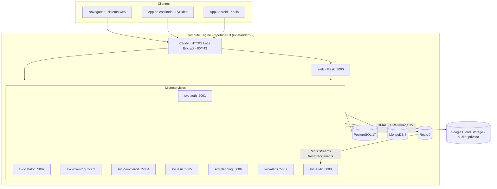
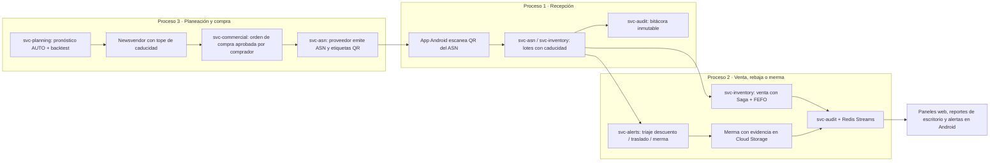
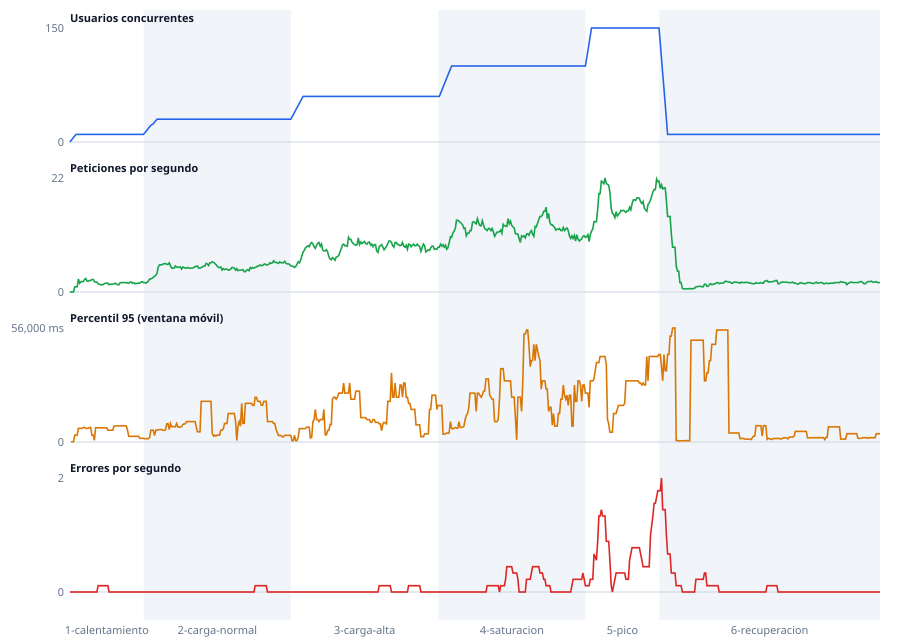

# PROYECTO IAC — INTEGRACIÓN DE APLICACIONES COMPUTACIONALES

# Reporte Técnico Final · FreshTrack (Entrega Final, Tercer Parcial)
## Plataforma Predictiva Distribuida para la Reducción de Desperdicio de Perecederos, Desplegada en Google Cloud

---

### **Identificación del Proyecto y Equipo**

- **Institución:** Universidad de Monterrey (UDEM)
- **Materia:** Integración de Aplicaciones Computacionales (IAC)
- **Proyecto:** Proyecto 12 · FreshTrack
- **Equipo:** Equipo 05
- **Integrantes:**
  - Santiago López Cervantes (612956)
  - Juan Nicolás Núñez Mendoza (613622)
  - Fabián Azaed Orta Singlaterry (613504)
- **Fecha de Entrega:** 24 de noviembre de 2026
- **Versión del Sistema:** FreshTrack v3.0 (commit `1c213e4`, rama `avance2-postgresql-real`)
- **Despliegue:** Google Compute Engine + Cloud Storage · `https://34.51.41.80.nip.io`
- **Tecnologías Centrales:** Python 3.14 · Flask · PostgreSQL 17 · MongoDB 7 · Redis 7 · Google Cloud Storage · Docker Compose · Caddy (HTTPS) · PySide6 (escritorio) · Kotlin (Android) · Locust

---

## **Índice General**

1. [Portada](#1-portada)
2. [Resumen ejecutivo](#2-resumen-ejecutivo)
3. [Descripción del problema](#3-descripción-del-problema)
4. [Objetivos](#4-objetivos)
5. [Alcance](#5-alcance)
6. [Usuarios](#6-usuarios)
7. [Requerimientos](#7-requerimientos)
8. [Reglas de negocio](#8-reglas-de-negocio)
9. [Arquitectura](#9-arquitectura)
10. [Diagramas](#10-diagramas)
11. [Modelo relacional](#11-modelo-relacional)
12. [Diseño MongoDB](#12-diseño-mongodb)
13. [Diseño Redis](#13-diseño-redis)
14. [Diseño de buckets](#14-diseño-de-buckets)
15. [Microservicios](#15-microservicios)
16. [Contratos JSON](#16-contratos-json)
17. [Contratos XML](#17-contratos-xml)
18. [Swagger](#18-swagger)
19. [Seguridad](#19-seguridad)
20. [Algoritmos](#20-algoritmos)
21. [Infraestructura de GCP](#21-infraestructura-de-gcp)
22. [Contenedores](#22-contenedores)
23. [Monitoreo](#23-monitoreo)
24. [Plan de pruebas](#24-plan-de-pruebas)
25. [Resultados de Locust](#25-resultados-de-locust)
26. [Resultados de rendimiento](#26-resultados-de-rendimiento)
27. [Manual de instalación](#27-manual-de-instalación)
28. [Manual técnico](#28-manual-técnico)
29. [Manual de usuario](#29-manual-de-usuario)
30. [Limitaciones](#30-limitaciones)
31. [Trabajo futuro](#31-trabajo-futuro)
32. [Conclusiones](#32-conclusiones)

---

## **1. Portada**

**FreshTrack** — Plataforma predictiva para la reducción de desperdicio de alimentos perecederos (Proyecto 12).

| Dato | Valor |
| --- | --- |
| Institución | Universidad de Monterrey (UDEM) |
| Materia | Integración de Aplicaciones Computacionales |
| Entregable | Proyecto final: expediente técnico (primer, segundo y tercer parcial integrados) |
| Equipo | Equipo 05 |
| Integrantes | Santiago López Cervantes (612956) · Juan Nicolás Núñez Mendoza (613622) · Fabián Azaed Orta Singlaterry (613504) |
| Repositorio | [github.com/crlsbk/freshtrack](https://github.com/crlsbk/freshtrack), rama `avance2-postgresql-real` |
| Despliegue | Google Compute Engine — `https://34.51.41.80.nip.io` |
| Versión documentada | Commit `1c213e4` del 24 de noviembre de 2026 (rama `avance2-postgresql-real`) |

---

## **2. Resumen ejecutivo**

FreshTrack es una plataforma distribuida, desplegada en Google Cloud, que reduce el desperdicio de perecederos: controla cada lote por caducidad, surte en orden FEFO, pronostica la demanda y propone reabastecimiento, descuentos y transferencias antes de que el producto se pierda.

La solución integra tres clientes (sistema web, app de escritorio para compradores y planeadores, y app Android para personal de tienda) sobre 8 microservicios REST con persistencia políglota: PostgreSQL 17 como fuente de verdad, MongoDB 7 para documentos y series, Redis 7 para sesiones, caché, bloqueos y eventos, y Google Cloud Storage para archivos.

| Indicador | Valor |
| --- | --- |
| Microservicios | 8 (`svc-auth`, `svc-catalog`, `svc-inventory`, `svc-commercial`, `svc-asn`, `svc-planning`, `svc-alerts`, `svc-audit`) |
| Operaciones REST de negocio | 94, documentadas en OpenAPI 3 con Swagger UI, JSON y XML |
| Clientes | Web (Flask), escritorio (PySide6, instalable con PyInstaller), Android (Kotlin, APK) |
| Despliegue | Google Compute Engine + Cloud Storage, gateway Caddy con HTTPS (Let's Encrypt) |
| Datos en la nube (24/nov/2026) | 52 locaciones, 212 productos, 3,301 lotes con existencia, 194,425 ventas, 1,200 usuarios generados |
| Algoritmos | Pronóstico (media móvil, suavización exponencial, backtest WMAPE), newsvendor, FEFO, triaje descuento/traslado/merma, detección de riesgo |
| Pruebas | 374 unitarias de backend, 27 de integración, 171 de escritorio y 38 de Android (todas aprobadas el 24/nov/2026); 22 casos de sistema de punta a punta (21 aprueban); 8 simulacros de fallas; Locust escalonado hasta 150 usuarios |
| Seguridad | JWT + refresh con rotación, denylist en Redis, RBAC por rol y sucursal, rate limiting, XSD, recuperación de contraseña por correo, registro de dispositivos, auditoría inmutable |

El punto débil medido es el rendimiento bajo carga en una VM de 2 núcleos: con 30 usuarios el p95 ya llega a 9.1 s y la base de datos consume la mayor parte del CPU (sección 25).

---

## **3. Descripción del problema**

Los perecederos se pierden porque las tiendas no ven la caducidad por lote ni ajustan su compra a la demanda real: una recomendación basada solo en demanda genera sobreinventario, y el sobreinventario termina en merma.

El problema combina variables que un sistema tradicional por SKU no considera:

- **Demanda incierta y estacional:** varía por día de la semana, promociones, clima y tienda.
- **Vida útil limitada:** de 2 a 14 días en los productos del catálogo (panadería, carnes, lácteos, frutas, verduras).
- **Diferencias entre tiendas:** una tienda tiene exceso mientras otra tiene faltante del mismo producto.
- **Restricciones de suministro:** tiempos de entrega (*lead time*) y tamaños mínimos de pedido (MOQ) por proveedor.
- **Consumo desordenado:** sin control por lote se surte el producto más nuevo (LIFO involuntario) y el viejo caduca en anaquel.

FreshTrack ataca las tres causas: visibilidad por lote con riesgo de caducidad calculado, decisiones de compra que restan el inventario en riesgo, y acciones preventivas (descuento, transferencia) medidas como desperdicio evitado.

---

## **4. Objetivos**

**Objetivo general:** desarrollar una plataforma de pronóstico y reabastecimiento para perecederos, desplegada en la nube, que reduzca la merma y cuantifique el desperdicio evitado.

**Objetivos específicos:**

1. Pronosticar la demanda por producto y tienda, con métricas de error (MAE, RMSE, WMAPE) y backtest.
2. Administrar lotes y caducidades, priorizando el consumo FEFO.
3. Detectar el riesgo de vencimiento y emitir alertas a tiempo.
4. Recomendar reabastecimiento (newsvendor + stock útil proyectado) respetando lead time y MOQ.
5. Sugerir transferencias entre tiendas y descuentos preventivos con aprobación humana.
6. Medir mermas y estimar el desperdicio evitado, el ahorro y el CO₂e evitado.
7. Integrar web, escritorio y móvil sobre 8 microservicios con seguridad, monitoreo y tolerancia a fallos en GCP.

---

## **5. Alcance**

El alcance cubre la operación de perecederos de punta a punta: compra, recepción, inventario por lote, venta, merma, planeación y reporte de sostenibilidad.

| Incluido | Fuera de alcance |
| --- | --- |
| 8 microservicios en contenedores sobre Google Compute Engine | Kubernetes (GKE), Pub/Sub y BigQuery: se justificó Docker Compose en una VM por costo y tamaño del equipo |
| Web con 7 perfiles, app de escritorio (comprador/planeador) y app Android (tienda) | Integración con hardware de punto de venta, básculas o lectores RFID físicos |
| Pronóstico estadístico explicable (media móvil, suavización exponencial) con backtest | Modelos Prophet, XGBoost y LSTM entrenados en producción |
| Archivos en Cloud Storage con URL firmada (PDF de OC, hoja QR de ASN) | Facturación y pagos |
| Monitoreo central, health checks, Locust y pruebas de fallos | Alta disponibilidad multi-zona y réplicas de base de datos |

---

## **6. Usuarios**

Siete perfiles operan el sistema, cada uno con permisos por rol (RBAC) y, en tienda, acotados a su sucursal; además existe un portal público sin sesión.

| Perfil (rol) | Qué hace | Cliente principal | Cuenta de demostración |
| --- | --- | --- | --- |
| Administrador (`admin`) | Usuarios, sesiones, parámetros, monitoreo | Web | `admin@freshtrack.mx` |
| Comprador (`buyer`) | Proveedores, órdenes de compra, aprobación de reabastecimiento | Escritorio y web | `buyer@freshtrack.mx` |
| Planeador (`planner`) | Pronósticos, parámetros, transferencias, comparación de modelos | Escritorio y web | `planner@freshtrack.mx` |
| Gerente de tienda (`store_manager`) | Operación de su tienda, autoriza descuentos y transferencias | Android y web | `gerente@freshtrack.mx` |
| Operador de almacén (`warehouse`) | Recepción, conteo, mermas, ejecución de transferencias | Android | `almacen@freshtrack.mx` |
| Proveedor (`supplier`) | Avisos de embarque (ASN) y etiquetas QR de sus lotes | Web | `proveedor@freshtrack.mx` |
| Auditor (`auditor`) | Bitácora inmutable, trazabilidad de lotes, mermas | Web | `auditor@freshtrack.mx` |

Las contraseñas de demostración están en `sql/07_seed_base.sql` y en el README; deben cambiarse antes de un despliegue real.

---

## **7. Requerimientos**

**Funcionales**

| ID | Requerimiento | Microservicio / cliente |
| --- | --- | --- |
| RF-01 | Inicio de sesión con JWT, renovación (refresh) y revocación inmediata | `svc-auth` |
| RF-02 | Catálogo de productos, tiendas y proveedores con caché | `svc-catalog` |
| RF-03 | Inventario por lote y cola FEFO con reserva sin carreras | `svc-inventory` |
| RF-04 | Recepción por escaneo de etiqueta QR firmada, idempotente | `svc-inventory`, `svc-asn`, Android |
| RF-05 | Venta POS con Saga y compensación; importación masiva de ventas | `svc-commercial`, escritorio |
| RF-06 | Registro justificado de merma (7 causas) | `svc-commercial`, Android |
| RF-07 | Avisos de embarque (ASN), inspección y hoja QR en PDF por correo | `svc-asn` |
| RF-08 | Pronóstico por producto y tienda, backtest, comparación de modelos y drift | `svc-planning`, escritorio |
| RF-09 | Reabastecimiento newsvendor, aprobación y órdenes de compra en PDF | `svc-planning`, escritorio |
| RF-10 | Transferencias y descuentos preventivos con aprobación humana | `svc-planning`, Android |
| RF-11 | Alertas de riesgo de vencimiento y reporte ESG de desperdicio evitado | `svc-alerts`, Android |
| RF-12 | Bitácora de auditoría inmutable y trazabilidad por lote | `svc-audit` |
| RF-13 | Panel central de monitoreo de los servicios con último error registrado | Web `/ops/status` |
| RF-14 | Recuperación de contraseña por correo con enlace de un solo uso | Web, `svc-auth` |
| RF-15 | Centro de notificaciones por rol y sucursal | Web `/notificaciones` |
| RF-16 | Conteo cíclico, evidencia fotográfica con URL firmada y solicitud manual de transferencias | `svc-inventory`, `svc-commercial`, `svc-planning`, Android |
| RF-17 | Trabajo sin conexión con sincronización posterior y registro seguro del dispositivo | Android, `svc-auth` |

**No funcionales**

| ID | Requerimiento | Criterio |
| --- | --- | --- |
| RNF-01 | Seguridad | JWT HS256, RBAC, rate limiting, XSD, errores sin trazas internas |
| RNF-02 | Interoperabilidad | JSON y XML en todos los endpoints, contratos XSD, OpenAPI |
| RNF-03 | Disponibilidad parcial | Si cae Redis, Mongo o un servicio, el resto responde con error controlado |
| RNF-04 | Trazabilidad | `X-Correlation-Id` en logs, eventos y bitácora |
| RNF-05 | Portabilidad | Todo en contenedores Docker con health checks |
| RNF-06 | Rendimiento | Medido con Locust y benchmark; ver secciones 25 y 26 |

---

## **8. Reglas de negocio**

Las reglas viven en el backend (funciones de PostgreSQL y módulos `app/domain`); los clientes solo las muestran, así que web, escritorio y móvil siempre deciden igual.

| Regla | Definición | Dónde |
| --- | --- | --- |
| Riesgo de caducidad | VENCIDO si quedan < 0 días; CRÍTICO si ≤ `dias_critico`; VIGILANCIA si ≤ `dias_vigilancia`; si no, NORMAL. Umbrales por SKU o categoría en `operacion.regla_riesgo` (por defecto 2 y 5 días) | `operacion.fn_clasificar_riesgo` |
| FEFO | Se surte y reserva primero el lote que caduca antes; solo lotes DISPONIBLE y sin la cantidad ya reservada | `svc-inventory`, `ventas.repartir_fefo` |
| Merma | Siempre ligada a un lote y causa (CADUCIDAD, DAÑO, CALIDAD, CADENA\_DE\_FRIO, MANIPULACION, DEVOLUCION, OTRA); no puede exceder la existencia; descuenta inventario y escribe kardex en la misma transacción | `mermas.registrar_merma` |
| Descuento preventivo | 30 % en riesgo crítico y 15 % en vigilancia (configurables); nunca por debajo del costo; requiere autorización del gerente o planeador | `descuentos.sugerir_descuentos` |
| Transferencia | Solo si el origen tiene inventario suficiente, el destino lo necesita y el lote llega con vida útil (traslado de 1 día); queda SUGERIDA hasta su aprobación | `transferencias` |
| Triaje por lote | Orden de decisión: inmovilizar/merma → traslado si su valor neto (con 10 % de costo logístico) supera al descuento → descuento | `triaje.decidir_ruta_lote` |
| Reabastecimiento | Necesidad = demanda del horizonte (incluye el lead time) + stock de seguridad − inventario útil proyectado (físico − en riesgo) − entradas confirmadas; ajustada al MOQ, sin pedir lo que caducaría antes de venderse, y contrastada con el óptimo newsvendor; aprobación humana | `reabastecimiento`, newsvendor |
| Recepción | La etiqueta QR (firma HMAC) debe ser válida y del destino correcto; reenviar no duplica (Idempotency-Key) | `recepcion` |
| Precio | `precio_venta` no puede ser menor que `precio_costo` (HTTP 409) | `svc-catalog` |
| Sucursal | Gerente y almacén solo escriben en su propia tienda (HTTP 403 `sucursal_no_autorizada`) | `common/auth.py` |

---

## **9. Arquitectura**

FreshTrack es una arquitectura de microservicios con un solo punto de entrada: Caddy termina HTTPS y enruta por prefijo de ruta a 8 servicios Flask y al sistema web, todos en contenedores dentro de una VM de Compute Engine.



Cada servicio es dueño de una parte del negocio y comparte la capa común `app/services/common` (seguridad, respuestas JSON/XML, errores, health, Swagger). Patrones aplicados:

- **Persistencia políglota:** PostgreSQL decide; MongoDB guarda documentos y series enlazados por los ids de PostgreSQL; Redis guarda solo datos efímeros.
- **API Gateway:** un dominio, un certificado y un firewall abierto solo en 80/443; ningún otro contenedor publica puertos.
- **Saga orquestada:** la venta reserva lotes FEFO, registra el ticket y compensa si algo falla.
- **Cache-Aside** con invalidación por patrón en catálogos.
- **Eventos asíncronos** en Redis Streams (`freshtrack:events`) consumidos por la auditoría.
- **Backend-for-Frontend:** la web no toca la base de datos en vistas operativas; llama a los servicios reenviando el JWT del usuario.

---

## **10. Diagramas**

Los tres procesos integrales exigidos recorren las mismas cinco capas — usuario y cliente, microservicios, datos y archivos, auditoría y notificación, visualización — y se encadenan: la compra del proceso 3 genera el ASN que recibe el proceso 1, y lo recibido se vende o se da de baja como merma en el proceso 2.



La arquitectura de despliegue está en la sección 9; el modelo de datos, en las secciones 11 a 14. Diagramas adicionales de componentes, contenedores y secuencia (Saga de venta, login con revocación) están en la sección 7 de `docs/Reporte_Tecnico_Integral.md`.

---

## **11. Modelo relacional**

PostgreSQL 17 es la única fuente de verdad transaccional: 30 tablas en tres esquemas de negocio (más el esquema `pruebas`, con 5 tablas para los resultados de Locust), 7 vistas, funciones de negocio en PL/pgSQL y una bitácora inmutable protegida por disparador.

| Esquema | Tablas | Propósito |
| --- | --- | --- |
| `operacion` | `rol`, `usuario`, `sesion_usuario`, `locacion`, `proveedor`, `producto`, `regla_riesgo`, `lote`, `existencia`, `movimiento_inventario`, `venta`, `venta_detalle`, `merma`, `orden_compra`, `orden_compra_detalle`, `recepcion_etiqueta`, `reporte_documento`, `evidencia`, `conteo_ciclico`, `dispositivo_movil` | Catálogos y núcleo transaccional: inventario por lote y kardex |
| `analitica` | `configuracion`, `forecast_run`, `forecast_result`, `orden_reabastecimiento`, `transferencia`, `descuento`, `alerta`, `desperdicio_evitado`, `agregado_refresco` | Decisiones del sistema y su seguimiento |
| `auditoria` | `bitacora_eventos` | Bitácora inmutable (UPDATE/DELETE bloqueados por `fn_bloquear_modificacion_auditoria`) |

**Relaciones clave.** `producto` pertenece a un `proveedor`; un `lote` es de un producto y tiene `fecha_caducidad`; `existencia` es la cantidad de un lote en una `locacion` (disponible y reservada); todo cambio de existencia escribe un renglón en `movimiento_inventario` (RECEPCION, VENTA, MERMA, TRANSFERENCIA\_SALIDA/ENTRADA, AJUSTE, VENCIMIENTO). `venta` → `venta_detalle` → lote consumido; `merma` → lote y locación; `orden_compra` → `orden_compra_detalle` → `recepcion_etiqueta`.

**Funciones y vistas.** `fn_vida_util_pct` y `fn_clasificar_riesgo` calculan la vida útil restante y el riesgo; `fn_generar_folio_venta` da folios únicos con ventas concurrentes; `fn_registrar_accion` escribe la bitácora. Vistas: `v_inventario_lote`, `v_lote_riesgo`, `v_demanda_diaria`, `v_merma_agregada`, `v_alerta_abierta`, `v_trazabilidad_lote`, `v_bitacora`.

**Optimización para volumen.** `08_optimizacion.sql` agrega 13 índices para los patrones de consulta reales, materializa la demanda diaria histórica (`mv_demanda_diaria_hist`, refresco CONCURRENTLY) y ejecuta `ANALYZE`. `10_refresh_token.sql` agrega a `sesion_usuario` el hash SHA-256 del refresh token, su expiración absoluta y la familia de rotación. `12_app_movil.sql` crea `evidencia` y `conteo_ciclico` y liga la merma con su foto; `13_dispositivos_idempotencia.sql` crea `dispositivo_movil` y la llave de idempotencia de la merma.

**Roles de base de datos.** `app_backend` (lectura/escritura de la aplicación), `app_etl` (carga) y `app_auditor` (solo lectura de auditoría); sus contraseñas vienen del entorno.

---

## **12. Diseño MongoDB**

MongoDB 7 guarda lo que es documento por naturaleza — manifiestos anidados, corridas de pronóstico y alertas con vencimiento — siempre enlazado por los ids de PostgreSQL y con validador `$jsonSchema` por colección (`mongo/01_init_freshtrack.js`).

| Colección | Contenido | Índices principales |
| --- | --- | --- |
| `avisos_asn` | Aviso de embarque: proveedor, OC, detalle de carga, transporte, inspecciones y etiquetas QR con su estado de escaneo | `uq_asn_folio` único; por estado, folio de OC, código de etiqueta, RFID y fecha |
| `pronosticos_demanda` | Corrida de pronóstico por SKU y tienda con serie y percentiles (P10/P50/P90) | Compuesto `id_sku + id_locacion + fecha_ejecucion` |
| `alertas_operativas` | Alerta de riesgo de pre-merma con criticidad y contexto | Por locación y estado; TTL que purga a los 180 días |

**Por qué MongoDB y no PostgreSQL para esto:** el ASN cambia de forma por proveedor y crece con inspecciones (`$push`), las corridas guardan series largas que se leen completas, y las alertas deben caducar solas (TTL) sin un proceso de limpieza. Si MongoDB no responde, los endpoints que dependen de él devuelven 503 `mongo_no_disponible` y el resto del sistema sigue operando.

---

## **13. Diseño Redis**

Redis 7 solo guarda datos efímeros o de coordinación: si se pierde, el sistema sigue siendo correcto porque PostgreSQL conserva la verdad.

| Clave | Tipo | TTL | Uso |
| --- | --- | --- | --- |
| `session:{jti}` | String (JSON) | Vida del token, deslizante | Sesión viva; se valida en cada petición |
| `user:sessions:{id_usuario}` | Set | 9 h | Índice para cerrar todas las sesiones de un usuario |
| `jwt:denylist:{jti}` | String | Lo que le queda al token | Revocación inmediata (logout, desactivación, refresh rotado) |
| `cache:catalog:{entidad}:{hash}` | String (JSON) | 300–600 s | Cache-Aside de productos, tiendas y proveedores; se invalida por patrón con `SCAN` al escribir |
| `counter:ops:{svc}:{op}:{fecha}` | String (entero) | 7 días | Contadores atómicos (`INCRBY`) para el monitoreo |
| `ratelimit:{ip o usuario}:{endpoint}` | String (entero) | 60 s | Ventana fija de rate limiting (10/min en login); responde 429 con `Retry-After` |
| `temp:pos_cart:{id}` | String (JSON) | 15 min | Carrito POS; se consume una sola vez con Lua (`GET` + `DEL`) |
| `temp:reservation:{saga_id}` | String (JSON) | 10 min | Reserva de la Saga de venta para compensar |
| `lock:{recurso}` | String (token) | 5–10 s | Bloqueo distribuido (`SET NX EX` + liberación con Lua) en reservas FEFO y escaneo de alertas |
| `freshtrack:events` | Stream | `MAXLEN ~10000` | Bus de eventos de dominio con `correlation_id`, consumido por la auditoría |

**Caída de Redis.** La validación de sesión cae a PostgreSQL (`sesion_usuario`); si tampoco puede verificarse, se rechaza (*fail-closed*). La caché se omite y se lee de PostgreSQL. El cliente de Redis se verifica con PING cada 5 s y, si Redis cayó, se descarta durante 10 s para no pagar el timeout en cada petición (medido: el catálogo pasó de 28 s a 0.0 s con Redis caído; ver `docs/pruebas/FALLAS_Y_RECUPERACION.md`).

**Otras claves agregadas en la entrega final:** `pwdreset:{sha256}` (30 min, recuperación de contraseña de un solo uso), `notif:leidas:{id_usuario}` (30 días, notificaciones leídas) y `errores:{servicio}` (lista de los últimos 20 errores, 7 días, para el «último error registrado»).

---

## **14. Diseño de buckets**

Los archivos viven en Google Cloud Storage y la base de datos solo guarda sus metadatos; hoy se almacenan los PDF de órdenes de compra y las hojas de etiquetas QR de los ASN.

| Bucket | Contenido | Acceso |
| --- | --- | --- |
| `BUCKET_PDF` (regional, privado) | `ordenes_compra/…` (PDF de OC) y hojas QR de ASN | Cuenta de servicio `freshtrack-storage` con `storage.objectAdmin`; llaves HMAC (API S3) en `.env` |
| `BUCKET_BK` (opcional, privado) | Respaldos nocturnos de PostgreSQL y MongoDB (`deploy/backup_db.sh`) | Misma política: `uniform-bucket-level-access` + `public-access-prevention` |

**Metadatos en PostgreSQL** (`operacion.reporte_documento`): identificador (`id_documento`), ruta (`bucket` + `object_key`), tipo (`content_type`, `tipo_reporte`), tamaño (`tamano_bytes`), propietario (`id_usuario`), fecha (`creado_en`), hash (`sha256`), `etag`, referencia de negocio y `metadatos` (JSON). Los reportes no tienen columna de privacidad: todo el bucket es privado. Las evidencias de la app móvil se registran aparte en operacion.evidencia (tipo, referencia, locación, tamaño, SHA-256, bucket, llave del objeto, usuario y fecha) y se entregan solo mediante URL firmada de 15 minutos.

**Acceso a archivos.** El cliente nunca recibe credenciales ni una ruta pública: pide el archivo al microservicio autenticado (por ejemplo `GET /api/v1/planning/purchase-orders/{id}/pdf`), que lo lee del bucket con firma AWS SigV4 y lo entrega. Si el bucket no responde, el PDF se regenera o se usa la copia local (`local_fallback`) y queda registrado.

**URLs firmadas y evidencias:** el commit `1926a17` añade `app/domain/movil.py` (conteo cíclico, solicitud manual de transferencias, guardado de evidencias y liga evidencia–merma), `object_storage.subir_objeto` / `url_firmada` (URLs firmadas V4 de 15 minutos), la migración `sql/12_app_movil.sql` (`operacion.evidencia` con hash SHA-256, tamaño y llave del objeto; `operacion.conteo_ciclico`; `merma.id_evidencia`), los XSD `count_request` y `transfer_request` y sus pruebas `tests/unit/test_app_movil.py`. El límite por foto es de 8 MB (el tipo real se valida por *magic bytes*); si el bucket no responde, se devuelve 503 `almacenamiento_no_disponible` y la merma puede registrarse sin foto.

---

## **15. Microservicios**

Ocho servicios Flask independientes exponen 94 operaciones de negocio bajo `/api/v1/`; cada uno tiene su contenedor, su `/health`, su Swagger y su contador de operaciones en Redis.

| Servicio | Puerto | Responsabilidad | Ops. | Endpoints representativos |
| --- | --- | --- | --- | --- |
| `svc-auth` | 5001 | Identidad, sesiones, tokens, dispositivos | 13 | `POST /auth/login`, `/auth/refresh`, `/auth/logout`, `GET /auth/me`, `DELETE /auth/sessions/{id}`, `POST/GET /auth/devices` |
| `svc-catalog` | 5002 | Productos, tiendas, proveedores | 11 | CRUD `/catalog/products` (GET, POST, PUT, PATCH, DELETE), `/catalog/locations`, `/catalog/suppliers` |
| `svc-inventory` | 5003 | Existencias por lote, FEFO y conteo | 8 | `GET /inventory/stock`, `/inventory/fefo-queue/{sku}/{loc}`, `POST /inventory/reserve-fefo`, `/inventory/receive-scan`, `/inventory/counts` |
| `svc-commercial` | 5004 | Venta POS, carritos, mermas, evidencias | 10 | `POST /commercial/checkout` (Saga), `/commercial/shrinkage`, `/commercial/sales/import`, `/commercial/evidence`, `GET /commercial/evidence/{id}/url` |
| `svc-asn` | 5005 | Avisos de embarque y etiquetas | 11 | `POST /asn`, `/asn/from-purchase-order`, `GET /asn/labels`, `/asn/{folio}/labels-pdf`, `/asn/{folio}/send-email` |
| `svc-planning` | 5006 | Pronóstico, reabastecimiento, compras, transferencias, descuentos, triaje | 31 | `POST /planning/forecast/run`, `/planning/newsvendor/evaluate`, `GET /planning/forecast/backtest`, `/planning/purchase-orders/{id}/pdf` |
| `svc-alerts` | 5007 | Alertas pre-merma y ESG | 6 | `POST /alerts/scan`, `GET /alerts/active`, `/alerts/esg/carbon-avoided`, `/alerts/waste-measurement` |
| `svc-audit` | 5008 | Bitácora y trazabilidad | 4 | `GET /audit/events`, `/audit/traceability/{id_lote}`, `/audit/stream/recent` |

**Por qué esta separación.** Cada servicio corresponde a un límite de negocio con su propio ritmo de cambio y carga: el pronóstico (`svc-planning`) es intensivo en CPU y no debe frenar la venta; la autenticación se consulta en cada petición; la auditoría solo agrega. Comparten la base de datos por esquemas, no por tablas cruzadas arbitrarias, y se comunican por HTTP (Saga de venta: commercial → inventory) y por eventos en Redis Streams.

**Capa común** (`app/services/common`): `auth.py` (JWT, sesión, RBAC, sucursal), `response.py` (JSON/XML, errores, paginación, XSD), `rate_limit.py`, `servicio.py` (fábrica: health, logs con correlation id, manejadores de error) y `swagger.py` (OpenAPI).

---

## **16. Contratos JSON**

JSON es el formato por omisión de todos los endpoints y sigue reglas comunes definidas en `app/services/common/response.py`.

| Regla | Contrato |
| --- | --- |
| Versionado | Toda ruta de negocio inicia con `/api/v1/` |
| Entrada | `Content-Type: application/json` (objeto); cuerpo mal formado → 400 `json_mal_formado`; otro tipo → 415 |
| Fechas | ISO 8601 (`YYYY-MM-DD`, `YYYY-MM-DDTHH:MM:SSZ`) |
| Decimales | Números JSON (no cadenas) |
| Paginación | `?pagina=1&por_pagina=20` (máx. 100) → `"paginacion": {"pagina", "por_pagina", "total", "total_paginas"}` |
| Trazabilidad | `X-Correlation-Id` aceptado o generado; vuelve en cabecera y en los errores |
| Idempotencia | `Idempotency-Key` en recepción por escaneo, conteo cíclico, merma e importación de ventas |

**Error único** para 400, 401, 403, 404, 409, 413, 415, 429, 500 y 503:

```json
{
  "error": "acceso_denegado",
  "mensaje": "El rol 'warehouse' no tiene permiso para esta operación.",
  "status": 403,
  "correlation_id": "3f2a9c1e0b7d4e6f",
  "detalles": {"roles_permitidos": ["admin", "store_manager"]}
}
```

**Ejemplo de petición y respuesta** (`POST /api/v1/auth/login`):

```json
{"email": "gerente@freshtrack.mx", "password": "••••••"}
```

```json
{
  "token": "eyJhbGciOiJIUzI1NiIs…",
  "jti": "b001a804…",
  "token_type": "Bearer",
  "expira_en_segundos": 900,
  "refresh_token": "Zm9vYmFy…",
  "refresh_expira_en_segundos": 27000,
  "usuario": {"id_usuario": "ff7a60ff-…", "email": "gerente@freshtrack.mx", "rol": "store_manager", "id_locacion": 3}
}
```

Los 94 contratos con sus ejemplos de cuerpo y respuesta están en el Swagger de cada servicio y en `docs/pruebas/sistema/EVIDENCIAS_REQUEST_RESPONSE.md` (peticiones reales contra los contenedores).

---

## **17. Contratos XML**

Todo endpoint responde en XML con `Accept: application/xml` (o `?formato=xml`) y acepta cuerpos XML; 44 esquemas XSD en `contracts/xsd/` validan las peticiones antes de llegar a la lógica de negocio y las respuestas que consume la app de escritorio.

| Grupo | Esquemas XSD |
| --- | --- |
| Peticiones | `login_request`, `refresh_request`, `producto_request`, `checkout_request`, `reserva_request`, `merma_request`, `asn_request`, `forecast_request`, `replenishment_request`, `newsvendor_request`, `purchase_order_request`, `sales_import_request`, `send_email_request`, `transfers_detect_request`, `discounts_generate_request`, `planning_cycle_request`, `rechazo_request`, `audit_log_request`, `count_request`, `transfer_request`, `device_register_request` |
| Respuestas | `auth_response`, `catalogo_productos`, `catalogo_locaciones`, `alertas_activas`, `kpis_alertas`, `kpis_pronosticos`, `forecast_run_result`, `forecast_backtest`, `forecast_drift`, `replenishment_orders`, `newsvendor_evaluation`, `purchase_orders_list`, `procurement_suppliers`, `supplier_procurement_catalog`, `transfers_list`, `discounts_list`, `triage_evaluation`, `medicion_desperdicio`, `reporte_esg_sostenibilidad`, `sales_import_result`, `planning_cycle_result`, `service_health` |
| Comunes | `error_response` |

**Reglas.** UTF-8 con declaración `<?xml version="1.0" encoding="UTF-8"?>`; un elemento raíz semántico por operación (`<auth_response>`, `<reserva_response>`…); listas como `<item>`; sin `targetNamespace`. Un XML que no cumple su XSD se rechaza con 400 `xml_no_cumple_contrato` y la ruta y el motivo de cada falla; uno mal formado, con 400 `xml_mal_formado`. Los XSD se descargan en `/api/v1/contracts/{nombre}.xsd`.

```xml
<?xml version="1.0" encoding="UTF-8"?>
<merma_request>
  <id_lote>c5e1c283-b35b-4dbf-8a77-9470a9a0abf9</id_lote>
  <id_locacion>3</id_locacion>
  <cantidad>1.5</cantidad>
  <causa>CADUCIDAD</causa>
  <observacion>Producto vencido en anaquel</observacion>
</merma_request>
```

---

## **18. Swagger**

Cada microservicio genera su especificación OpenAPI 3 a partir de sus rutas reales (`app/services/common/swagger.py`), así que la documentación no puede quedar desfasada del código.

| Recurso | Ruta |
| --- | --- |
| Especificación | `/api/v1/openapi.json` en cada servicio |
| Interfaz interactiva | `/api/v1/docs` (Swagger UI con autorización Bearer) |
| Contratos XSD | `/api/v1/contracts/{nombre}.xsd` |
| Local | `http://localhost:5001/api/v1/docs` … `http://localhost:5008/api/v1/docs` |

Cada operación declara resumen, seguridad JWT y roles, parámetros, ejemplos de cuerpo en JSON **y** XML, respuestas en ambos formatos y sus errores (400, 401, 403, 404, 409, 413, 415, 429, 500, 503 según aplique). Las pruebas `tests/unit/test_openapi_microservicios.py` verifican en los 8 servicios que todas las rutas estén versionadas, que las protegidas documenten 401 y que todo cuerpo traiga ejemplo JSON y XML.

En el despliegue de GCP el gateway solo publica `/api/v1/{servicio}*`, por lo que el Swagger se consulta en la VM (puertos internos) o en el entorno local.

---

## **19. Seguridad**

La seguridad es común a los 8 servicios: un mismo decorador (`requiere_auth`) valida token, revocación, sesión y rol en cada petición, y la identidad sale siempre de los claims firmados, nunca de cabeceras que el cliente pueda falsificar.

| Requisito | Implementación |
| --- | --- |
| JWT de acceso | HS256, 15 minutos (`jwt_minutos_acceso`), claims `sub`, `rol`, `id_locacion`, `jti`; clave `JWT_SECRET_KEY` del entorno |
| Refresh token | 256 bits, se guarda solo su SHA-256; cada uso rota el par; sesión con tope absoluto de 8 h (`JWT_HORAS_VIGENCIA`) |
| Revocación | `jwt:denylist:{jti}` en Redis antes de tocar PostgreSQL; reutilizar un refresh ya rotado revoca toda la familia de la sesión |
| Expiración | `exp` del JWT + sesión viva en Redis (`session:{jti}`); con Redis caído decide PostgreSQL (*fail-closed*) |
| Roles y permisos por recurso | Lista de roles por endpoint (403 `acceso_denegado` con los roles permitidos); `admin` pasa siempre; gerente y almacén acotados a su sucursal (403 `sucursal_no_autorizada`) |
| Rate limiting | Ventana fija en Redis: 10/min en login, 300/min en refresh, límites por endpoint; 429 con `Retry-After` y `X-RateLimit-*` |
| Protección de endpoints | Todo `/api/v1/*` exige `Authorization: Bearer` salvo login, refresh, verify, catálogo público y health |
| Validación de archivos | PDF generados por el sistema con SHA-256 y etag registrados; fotos de evidencia validadas por *magic bytes* (JPEG/PNG/WebP) y tamaño (≤ 8 MB, 413 si se excede); carga de ventas validada por contrato |
| Validación XML / JSON | XSD por contrato (44 esquemas); JSON con campos requeridos, tipos, rangos y reglas de negocio (409) |
| Intentos fallidos | `LOGIN_FALLIDO` en la bitácora; tras `max_intentos_login` (5) la cuenta se bloquea temporalmente |
| Recuperación de contraseña | Enlace por correo de un solo uso (30 min); en Redis solo se guarda el SHA-256 del token; respuesta neutra que no revela si la cuenta existe; al cambiarla se revocan todas las sesiones |
| Dispositivos móviles | Cada teléfono se registra ligado al usuario (`POST /auth/devices`); el administrador puede revocarlo y la app cierra sesión |
| Dependencias caídas | Si PostgreSQL no responde, un token válido recibe 503 `sesion_no_verificable` (no 401), así el cliente reintenta en vez de cerrar la sesión |
| Auditoría | `auditoria.bitacora_eventos` inmutable (disparador bloquea UPDATE/DELETE) con usuario, IP, user agent y `correlation_id` |
| Secretos protegidos | Solo en `.env` (fuera de git); la app no arranca sin `SECRET_KEY`; contraseñas con `crypt()`/bcrypt en PostgreSQL; llaves HMAC del bucket con privilegio mínimo |
| Manejo seguro de errores | 500 genérico `error_interno` sin traza ni mensaje interno; el detalle queda en el log con el `correlation_id` |
| Transporte | HTTPS con certificado Let's Encrypt, HSTS, `X-Content-Type-Options`, `X-Frame-Options`; firewall solo 80/443 |

**Clientes.** La app Android guarda el token y la cola sin conexión cifrados con una llave del Android Keystore, excluye la sesión de respaldos y vuelve al login en cualquier 401; la app de escritorio enmascara el token en su inspector XML.

---

## **20. Algoritmos**

Cuatro algoritmos encadenados resuelven el problema: el pronóstico dice cuánto se va a vender, el newsvendor cuánto conviene tener, el triaje qué hacer con cada lote en riesgo y FEFO en qué orden surtir. Tiempos medidos el 24/nov/2026 en una laptop con las funciones puras de `app/domain` (mediana de 200 a 2,000 repeticiones, serie sintética de 120 días con fin de semana ×1.6).

### 20.1 Pronóstico con selección automática y backtest

| Aspecto | Detalle |
| --- | --- |
| Problema | Estimar la demanda diaria de cada producto en cada tienda para los próximos *h* días |
| Entradas | Ventas diarias (`analitica.v_demanda_diaria`), horizonte *h* (7), ventana *N* (7), α (0.3), método o AUTO |
| Salidas | Pronóstico por fecha, factores semanales, MAE, RMSE, WMAPE, sesgo, mejora vs. ingenuo, método ganador |
| Variables | Serie *y*, factor por día de semana *f(d)*, nivel desestacionalizado |
| Restricciones | Salida ≥ 0; mínimo 14 días con venta para evaluar; backtest = min(*h*, n/5) días |
| Complejidad | O(n·N) por serie y método (walk-forward); AUTO = 3 métodos; total O(S·n·N) para S series |
| Tiempo medido | 0.38 ms (media móvil), 0.41 ms (ponderada), 0.65 ms (exponencial), 3.5 ms AUTO por serie |
| Métricas medidas | WMAPE 21.3–22.5 %; mejora de 12.8–17.7 % de MAE sobre el ingenuo estacional |
| Limitaciones | Sin variables exógenas (clima, promociones); sin Prophet/XGBoost/LSTM; estacionalidad solo semanal |

```text
para cada serie (producto, tienda):
    f[d] ← promedio(y en día d) / promedio(y)          # estacionalidad semanal
    para cada método m en {MM, MMP, SES} (o el elegido):
        para cada día t de la ventana de backtest:      # walk-forward
            nivel ← m(y[0..t-1] / f)
            ŷ[t] ← nivel · f[día(t)]; ingenuo[t] ← y[t-7]
        error[m] ← WMAPE(y, ŷ)
    m* ← argmin error[m]
    para k en 1..h: pronóstico[k] ← max(0, m*(y / f) · f[día(hoy+k)])
```

Detección de *drift*: compara la ventana reciente contra la base con PSI por cuartiles, cambio de nivel (%), cambio en la tasa de días en cero y días atípicos (> max(2.8σ, 0.85µ, 3)); `GET /planning/forecast/drift`.

### 20.2 Newsvendor para perecederos

| Aspecto | Detalle |
| --- | --- |
| Problema | Cantidad a pedir que minimiza el costo esperado de faltante + sobrante con demanda incierta y caducidad |
| Entradas | Precio, costo, media µ y desviación σ de la demanda en el horizonte, vida útil, demanda diaria, stock útil, entradas |
| Salidas | Fractil crítico, z, inventario objetivo, cantidad newsvendor vs. política simple, ahorro esperado |
| Restricciones | Objetivo ≤ demanda diaria × vida útil (no pedir lo que caducará); fractil acotado a \[0.01, 0.99\] |
| Complejidad | O(1) por producto + O(d) para σ sobre d = 28 días |
| Tiempo medido | 39 µs por evaluación |

```latex
C_u = \max(0.01,\ P - C) \qquad C_o = \max(0.01,\ C - V) \qquad F(Q^*) = \frac{C_u}{C_u + C_o} \qquad S^* = \min(\mu + z\,\sigma,\ d \cdot L)
```

Caso de prueba (P = 45.90, C = 28.50, µ = 140, σ = 35, vida 5 días, 20/día, 40 en stock): fractil 0.449, z = −0.13, objetivo acotado por caducidad a 100 → pedir 60 en lugar de 100 con la política simple, con un ahorro esperado de $187.57.

### 20.3 Triaje por lote (descuento, traslado o merma)

| Aspecto | Detalle |
| --- | --- |
| Problema | Decidir la mejor salida económica para cada lote en riesgo |
| Entradas | Estado, días restantes, cantidad, demanda diaria del origen, precio, costo, mejor tienda destino |
| Salidas | Acción (MERMA/INMOVILIZAR, TRASLADO, DESCUENTO) con valores netos y motivo |
| Restricciones | Traslado solo si llega con vida útil (d > tránsito + 1) y su valor neto con 10 % de costo logístico supera al descuento; descuento nunca bajo costo |
| Complejidad | O(1) por lote; O(L·T) para L lotes y T tiendas candidatas |
| Tiempo medido | 29 µs por lote |

### 20.4 FEFO con reserva concurrente

Ordena los lotes disponibles por fecha de caducidad y reparte la cantidad pedida consumiendo primero el más próximo, respetando lo ya reservado; la reserva se protege con un bloqueo distribuido en Redis y `SELECT … FOR UPDATE`. Complejidad O(L log L); 88 µs para repartir 120 unidades entre 50 lotes. Casos de prueba PU-33 a PU-36 (sección 24): consume primero el lote que vence antes, respeta reservas, cubre lo posible con stock insuficiente y omite lotes sin disponible.

---

## **21. Infraestructura de GCP**

La plataforma corre en una sola VM de Compute Engine con Docker Compose, detrás de Caddy con HTTPS, y guarda archivos en Cloud Storage; se eligió así por costo y simplicidad operativa para un equipo de tres, en lugar de GKE o servicios administrados.

| Requisito mínimo | Implementación en el proyecto `iac-ot2026` |
| --- | --- |
| Google Compute Engine | VM `maquina-03`, `e2-standard-2` (2 vCPU, 8 GB), CentOS Stream 10, zona `northamerica-south1-c` |
| Google Cloud Storage | Bucket privado para PDF y hojas QR (y opcional de respaldos), acceso por cuenta de servicio con llaves HMAC |
| Reglas de firewall | `allow-freshtrack-web`: solo `tcp:80` y `tcp:443` hacia la etiqueta `freshtrack-web`; `firewalld` en la VM |
| Direcciones y puertos controlados | IP estática regional `34.51.41.80` (`freshtrack-ip`); solo Caddy publica puertos; 5432, 6379, 27017 y 5000–5008 quedan en la red interna de Docker |
| Variables de entorno | `.env` generado por `deploy/gcp_bootstrap.sh` con contraseñas aleatorias; `docker-compose.prod.yml` las inyecta |
| Credenciales protegidas | `.env` fuera de git; roles de BD con privilegio mínimo; HMAC de una cuenta de servicio con permiso solo sobre el bucket |
| Certificado HTTPS | Caddy obtiene y renueva Let's Encrypt para `34.51.41.80.nip.io`; HSTS activo |
| Registro de logs | Cada servicio escribe en stdout método, ruta, estado, duración, usuario y `correlation_id` (`docker compose logs`); bitácora de auditoría en PostgreSQL; contadores en Redis |

**Distribución de componentes.** Sistema web y microservicios: contenedores `freshtrack_app` y `freshtrack_svc_*`. PostgreSQL, MongoDB y Redis: contenedores con volúmenes persistentes en la misma VM (justificación: latencia mínima, costo cero adicional, control total de extensiones como `pgcrypto`; contra: sin alta disponibilidad). Archivos: Cloud Storage. Monitoreo: panel `/ops/status` del sistema web y health checks por servicio.

**Respaldos.** `deploy/backup_db.sh` vuelca PostgreSQL y MongoDB a `/var/backups/freshtrack` cada noche (cron a las 03:00) y opcionalmente al bucket de respaldos.

---

## **22. Contenedores**

Todo el sistema se levanta con un solo comando de Docker Compose: 15 contenedores en la red `freshtrack`, cada uno con *health check* y reinicio automático.

| Contenedor | Imagen | Health check |
| --- | --- | --- |
| `freshtrack_db` | `postgres:17-alpine` (inicializa `sql/` y `mongo/` al crear el volumen) | `pg_isready` cada 10 s |
| `freshtrack_mongo` | `mongo:7` | `ping` cada 10 s |
| `freshtrack_redis` | `redis:7-alpine` con contraseña | `redis-cli ping` cada 10 s |
| `freshtrack_app` | `freshtrack/web` (Flask + gunicorn) | `curl /health` cada 15 s |
| `freshtrack_svc_auth` … `freshtrack_svc_audit` (8) | `freshtrack/svc-*`, base `python:3.13-slim` | `curl /health` cada 15 s |
| `freshtrack_mail` | `axllent/mailpit:v1.27` (SMTP de pruebas) | `readyz` cada 10 s |
| `freshtrack_minio` | Almacenamiento S3 local (solo desarrollo; en GCP se usa Cloud Storage) | — |
| `freshtrack_caddy` | `caddy:2-alpine` (solo producción) | — |

**Composición.** `docker-compose.yml` define el entorno completo de desarrollo con puertos publicados; `docker-compose.prod.yml` lo extiende para GCP: quita todos los puertos (`ports: !reset []`), agrega Caddy, monta los archivos con `:ro,z` para SELinux y usa Cloud Storage en lugar de MinIO. Cada microservicio tiene su propio `Dockerfile` y su imagen; las dependencias arrancan antes que los servicios (`depends_on` con `service_healthy`).

```bash
docker compose -f docker-compose.yml -f docker-compose.prod.yml up -d --build --wait
docker compose -f docker-compose.yml -f docker-compose.prod.yml ps
```

---

## **23. Monitoreo**

Cada microservicio reporta su propia salud en `/health` y un panel central (`/ops/status` en el sistema web) los consulta en paralelo, guarda el historial en Redis y muestra qué está degradado y por qué.

**Health check por servicio** (`app/services/common/servicio.py`), consultado también por Docker:

| Requisito | Campo en `/health` |
| --- | --- |
| Estado del proceso | `process.status`, `pid`, `uptime_seconds`, `started_at` |
| PostgreSQL, MongoDB, Redis, bucket | `dependencies.postgres`, `.mongo`, `.redis`, `.bucket` (verificados en paralelo) |
| Tiempo de respuesta | `response_time_ms` |
| Versión desplegada | `version` |
| Estado global | `status`: HEALTHY (200) o DEGRADED (503) y `checked_at` |

**Panel central** (`app/domain/monitoreo.py`, `app/templates/monitoreo/panel.html`), con acceso propio y rate limit:

| Requisito | Cómo lo muestra |
| --- | --- |
| Estado actual | Semáforo por servicio y por dependencia |
| Última verificación | Hora de la consulta y `checked_at` de cada servicio |
| Tiempo de respuesta | Latencia de cada `/health` |
| Número de errores | Contadores de errores por servicio desde Redis (`counter:ops:*`, `http_5xx`, `errores_internos`) |
| Historial de disponibilidad | Últimas 60 verificaciones en Redis (`monitor:health:history`, 7 días), con respaldo en memoria si Redis cae |
| Servicios degradados | Lista de los que responden DEGRADED o no responden |
| Dependencias caídas | Qué dependencia falla y en cuántos servicios |
| Último error registrado | Hora, origen, código, mensaje seguro y `correlation_id` del último error de cada servicio (últimos 20 en Redis; «sin datos» si Redis no responde) |

El panel se actualiza con su *snapshot* JSON (`/ops/status`). Las apps de escritorio (*Estado*) y Android (*Estado de servicios*) tienen su propia vista: la de Android sondea un endpoint real de cada servicio a través del gateway y clasifica cada uno como arriba, degradado (503), caído (502/504) o timeout (5 s).

---

## **24. Plan de pruebas**

El plan combina suites automatizadas por componente con pruebas de carga y de fallos sobre el sistema levantado; los resultados del backend se generan automáticamente desde la ejecución real de pytest (`scripts/generar_reporte_pruebas.py` → `docs/pruebas/REPORTE_PRUEBAS.md`).

| Suite | Ubicación | Casos en git | Ejecución |
| --- | --- | --- | --- |
| Backend unitarias | `tests/unit` | 374 casos | `make test-unit`; sin bases de datos (fakeredis, mongomock) |
| Backend integración | `tests/integration` | 27 | `make test-integration`; PostgreSQL real con seed y los 8 servicios |
| Escritorio | `desktop/tests` | 171 | `pytest` en `desktop/`; valida peticiones y respuestas contra XSD |
| Android | `android-app/app/src/test` | 38 | `./gradlew testDebugUnitTest`; MockWebServer |
| Carga y estrés | `tests/carga/locustfile.py` | 8 perfiles, 6 escalones | `tests/carga/correr.sh` (sección 25) |
| Rendimiento y datos masivos | `scripts/benchmark_plataforma.py` | 8 indicadores | Contra el sistema cargado (sección 26) |
| Sistema | `docs/pruebas/scripts/pruebas_sistema.py` | 22 casos | Con el stack completo levantado (`docs/pruebas/REPORTE_PRUEBAS_SISTEMA.md`) |
| Fallas y recuperación | `docs/pruebas/scripts/simulacro_fallas.py` | 8 escenarios | Detiene y restaura cada dependencia (`docs/pruebas/FALLAS_Y_RECUPERACION.md`) |

**Cobertura de los tipos de prueba exigidos**

| Tipo | Evidencia |
| --- | --- |
| Unitarias | Reglas FEFO, pronóstico y métricas, JSON/XML, Redis, JWT, rate limit (PU-01 a PU-54 y siguientes) |
| Integración | CRUD con XML y caché, Saga de venta y compensación, ASN en MongoDB, alertas, auditoría (PI-55 a PI-81) |
| Sistema | 22 casos de punta a punta con la plataforma levantada (login y revocación, OC → ASN → recepción QR → FEFO → venta, merma con foto, conteo, transferencia, descuento, pronóstico, importación, XML/XSD, Swagger, monitoreo): 21 aprueban; el que falla es de configuración del endpoint público del bucket en local (`REPORTE_PRUEBAS_SISTEMA.md`) |
| Regresión | Las tres suites corren completas en cada cambio (`make test`, GitHub Actions) |
| Seguridad | Token ausente, manipulado, expirado, revocado; RBAC entre servicios; logout global; fuerza bruta (PU-42 a PU-53, PI-72 a PI-81) |
| Carga y estrés | Locust de 10 a 150 usuarios hasta saturar |
| Recuperación | Escalón de recuperación de Locust (18 s) y simulacros de caída de cada dependencia con tiempos de recuperación de 0.6 a 16 s sin reiniciar servicios (sección 26) |
| Usabilidad | Recorridos guiados por perfil documentados en `docs/manuales/MANUAL_USUARIO.md` y en las 65 pantallas por rol verificadas en PS-21; no se hizo una prueba formal con usuarios externos (pendiente) |
| Contratos | XSD de peticiones y respuestas compilan y validan; OpenAPI con ejemplos JSON y XML en los 8 servicios |
| Roles | Matriz por rol en web, servicios (403) y app móvil (perfiles no de tienda rechazados) |
| Archivos | PDF de OC en el bucket con SHA-256; fallback local cuando el bucket no responde; fotos de 1 KB a 10 MB, tipos inválidos (415) y vacíos (400) |
| Datos masivos | Generador `generar_dataset_masivo.py` y benchmark de inserción, consulta e índices |

**Resultado registrado (24/nov/2026, commit `1c213e4`).** Backend: 374 de 374 pruebas unitarias aprobadas. Escritorio: 171 de 171. Android: 38 de 38 (`testDebugUnitTest`) y APK de depuración compilado. Sistema: 21 de 22 casos. El reporte automático anterior (23/oct/2026) registró 116 de 116 (89 unitarias y 27 de integración).

---

## **25. Resultados de Locust**

La plataforma sostuvo 150 usuarios concurrentes con 1.46 % de errores, pero se satura desde la carga normal: con 30 usuarios el p95 ya es de 9.1 s porque las pantallas web y los reportes analíticos compiten por la base de datos, mientras las APIs puntuales siguen respondiendo en milisegundos.



*Figura: corrida escalonada de Locust (`docs/pruebas/carga/escalonada/`).*

**Corrida.** 11 minutos en 6 escalones (10 → 30 → 60 → 100 → 150 → 10 usuarios) en una VM de 2 vCPU y 7 GB, con Locust en el mismo host, volumetría masiva cargada y el rate limit multiplicado ×1000 para medir capacidad y no el limitador. Totales: 4,586 peticiones; 6.9 peticiones/s de promedio y 17.3 sostenidas en el pico; tiempo medio 3.2 s, mediana 140 ms, p95 21 s, p99 54 s.

| Perfil simulado | Peso | Qué ejerce |
| --- | --- | --- |
| Usuarios consultando | 6 | Pantallas web de inventario, productos, alertas, lotes, ventas y mapa |
| Usuarios registrando operaciones | 3 | Checkout (Saga + FEFO), mermas, historial de ventas |
| Apps móviles enviando datos | 3 | Carrito POS en Redis, stock, cola FEFO, catálogo |
| App de escritorio pidiendo reportes | 1 | KPIs, backtest, órdenes, desperdicio, ASN, stock en XML |
| Sensores transmitiendo lecturas | 4 | Documento de temperatura en MongoDB cada 5 s |
| Conductores actualizando ubicación | 2 | Posición en la bitácora cada 10 s, ASN en tránsito |
| Administradores consultando paneles | 1 | Panel, triaje, desperdicio evitado, bitácora, usuarios |
| Procesos automáticos | 1 fijo | Escaneo de alertas y de caducidades cada 30 s |

**Saturación.** Los contenedores usan 173 % de los 200 % de CPU desde los 30 usuarios; PostgreSQL consume la mayor parte (hasta 130 %) y cada microservicio de API menos del 10 %.

**Errores (67).** 25 HTTP 500 y 21 fallas de sesión o login en pantallas web, por agotamiento del pool de conexiones de la web (5 + 10); 21 HTTP 401 en lecturas de sensor bajo carga (causa no verificada). Ningún microservicio de API devolvió errores y la Saga de venta no dejó compensaciones fallidas.

**Recuperación.** Al bajar de 150 a 10 usuarios el sistema volvió a operar sin errores en 18 s y el p95 cayó a 2.9 s.

| Endpoint más lento | p95 | Media |
| --- | --- | --- |
| `GET svc-audit /audit/events` | 107 s | 52 s |
| `GET web /triaje` | 95 s | 44 s |
| `GET web /mapa` | 93 s | 15 s |
| `GET web /panel` | 75 s | 15 s |
| `POST svc-inventory /inventory/expiration/scan` | 74 s | 31 s |

La corrida es la línea base **antes** de las optimizaciones posteriores (índices de `08_optimizacion.sql`, demanda materializada, Gunicorn y ajuste de PostgreSQL); debe repetirse con el *overlay* de producción para medir la mejora.

---

## **26. Resultados de rendimiento**

El sistema en GCP opera con el volumen del modo «rúbrica» del generador masivo, y ante la caída de cualquier dependencia responde con errores controlados y se recupera solo; los simulacros se documentan en `docs/pruebas/FALLAS_Y_RECUPERACION.md`. Falta anexar el reporte del benchmark de 8 indicadores, que no está en git.

**Volumen de datos.** `scripts/generar_dataset_masivo.py` genera datos coherentes por *streaming* con `COPY` de PostgreSQL (< 150 MB de RAM en la VM), consumo FEFO diario y cuatro perfiles de demanda (50 % estable-estacional, 20 % con *drift*, 20 % intermitente, 10 % con quiebres de stock) para que los modelos se distingan entre sí.

| Modo | Tiendas | Días | SKU | Usuarios | Órdenes de compra | Eventos de auditoría | Documentos Mongo |
| --- | --- | --- | --- | --- | --- | --- | --- |
| demo-rapida | 10 | 90 | 200 | 400 | 800 | 25,000 | 1,500 |
| masivo | 10 | 365 | 200 | 1,200 | 3,000 | 100,000 | 6,000 |
| rúbrica | 50 | 730 | 200 | 2,000 | 18,250 (912,500 líneas) | 150,000 | 6,500 |

Verificado en GCP el 24/nov/2026 vía API: 52 locaciones, 212 productos, 3,301 lotes con existencia y 194,425 ventas (tickets de hasta 10 líneas).

**Benchmark** (`scripts/benchmark_plataforma.py`, salida `docs/REPORTE_BENCHMARK.md`): mide tiempo de inserción (`COPY` vs `INSERT`, `insert_many`, pipeline de Redis), tiempo de consulta p50/p95/p99, uso de índices (`EXPLAIN ANALYZE`, `pg_stat_user_indexes`, IXSCAN), caché Redis (miss vs hit, memoria), tiempo de procesamiento analítico, consumo de recursos, comportamiento con y sin Redis, y escalabilidad con 1, 5, 15 y 30 hilos con verificación de integridad FEFO. **Pendiente:** ejecutarlo en la VM y anexar sus resultados; la corrida de Locust (sección 25) ya mide saturación y recuperación.

**Pruebas de fallos** (simulacros del 24/nov/2026 en el stack local; detalle, bitácoras y script reproducible en `docs/pruebas/FALLAS_Y_RECUPERACION.md`)

| Falla provocada | Comportamiento medido | Recuperación sin reiniciar servicios |
| --- | --- | --- |
| Se detiene un microservicio (`svc-planning`) | El gateway responde 502 `servicio_no_disponible` solo en ese prefijo; inventario, ventas y alertas siguen; la web muestra «El módulo solicitado no está disponible…»; el panel lo marca caído | /health 1.9 s; contenedor sano 6.3 s |
| Redis no responde | Sesiones previas validadas contra PostgreSQL; un token revocado sigue rechazado (*fail-closed*); importación y carrito 503; catálogo desde PostgreSQL en 0.0 s tras la corrección (antes 28 s) | 0.6 s |
| MongoDB no responde | Alertas y ASN 503 `mongo_no_disponible` tras la corrección (antes 200 vacío y 500); inventario, FEFO, venta y login siguen | 4.3 s |
| PostgreSQL no responde | /health 503 en los 9 componentes; 500 `error_interno` sin trazas y con `correlation_id`; un token válido recibe 503 `sesion_no_verificable` tras la corrección (antes 401) | 0.9 s; contenedores sanos 10.9 s |
| Archivos (bucket) no disponibles | Evidencia 503 `almacenamiento_no_disponible` y merma sin foto 201; PDF de OC y ASN servidos desde la copia local | 0.6 s |
| Petición excede el tiempo máximo | Con un servicio congelado: el cliente corta a los 20 s y el gateway responde 502 a los 30 s; el panel lo marca caído en 4 s | Inmediata al reanudar |
| Archivos grandes | Foto de 6 MB → 201; más de 9 MB → 413 en español; PDF renombrado → 415; vacío → 400 | n/a |
| Token revocado | 401 `token_revocado` en todos los servicios; las apps regresan al login con el motivo | PI-79, PS-04 |
| Intento sin permisos | 403 `acceso_denegado` con los roles permitidos | PI-77, PS-03 |
| Respuesta o XML inválido | 400 `xml_no_cumple_contrato` o `json_mal_formado` con detalle | PU-07, PU-09, PS-17 |

Los simulacros encontraron tres fallas de severidad alta (límite real de fotos de 4 MB, clientes de Redis y MongoDB que no detectaban la caída, y 401 con PostgreSQL caído); se corrigieron el mismo día (commit `5a99079`), con pruebas de regresión, y se re-verificaron en vivo. Los hallazgos de severidad media se listan en la sección 30.

En todos los casos el error queda en el log con su `correlation_id`, que el cliente puede mostrar para rastrearlo, y el servicio se recupera solo al restablecer la dependencia (reconexión y *health checks* de Docker).

---

## **27. Manual de instalación**

El backend completo se instala con Docker Compose; los clientes de escritorio y Android se instalan aparte y solo necesitan la URL del gateway.

**1. Backend local (desarrollo)** — requiere Docker con Compose v2.

```bash
git clone https://github.com/crlsbk/freshtrack.git && cd freshtrack
git checkout avance2-postgresql-real
cp env.example .env                       # claves de ejemplo válidas en local
docker compose up -d --build --wait       # bases + web + 8 microservicios
python scripts/ETL.py                     # 180 días de historia (opcional)
# o volumen masivo: python scripts/generar_dataset_masivo.py --modo masivo --reset
```

Web en `http://localhost:5000`; Swagger en `http://localhost:5001/api/v1/docs` … `5008`.

**2. Producción en GCP** (guía completa en `docs/DESPLIEGUE_GCP.md`):

1. En Cloud Shell: IP estática, regla de firewall `tcp:80,tcp:443`, buckets privados, cuenta de servicio y llaves HMAC.
2. En la VM por SSH: `sudo bash deploy/gcp_bootstrap.sh` (instala Docker y genera `.env` con contraseñas aleatorias).
3. Completar en `.env`: `PUBLIC_DOMAIN=<IP>.nip.io`, `OBJECT_STORAGE_*` con las llaves HMAC, `SESSION_COOKIE_SECURE=true`, `TRUST_PROXY=true`.
4. `docker compose -f docker-compose.yml -f docker-compose.prod.yml up -d --build --wait`.
5. Cargar datos y aplicar migraciones en caliente (`08_optimizacion.sql` a `13_dispositivos_idempotencia.sql`) con `psql` dentro del contenedor.
6. Programar el respaldo nocturno: `0 3 * * * deploy/backup_db.sh`.

**3. App de escritorio** — Python 3.11+: `pip install -r desktop/requirements.txt` y `python desktop/run_desktop.py`; ejecutable con `make desktop-build` (PyInstaller). En «Servidores…» se captura el gateway.

La guía completa, con la explicación de cada variable de `.env`, el correo (Mailpit/Gmail) y la solución de problemas, está en `docs/manuales/MANUAL_INSTALACION.md`.

**4. App Android** — Android 8.0 o superior: instalar `app-release.apk` (permitir apps de origen desconocido) o abrir `android-app/` en Android Studio y ejecutar; compilar con `./gradlew assembleRelease`. La URL del servidor viene configurada y se cambia en Ajustes.

---

## **28. Manual técnico**

El código está organizado por capas y por componente desplegable; quien mantenga el sistema debe empezar por `app/domain` (reglas) y `app/services/common` (contrato común de los servicios).

| Carpeta | Contenido |
| --- | --- |
| `app/config.py`, `db.py`, `security.py` | Configuración desde el entorno, acceso a PostgreSQL con usuario fijado por transacción, login con bloqueo por intentos y tokens |
| `app/domain/` | Reglas de negocio puras: FEFO, pronóstico, reabastecimiento y newsvendor, transferencias, descuentos, triaje, mermas, recepción, KPIs, monitoreo |
| `app/services/<svc>_service/app.py` | Los 8 microservicios, cada uno con su `Dockerfile` |
| `app/services/common/` | Autenticación y RBAC, respuestas JSON/XML, rate limit, fábrica de servicio, Swagger |
| `app/services/` | Clientes de Redis (`cache_service`), MongoDB (`doc_store`) y Object Storage (`object_storage`) |
| `app/blueprints/`, `templates/`, `static/` | Sistema web (Flask + Jinja2) y panel de monitoreo |
| `app/events/` | Publicación de eventos en Redis Streams |
| `contracts/xsd/` | 41 contratos XSD |
| `sql/`, `mongo/` | Esquemas, funciones, vistas, semillas y migraciones idempotentes; inicialización de MongoDB |
| `deploy/` | Caddyfile, bootstrap de la VM, respaldos |
| `desktop/` | App de escritorio PySide6 (solo XML, valida contra XSD) |
| `android-app/` | App Android Kotlin (MVVM, Retrofit, CameraX + ML Kit, WorkManager) |
| `scripts/` | ETL, dataset masivo, benchmark, verificaciones HTTP, generadores de evidencias y reportes |
| `tests/` | Unitarias, integración y carga (Locust) |

**Agregar un endpoint.** Declararlo en el servicio con `@documentar(...)` (alimenta Swagger), protegerlo con `@requiere_auth(<roles>)`, leer el cuerpo con `leer_cuerpo("<contrato>")` (valida XSD si llega XML), responder con `render_response(...)` y, si escribe, registrar en la bitácora y publicar un evento. Agregar su XSD y sus pruebas.

**Variables de entorno principales.** `SECRET_KEY`, `JWT_SECRET_KEY`, `JWT_HORAS_VIGENCIA`, `JWT_MINUTOS_ACCESO`, `DATABASE_URL`, `APP_BACKEND_PASSWORD`, `APP_AUDITOR_PASSWORD`, `MONGO_USER`/`MONGO_PASSWORD`, `REDIS_PASSWORD`, `OBJECT_STORAGE_*`, `PUBLIC_DOMAIN`, `TRUST_PROXY`, `SESSION_COOKIE_SECURE`, `APP_VERSION`, `MONITOR_USER`/`MONITOR_PASSWORD`, `SMTP_*` (opcional) y `RATE_LIMIT_FACTOR` (solo pruebas de carga).

El manual técnico completo (diagramas, catálogo de endpoints por servicio, claves Redis, caché e invalidación, algoritmos con fórmulas) está en `docs/manuales/MANUAL_TECNICO.md`.

**Diagnóstico.** `docker compose ps` (estado), `docker compose logs <servicio>` (buscar por `cid=<correlation_id>`), panel `/ops/status`, `GET /api/v1/auth/counters` (contadores), `scripts/check_servicios.py` (barrido HTTP de los 8 servicios).

---

## **29. Manual de usuario**

Cada perfil usa el cliente pensado para su trabajo; los tres comparten cuentas y datos, así que lo que registra la tienda en el móvil aparece al momento en la web y en el escritorio. La guía paso a paso por rol y por pantalla está en `docs/manuales/MANUAL_USUARIO.md`.

### Sistema web (`https://34.51.41.80.nip.io`)

1. Iniciar sesión con correo y contraseña (la pantalla ofrece botones de cuentas de demostración). El menú muestra solo las vistas del rol. «¿Olvidaste tu contraseña?» envía un enlace de recuperación por correo.
2. **Notificaciones:** la campana de la barra superior muestra las alertas y eventos de tu rol y tienda sin leer; `/notificaciones` permite marcarlas como leídas.
3. **Catálogo:** productos, proveedores (lead time, MOQ) y tiendas.
4. **Operación:** lotes con riesgo de caducidad, inventario FEFO, ventas, mermas, recepción.
5. **Analítica:** pronóstico, reabastecimiento, transferencias, descuentos, triaje, desperdicio evitado, mapa de tiendas.
6. **Administración:** usuarios y sesiones, bitácora (auditor), panel de microservicios y `/ops/status`.
7. **Proveedor:** crea ASN, descarga y envía por correo la hoja de etiquetas QR.

### App de escritorio (comprador y planeador)

| Tarea | Dónde |
| --- | --- |
| Importar ventas | Importar ventas: CSV → vista previa validada → envío en bloques de 500 (idempotente) |
| Ejecutar y comparar pronósticos | Pronósticos: método, horizonte, ventana, alfa; «Comparar modelos» y «Drift» |
| Revisar recomendaciones y aprobar órdenes | Reabastecimiento (aprobar o rechazar con motivo) y Newsvendor |
| Planear transferencias | Transferencias: detectar, aprobar, ejecutar |
| Analizar mermas | Mermas y desperdicio; Descuentos |
| Exportar órdenes de compra | Órdenes de compra: «Exportar CSV» y «Descargar PDF» |

### App Android (gerente de tienda y almacén)

| Tarea | Cómo |
| --- | --- |
| Iniciar sesión | Correo y contraseña; solo perfiles de tienda. La sesión se renueva sola |
| Escanear | Botón naranja **Escanear**: una etiqueta de lote abre Recepción; un código de producto abre su orden FEFO. También «Capturar manualmente» |
| Registrar recepción y caducidad | Recibir → escanear el QR del ASN → cantidad real, caducidad verificada, temperatura, inspección y acción → Registrar |
| Consultar FEFO | Inventario o FEFO: el lote marcado «SURTIR PRIMERO» es el que sale primero |
| Registrar merma | Tocar un lote → Registrar merma → cantidad, causa y foto |
| Ejecutar conteo | Conteo → producto → cantidad física por lote → Enviar |
| Solicitar transferencia | Tocar un lote → Solicitar transferencia → tienda destino y cantidad |
| Aplicar descuento autorizado | Descuentos → Autorizar (solo gerente) y cambiar la etiqueta en anaquel |
| Recibir alertas | Notificaciones del teléfono y pestaña Alertas («Escanear ahora», «Atendida») |
| Trabajar sin conexión | Si no hay red, la merma o el conteo se guardan cifrados en el teléfono («Guardado sin conexión») y se envían solos al volver la red; «Más → Pendientes sin conexión → Sincronizar ahora» |

Al iniciar sesión, el teléfono se registra como dispositivo del usuario; si un administrador lo revoca, la app cierra la sesión.

---

## **30. Limitaciones**

Las limitaciones principales son de capacidad y de modelo, no de funcionalidad.

| Limitación | Impacto | Causa |
| --- | --- | --- |
| Una sola VM de 2 vCPU | p95 de 9.1 s con 30 usuarios; sin alta disponibilidad | Costo; todos los contenedores y las bases comparten CPU |
| Pool de conexiones de la web (5 + 10) | Errores 500 y sesiones perdidas en el pico de 150 usuarios | Pantallas web pesadas que consultan PostgreSQL directamente |
| Pantallas y reportes analíticos lentos | Bitácora completa, triaje y mapa tardan decenas de segundos bajo carga | Recalculan sobre miles de lotes en cada carga |
| Pronóstico estadístico | Sin clima, promociones ni Prophet/XGBoost/LSTM; WMAPE de 21–23 % en series sintéticas | Se priorizó un modelo explicable y auditable |
| Hallazgos de severidad media de los simulacros | Con un archivo o MongoDB caídos, los 8 `/health` responden 503 y Docker los marca no sanos aunque funcionen; sin `statement_timeout` en PostgreSQL, un /health puede colgarse con la base congelada; un token emitido con Redis caído se invalida al volver Redis | Documentados en `docs/pruebas/FALLAS_Y_RECUPERACION.md`; corrección planeada en trabajo futuro |
| App Android sin conexión | Las fotos no se guardan sin red (la merma se envía después sin evidencia); la revocación del dispositivo se detecta en el siguiente login | Alcance acotado a la entrega |
| Swagger no expuesto por el gateway | Se consulta solo dentro de la VM o en local | El Caddyfile solo publica `/api/v1/*` |
| Sin endpoints de telemetría ni GPS | Sensores y conductores se simulan con documentos y bitácora | Fuera del alcance funcional |
| Datos sintéticos | Los resultados de modelos y ahorro no son de una tienda real | Se generó el volumen con `generar_dataset_masivo.py` |

---

## **31. Trabajo futuro**

El siguiente paso es cerrar lo pendiente para la entrega y después escalar la capacidad.

**Completado en la entrega final (24/nov/2026)**

- [x] URLs firmadas, evidencias fotográficas, conteo cíclico y solicitud manual de transferencias (commit `1926a17`, `sql/12_app_movil.sql`).
- [x] Recuperación de contraseña, centro de notificaciones, «último error registrado» en el monitoreo, y trabajo sin conexión, sincronización y registro de dispositivos en Android (`sql/13_dispositivos_idempotencia.sql`).
- [x] La app Android usa el refresh token rotatorio (access de 15 min).
- [x] Pruebas de sistema (22 casos) y simulacros de fallas con correcciones verificadas en vivo (commit `5a99079`).
- [x] Manuales de instalación, técnico y de usuario (`docs/manuales/`).

**Pendiente inmediato**

- [ ] Reconstruir los contenedores en la VM con la versión `1c213e4` y aplicar `12_app_movil.sql` y `13_dispositivos_idempotencia.sql`.
- [ ] Ejecutar `scripts/benchmark_plataforma.py` en la VM y anexar `docs/REPORTE_BENCHMARK.md`.
- [ ] Repetir Locust con el *overlay* de producción (Gunicorn, índices, demanda materializada, caché) para medir la mejora contra la línea base de la sección 25.

**Después**

- Separar las bases de datos de la VM de cómputo (Cloud SQL o una VM dedicada) y escalar los servicios horizontalmente (GKE o grupos de instancias).
- Precalcular triaje, mapa y KPIs en segundo plano y servirlos desde caché.
- Modelos de pronóstico con variables exógenas (clima, promociones) y pronóstico jerárquico tienda → región.
- Endpoints de telemetría de temperatura y ubicación de transporte con Pub/Sub.
- Publicar Swagger detrás del gateway con autenticación.
- Separar en `/health` las dependencias críticas de las opcionales (bucket, MongoDB) y agregar `statement_timeout` a PostgreSQL.

---

## **32. Conclusiones**

FreshTrack cumple el objetivo del proyecto: una plataforma desplegada en GCP que controla perecederos por lote, surte en FEFO, pronostica, recomienda y mide el desperdicio evitado, integrando web, escritorio y Android sobre 8 microservicios.

- **Integración.** Tres clientes heterogéneos (navegador, PySide6 que habla solo XML, Kotlin) consumen los mismos contratos sin duplicar reglas de negocio; los contratos JSON/XML con XSD y OpenAPI fueron lo que hizo posible desarrollar los clientes en paralelo.
- **Persistencia políglota.** Asignar a cada motor lo que hace bien — PostgreSQL la verdad, MongoDB los documentos y series, Redis lo efímero, Cloud Storage los archivos — permitió que la caída de cualquiera degradara solo su parte.
- **Seguridad.** El mismo decorador en todos los servicios, con revocación en Redis, refresh con rotación y RBAC por sucursal, mantuvo la autorización consistente en los tres clientes.
- **Algoritmos.** El pronóstico con selección automática mejora entre 13 y 18 % al ingenuo estacional, y el newsvendor con tope de caducidad evita pedir lo que se va a tirar.
- **Lo que aprendimos de la carga.** La mediana de 140 ms ocultaba un p95 de 21 s: el cuello de botella no fueron los microservicios sino las pantallas analíticas sobre una base compartida en 2 vCPU. Medir con percentiles cambió las prioridades de optimización.

- **Lo que aprendimos de las fallas.** Provocar cada caída a propósito encontró tres errores que las pruebas unitarias no veían (clientes de Redis y MongoDB que no detectaban la caída, un 401 que sacaba al usuario cuando el problema era la base de datos y un límite de archivos mal configurado); se corrigieron y quedaron con pruebas de regresión.

Lo pendiente (sección 31) es operativo: desplegar la última versión en la VM y volver a medir el rendimiento.
