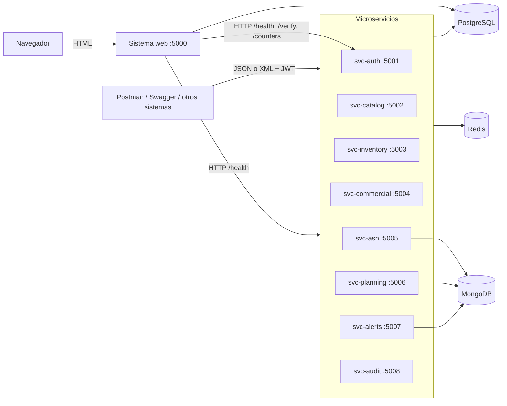
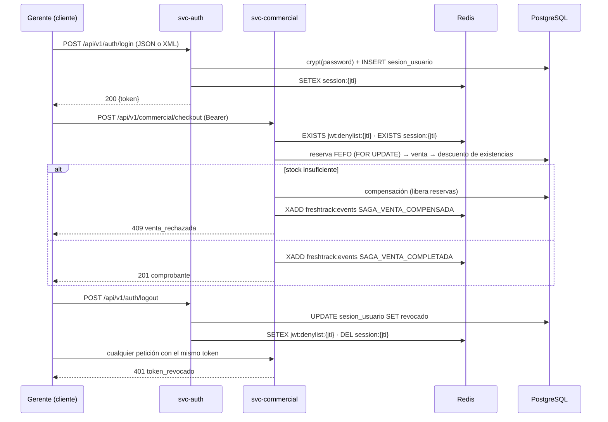
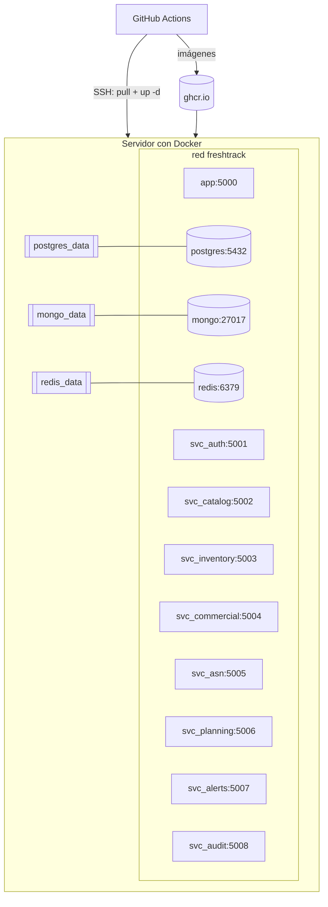

# FreshTrack — Segundo parcial: arquitectura distribuida

Equipo 05 · Proyecto IAC · Entrega: viernes 23 de octubre de 2026

Este documento describe lo que **está implementado y probado** en el código. Complementa a:

| Documento | Contenido |
|---|---|
| [`DOCUMENTACION_TECNICA_MICROSERVICIOS.md`](DOCUMENTACION_TECNICA_MICROSERVICIOS.md) | Ficha de cada microservicio (13 elementos) |
| [`ENDPOINTS_MICROSERVICIOS.md`](ENDPOINTS_MICROSERVICIOS.md) | Catálogo completo de endpoints, generado del OpenAPI real |
| [`DISENO_PERSISTENCIA_MONGODB.md`](DISENO_PERSISTENCIA_MONGODB.md) | Colecciones, validadores, índices y pipelines |
| [`DISENO_PERSISTENCIA_REDIS.md`](DISENO_PERSISTENCIA_REDIS.md) | Diseño de Redis |
| [`DISENO_SEGURIDAD_INTEGRACION.md`](DISENO_SEGURIDAD_INTEGRACION.md) | Diseño de seguridad |
| `evidencias/EVIDENCIAS_REQUEST_RESPONSE.md` | Peticiones y respuestas reales (se genera con `scripts/generar_evidencias.py`) |
| [`../contracts/xsd/`](../contracts/xsd) | Esquemas XSD de los contratos XML |

---

## 1. Qué se corrigió y amplió en esta entrega

| Área | Antes | Ahora |
|---|---|---|
| Errores HTTP | Cada servicio respondía distinto (`bad_request`, `detalle` con la excepción, 500 con trazas) | Estructura única `{error, mensaje, status, correlation_id, detalles}` en JSON y XML; los 500 nunca exponen detalles internos |
| XML | Solo respuestas; la entrada XML existía únicamente en ASN, sin validación | Entrada y salida XML en todos los servicios; 8 contratos de petición validados con **XSD** antes de la lógica de negocio |
| JWT / Redis | No se verificaba la sesión en Redis; "cerrar sesiones" de un usuario no invalidaba sus tokens | Cada petición verifica firma, expiración, registro en PostgreSQL, **denylist** y **sesión viva en Redis**; el cierre forzado manda los `jti` a la denylist y revoca en PostgreSQL |
| Identidad | Algunos servicios tomaban el usuario de headers `X-User-*` (falsificables) | La identidad sale siempre de los claims del JWT |
| Métodos HTTP | Sin `PUT`; varios endpoints sin validar | `GET/POST/PUT/PATCH/DELETE`; validación de tipos, rangos, UUID, enums y campos obligatorios |
| Paginación y filtros | Listados con `LIMIT 30` fijo | `?pagina=&por_pagina=` (máx. 100) con `{pagina, por_pagina, total, total_paginas}` y filtros por servicio |
| Swagger | Rutas declaradas a mano, sin cuerpos ni errores (faltaban endpoints) | Spec generada desde las rutas reales: parámetros, JWT, roles, ejemplos JSON y XML, respuestas de error |
| Bugs | `approve` de órdenes escribía una columna inexistente (500); `full-context` consultaba columnas inexistentes (500); la reserva FEFO continuaba aunque otro proceso tuviera el lock; `PATCH` permitía precio de venta < costo; el rate limit de login por IP bloqueaba a toda una oficina; el stream de eventos crecía sin límite | Corregidos y cubiertos por pruebas |
| Resiliencia | Si Redis o Mongo no respondían, **cada** petición esperaba su timeout | Reintento cada 10 s; las operaciones degradan sin excepción |
| Docker | La app web apuntaba a `localhost` dentro del contenedor; código montado como volumen; sin healthchecks en los servicios; sin `.dockerignore` | Red `freshtrack`, variables por nombre de servicio, healthcheck en los 12 contenedores, imágenes autocontenidas |
| Web ↔ microservicios | La web llamaba directo a PostgreSQL y a funciones en Python; los servicios solo se usaban desde Swagger/Postman | La web es el **frontend de los microservicios**: login, ventas, mermas, productos, pronóstico y reabastecimiento se ejecutan en ellos por HTTP con el JWT del usuario; gateway `/svc/...` para el navegador y consola de pruebas (ver §2.3) |
| Interfaz | Textos técnicos/defensivos ("no es un valor de ejemplo", "Guardar en PostgreSQL", nombres de tablas) | Descripciones orientadas a la tarea del usuario |
| Pruebas | Scripts `verify_*` sin framework | **pytest**: 81 unitarias + 25 de integración entre servicios |
| CI/CD | No existía | GitHub Actions: pruebas → arquitectura completa en compose → imágenes en GHCR → despliegue por SSH |

---

## 2. Arquitectura



| Servicio | Responsabilidad | PostgreSQL | MongoDB | Redis |
|---|---|---|---|---|
| svc-auth | Login, JWT, sesiones, revocación, usuarios | usuario, rol, sesion_usuario | — | sesiones, denylist, rate limit, contadores |
| svc-catalog | Productos, tiendas, proveedores | producto, locacion, proveedor | — | caché Cache-Aside, eventos |
| svc-inventory | Existencias, cola FEFO, reservas de la saga | existencia, lote | — | lock distribuido, reserva temporal |
| svc-commercial | Venta POS (saga), carritos, mermas, historial | venta, merma, movimiento_inventario | — | carritos con TTL, contadores |
| svc-asn | Avisos de embarque JSON/XML, inspecciones | proveedor, producto (validación) | avisos_asn | eventos |
| svc-planning | Pronóstico, órdenes de reabastecimiento | forecast_run, orden_reabastecimiento | pronosticos_demanda | eventos |
| svc-alerts | Alertas pre-merma, ESG | existencia, lote, desperdicio_evitado | alertas_operativas (TTL) | lock de escaneo, caché ESG, eventos |
| svc-audit | Bitácora, trazabilidad, stream de eventos | auditoria.bitacora_eventos, kardex | — | lectura del stream |

**¿Por qué MongoDB para esa información?** Los pronósticos son series con percentiles y
metadatos del modelo que cambian por versión; los ASN llegan con detalle de carga anidado e
inspecciones que se agregan con el tiempo; las alertas son eventos de alta frecuencia que
deben expirar solas (índice TTL). PostgreSQL sigue siendo la fuente de verdad: los
documentos se enlazan por `id_sku`, `id_locacion` e `id_proveedor` y, antes de insertar un
ASN, `svc-asn` valida en PostgreSQL que el proveedor y los SKU existan.

### 2.1 Secuencia: venta POS (Saga) y revocación de sesión



### 2.2 Despliegue



### 2.3 La web como frontend de los microservicios

El sistema web ya no ejecuta las operaciones de negocio por su cuenta: las delega por HTTP al
microservicio responsable, reenviando el JWT del usuario. Cada servicio aplica su propio RBAC,
validación y reglas, y la web solo muestra el resultado (o el error controlado que devuelva).

| Pantalla de la web | Acción | Microservicio y endpoint |
|---|---|---|
| Inicio de sesión | Validar credenciales y emitir JWT | `svc-auth` `POST /api/v1/auth/login` |
| Salir | Revocar el token (PostgreSQL + denylist Redis) | `svc-auth` `POST /api/v1/auth/logout` |
| Ventas | Registrar venta (Saga FEFO con compensación) | `svc-commercial` `POST /api/v1/commercial/checkout` |
| Mermas | Registrar merma | `svc-commercial` `POST /api/v1/commercial/shrinkage` |
| Productos | Alta, edición, activar/desactivar | `svc-catalog` `POST` / `PATCH /api/v1/catalog/products` |
| Pronósticos | Ejecutar corrida | `svc-planning` `POST /api/v1/planning/forecast/run` |
| Reabastecimiento | Generar, aprobar y rechazar órdenes | `svc-planning` `POST /api/v1/planning/replenishment/...` |
| Administración → Microservicios | Estado de los servicios, sesión y consola de consultas | `/health` de los 8 + gateway `/svc/<servicio>/...` |

- **Gateway del navegador:** `GET|POST|PUT|PATCH|DELETE /svc/<servicio>/<ruta>` reenvía la petición
  al contenedor con el token de la sesión (el token nunca llega al JavaScript). Las peticiones se
  ven en F12 → Red, y en `docker compose logs -f svc_<servicio>` con el mismo `X-Correlation-Id`.
- **Mensajes:** cada operación confirma qué servicio la ejecutó, p. ej. «Venta VT-3-… registrada
  por $24.90 a través de svc-commercial». Si el servicio rechaza (403, 409, 400) se muestra su
  mensaje; si no responde, se avisa que no está disponible.
- **Permisos alineados:** los formularios solo se muestran a los roles que el servicio autoriza
  (p. ej. el auditor ya no ve «Registrar venta»).
- **Modo autónomo:** `WEB_USA_MICROSERVICIOS=false` hace que la web vuelva a operar sola contra
  PostgreSQL, solo para desarrollar la interfaz sin levantar los 8 servicios. En Docker es `true`.

---

## 3. Contratos de integración JSON y XML

### 3.1 Reglas comunes

| Aspecto | Contrato |
|---|---|
| Versionamiento | Prefijo `/api/v1/` en todas las rutas de negocio. Un cambio incompatible irá en `/api/v2/` |
| Formato de respuesta | JSON por omisión. XML con `Accept: application/xml` (o `text/xml`, o `?formato=xml`) |
| Formato de petición | `Content-Type: application/json` o `application/xml`; otro tipo → `415` |
| Codificación | UTF-8. XML con declaración `<?xml version="1.0" encoding="UTF-8"?>` |
| Raíz XML | Cada operación define su elemento raíz (`<auth_response>`, `<producto>`, `<error_response>`...) |
| Listas en XML | Cada elemento de una lista se serializa como `<item>` (en ASN también se acepta `<item_carga>`) |
| Espacios de nombres | No se usan: los contratos son internos al sistema y los XSD no declaran `targetNamespace`, para que cualquier cliente pueda producir el XML sin prefijos |
| Fechas | ISO 8601 (`2026-10-21` o `2026-10-21T13:45:00+00:00`) |
| Trazabilidad | `X-Correlation-Id` opcional en la petición; siempre presente en la respuesta y en el log |
| Paginación | `?pagina=1&por_pagina=20` (máx. 100) → `"paginacion": {"pagina", "por_pagina", "total", "total_paginas"}` |

### 3.2 Estructura de error (todas las respuestas 4xx/5xx)

```json
{
  "error": "campos_requeridos",
  "mensaje": "Faltan campos obligatorios.",
  "status": 400,
  "correlation_id": "3f2a9c1e0b7d4e6f",
  "detalles": {"faltantes": ["password"]}
}
```

```xml
<?xml version="1.0" encoding="UTF-8"?>
<error_response><error>campos_requeridos</error><mensaje>Faltan campos obligatorios.</mensaje><status>400</status><correlation_id>3f2a9c1e0b7d4e6f</correlation_id><detalles><faltantes><item>password</item></faltantes></detalles></error_response>
```

| HTTP | `error` | Cuándo |
|---|---|---|
| 400 | `campos_requeridos`, `parametro_invalido`, `json_mal_formado`, `xml_mal_formado`, `xml_no_cumple_contrato`, `cuerpo_vacio` | Validación de entrada (el XSD reporta ruta y motivo en `detalles`) |
| 401 | `token_requerido`, `token_invalido`, `token_revocado`, `sesion_inexistente`, `credenciales_invalidas` | Autenticación |
| 403 | `acceso_denegado` | Rol sin permiso (`detalles.roles_permitidos`) |
| 404 | `no_encontrado` | Registro inexistente |
| 405 | `metodo_no_permitido` | Método HTTP no soportado por la ruta |
| 409 | `regla_negocio`, `duplicado`, `stock_insuficiente`, `venta_rechazada`, `transicion_invalida`, `recurso_bloqueado` | Errores de negocio |
| 415 | `tipo_no_soportado` | Content-Type distinto de JSON/XML |
| 429 | `limite_excedido` | Rate limit (cabeceras `X-RateLimit-*` y `Retry-After`) |
| 503 | `mongo_no_disponible`, `redis_no_disponible` | Dependencia caída |
| 500 | `error_interno` | Error no controlado (sin detalles; se busca por `correlation_id` en el log) |

### 3.3 Contratos XSD

Se publican en cada servicio en `GET /api/v1/contracts/{nombre}.xsd`.

| XSD | Operación | Campos obligatorios | Validaciones |
|---|---|---|---|
| `login_request` | `POST /api/v1/auth/login` | email, password | patrón de correo, longitudes |
| `producto_request` | `POST/PUT/PATCH /api/v1/catalog/products` | (el servicio exige nombre, categoria, precios en POST/PUT) | GTIN ≤14, precio_venta > 0, vida útil entera positiva |
| `reserva_request` | `POST /api/v1/inventory/reserve-fefo` | id_locacion, lineas/item(id_sku, cantidad) | enteros positivos, cantidad > 0 |
| `checkout_request` | `POST /api/v1/commercial/checkout` | lineas/item(id_sku, cantidad) | canal ∈ {TIENDA, ONLINE, MAYOREO} |
| `merma_request` | `POST /api/v1/commercial/shrinkage` | id_lote, cantidad, causa | UUID, 7 causas válidas |
| `asn_request` | `POST /api/v1/asn` | folio_asn, id_proveedor, detalle_carga | `xs:date`, estado enumerado, folio con patrón |
| `forecast_request` | `POST /api/v1/planning/forecast/run` | — | método enumerado, horizonte ≤ 90, alpha ∈ (0,1] |
| `audit_log_request` | `POST /api/v1/audit/log` | accion, descripcion | patrón y longitudes |
| `error_response` | Respuesta de error | error, mensaje, status, correlation_id | — |
| `service_health` | `GET /health` | service, status, version, dependencies | status ∈ {HEALTHY, DEGRADED} |

---

## 4. Seguridad: JWT, sesiones y RBAC

Mecanismo común (`app/services/common/auth.py`, decorador `@requiere_auth(*roles)`), usado por
los 8 servicios:

1. `Authorization: Bearer <JWT>` obligatorio → si falta, **401 token_requerido**.
2. `jti` en `jwt:denylist:{jti}` de Redis → **401 token_revocado** (antes de tocar PostgreSQL).
3. Firma HS256, `exp` y registro no revocado en `operacion.sesion_usuario` → **401 token_invalido**.
4. `session:{jti}` debe existir en Redis → **401 sesion_inexistente** (si Redis está caído, decide PostgreSQL).
5. Rol del claim `rol` contra los roles del endpoint (`admin` siempre pasa) → **403 acceso_denegado**.

Otros controles: bloqueo de cuenta tras N intentos fallidos (configurable), cuentas inactivas
rechazadas, rate limit de login de 10 intentos/min por IP + correo, contraseñas verificadas
con `crypt()` dentro de PostgreSQL, identidad tomada solo del JWT, validación de entrada en
todos los endpoints, errores 500 sin trazas, y registro de cada petición con usuario y
`correlation_id`.

| Rol | Permisos principales en microservicios |
|---|---|
| admin | Todo; administración de usuarios y sesiones |
| buyer | Alta/edición de productos, ASN, aprobación de órdenes, pronósticos |
| planner | Pronósticos, generación de órdenes, proveedores |
| store_manager | Ventas POS, reservas, mermas, alertas de su tienda, órdenes |
| warehouse | Reservas, mermas, ASN (estados e inspecciones), alertas, trazabilidad |
| supplier | Registro de ASN |
| auditor | Bitácora, trazabilidad, stream de eventos |

---

## 5. Redis: claves, finalidad y TTL

| Clave | Tipo | Finalidad | TTL | Efecto en el sistema |
|---|---|---|---|---|
| `session:{jti}` | String (JSON) | Sesión activa del token | vigencia del JWT (8 h) | Sin ella el token se rechaza (401) |
| `user:sessions:{id_usuario}` | Set | Índice de sesiones por usuario | 8 h + 1 h | Permite cerrar todas las sesiones de un usuario |
| `jwt:denylist:{jti}` | String | Token revocado (logout / cierre forzado / desactivación) | resto de la vigencia | Rechazo inmediato en todos los servicios |
| `catalog:products:{hash}` | String (JSON) | Caché de cada combinación de filtros/página | 5 min | Respuesta `"fuente": "redis_cache"`; se invalida por patrón al escribir |
| `catalog:locations:all` | String (JSON) | Caché de tiendas y CEDIS | 10 min | — |
| `alerts:esg:resumen` | String (JSON) | Caché del reporte ESG | 5 min | — |
| `counter:ops:{servicio}:{operación}:{fecha}` | String (INCR) | Contadores de operaciones y códigos HTTP | 7 días | Pantalla *Microservicios* y `GET /api/v1/auth/counters` |
| `ratelimit:{identificador}` | String (INCR + EXPIRE en Lua) | Ventana fija de rate limiting | ventana (60 s) | 429 con `Retry-After` |
| `temp:pos_cart:{cart_id}` | String (JSON) | Carrito POS temporal | 15 min | Se consume de forma atómica (GET+DEL en Lua) |
| `temp:reservation:{saga_id}` | String (JSON) | Reserva FEFO pendiente de la saga | 10 min | Permite compensar con solo el `saga_id` |
| `lock:inventory:loc:{id}:reserve` | String (SET NX EX) | Bloqueo distribuido de reservas por tienda | 8 s | Evita sobreventa concurrente; si no se obtiene en 3 s → 409 |
| `lock:alerts:scan:{loc}` | String (SET NX EX) | Evita escaneos de alertas simultáneos | 30 s | 409 `escaneo_en_curso` |
| `freshtrack:events` | Stream (MAXLEN ~10 000) | Eventos de dominio de todos los servicios | — | Consultable en `svc-audit /stream/recent` |

---

## 6. Pruebas

```bash
make test-unit          # 81 pruebas, sin bases de datos (fakeredis con Lua)
make test-integration   # 25 pruebas contra PostgreSQL real (+ Redis/Mongo reales si están arriba)
python scripts/smoke_http.py           # flujo HTTP real entre contenedores
python scripts/generar_evidencias.py   # 87 peticiones reales → docs/evidencias/
```

| Archivo | Tipo | Qué demuestra |
|---|---|---|
| `tests/unit/test_contratos_json_xml.py` | Unitaria | Negociación JSON/XML, XML↔dict, validación XSD (válido e inválido), estructura de error validada contra `error_response.xsd`, paginación |
| `tests/unit/test_seguridad_jwt.py` | Unitaria | 401 sin token / manipulado / expirado / revocado / sin sesión; 403 por rol; admin; 429 con cabeceras; 404/405 estandarizados; 500 sin fugas; `/health` |
| `tests/unit/test_redis_cache_service.py` | Unitaria | Sesiones con TTL, denylist, Cache-Aside e invalidación, contadores, temporales de un solo uso, locks, rate limit, degradación sin Redis |
| `tests/unit/test_openapi_microservicios.py` | Unitaria | Los 8 servicios exponen Swagger, rutas `/api/v1`, JWT y errores documentados, ejemplos JSON+XML, uso de GET/POST/PUT/PATCH/DELETE |
| `tests/unit/test_reglas_negocio.py` | Unitaria | Reparto FEFO, medias móviles, suavización exponencial, métricas de error, pronóstico no negativo |
| `tests/integration/test_seguridad_distribuida.py` | Integración | Token de svc-auth válido en otros servicios; RBAC cruzado; logout revoca en **todos** los servicios (Redis + PostgreSQL); cierre forzado por admin; rate limit de login; tokens alterados/expirados/de otro emisor |
| `tests/integration/test_procesos_negocio.py` | Integración | CRUD de producto con XML y caché; **saga de venta** que descuenta inventario FEFO; compensación por stock insuficiente sin reservas huérfanas; reserva + cancelación por `saga_id`; mermas; carrito con TTL; ciclo de vida de ASN en MongoDB (duplicado, transiciones, `$push`, filtro anidado); validación ASN contra PostgreSQL; alertas; planeación; auditoría con identidad del JWT; trazabilidad |

Las pruebas de integración usan PostgreSQL real. Si Redis o MongoDB no están disponibles
(p. ej. en una laptop sin Docker) se sustituyen por fakeredis/mongomock; en GitHub Actions
corren contra los contenedores reales.

---

## 7. CI/CD y despliegue en la nube

Archivo: `.github/workflows/ci-cd.yml`.

1. **unit** — en cada push y PR.
2. **integration** — `docker compose up -d --build --wait` con los 12 contenedores y claves
   aleatorias, smoke HTTP entre contenedores y pruebas de integración. Si algo falla, publica
   los logs de los servicios.
3. **publish** — en push a `main` o `avance2-postgresql-real`: construye y sube las 9 imágenes a
   `ghcr.io/<owner>/freshtrack/*` con tag del commit y `latest`.
4. **deploy** — si existen los secretos, entra por SSH al servidor, actualiza el repo, hace
   `docker compose pull` y `up -d --wait`, y corre el smoke HTTP contra la IP pública.

**Preparar el servidor una sola vez** (cualquier VM Linux: AWS EC2, Azure, GCP, DigitalOcean):

```bash
# en la VM
curl -fsSL https://get.docker.com | sh && sudo usermod -aG docker $USER
git clone https://github.com/crlsbk/freshtrack.git ~/freshtrack && cd ~/freshtrack
cp env.example .env   # cambiar TODAS las claves y poner SVC_PUBLIC_HOST=<IP pública>
docker compose up -d --build --wait
```

Abrir en el firewall los puertos 5000–5008. Después, en GitHub → *Settings → Secrets and
variables → Actions*, crear `DEPLOY_HOST`, `DEPLOY_USER`, `DEPLOY_SSH_KEY` y (opcional)
`DEPLOY_PATH`. Desde ese momento cada push a la rama se despliega solo. Sin esos secretos el
pipeline igual prueba y publica las imágenes, y omite el paso de despliegue.

---

## 8. Matriz de cumplimiento (rúbrica del segundo parcial)

| Requisito | Evidencia en el repositorio |
|---|---|
| 6–10 microservicios con responsabilidad real | 8 servicios en `app/services/*_service`, tabla §2 |
| Contenedor Docker propio | `app/services/*/Dockerfile`, `docker-compose.yml` |
| Endpoints REST versionados | `/api/v1/...` — `docs/ENDPOINTS_MICROSERVICIOS.md` |
| GET, POST, PUT, PATCH, DELETE | `test_usa_metodos_http_variados` |
| Recepción y validación de parámetros | `app/services/common/response.py` (`requerir_campos`, `entero`, `decimal_pos`, `validar_uuid`, XSD) |
| Autenticación JWT y autorización por roles | §4, `test_seguridad_jwt.py`, `test_seguridad_distribuida.py` |
| Respuestas JSON y XML | `render_response`, `test_contratos_json_xml.py` |
| Contratos XML con XSD | `contracts/xsd/`, §3.3 |
| Errores HTTP estandarizados | §3.2, `crear_servicio()` |
| Registro de actividad | log por petición con `correlation_id`; contadores Redis; bitácora PostgreSQL; stream de eventos |
| `/health` | los 8 servicios + web; healthchecks de Docker |
| OpenAPI/Swagger ejecutable | `/api/v1/docs` en cada servicio |
| PostgreSQL, MongoDB, Redis según responsabilidad | §2, §5, `DISENO_PERSISTENCIA_MONGODB.md` |
| MongoDB: inserción, consulta, actualización, filtros, agregación, índices, enlace con PG | `svc-asn`, `svc-planning`, `svc-alerts`; `test_ciclo_de_vida_asn_en_mongodb` |
| Redis: sesiones, revocación, caché, contadores, rate limit, temporales, TTL, locks | §5, `test_redis_cache_service.py` |
| Pruebas unitarias y de integración | §6 (106 pruebas) |
| Evidencias request/response | `scripts/generar_evidencias.py` → `docs/evidencias/` |
| Sistema web independiente e integrado con los servicios | Web sigue operando contra PostgreSQL; pantalla *Microservicios* |
| Despliegue reproducible | README §1.1, `make up`, pipeline CI |

---

## 9. Pendiente / a revisar por el equipo

- **Ejecutar `scripts/generar_evidencias.py` con la arquitectura completa en Docker** y tomar
  las capturas de Postman/Swagger que pide la rúbrica. Los casos que dependen de MongoDB
  (ASN, pronóstico, alertas) solo se verificaron con mongomock; con Mongo real se validan en el
  job *integration* de GitHub Actions.
- Configurar los secretos `DEPLOY_*` y un servidor para que el job *deploy* publique en la nube.
- Actualizar el documento técnico (.docx) con las secciones de este archivo: arquitectura,
  contratos, Redis, pruebas y matriz.
- Las fichas de `DOCUMENTACION_TECNICA_MICROSERVICIOS.md` describen los endpoints originales;
  ante cualquier diferencia, mandan `ENDPOINTS_MICROSERVICIOS.md` y este documento.
