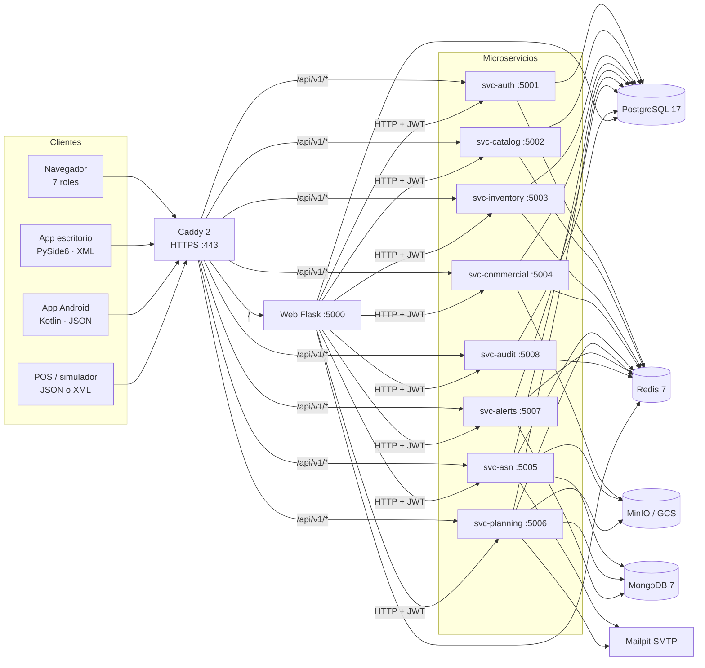
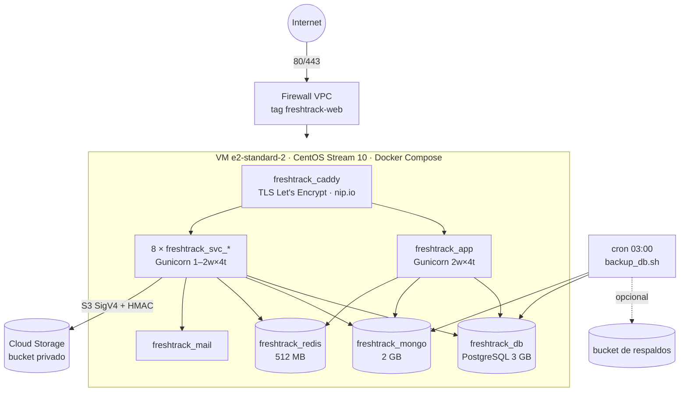
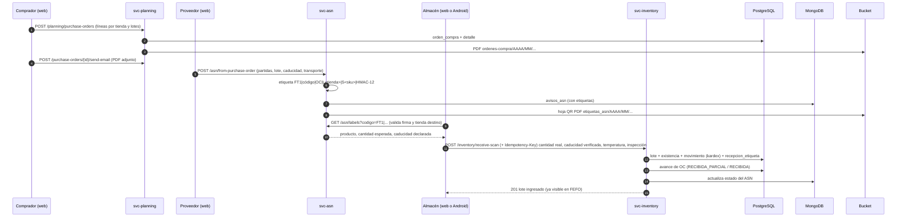

# Manual técnico — FreshTrack

**Proyecto 12 · Plataforma predictiva para reducción de desperdicio de alimentos**
Integración de Aplicaciones Computacionales · UDEM · Equipo 05
Santiago López Cervantes · Juan Nicolás Núñez Mendoza · Fabián Azaed Orta Singlaterry

Versión del documento: 24 de noviembre de 2026 · Rama `avance2-postgresql-real` (commit `1926a17`)

---

## Contenido

1. [Visión general](#1-visión-general)
2. [Arquitectura](#2-arquitectura)
3. [Diagramas](#3-diagramas)
4. [Modelo de datos](#4-modelo-de-datos)
5. [Seguridad](#5-seguridad)
6. [Contratos de integración](#6-contratos-de-integración)
7. [Catálogo de endpoints](#7-catálogo-de-endpoints)
8. [Algoritmos](#8-algoritmos)
9. [Estrategia de caché](#9-estrategia-de-caché)
10. [Eventos y Saga](#10-eventos-y-saga)
11. [Monitoreo y salud](#11-monitoreo-y-salud)
12. [App de escritorio](#12-app-de-escritorio)
13. [App Android](#13-app-android)
14. [Pruebas y rendimiento](#14-pruebas-y-rendimiento)
15. [Limitaciones conocidas](#15-limitaciones-conocidas)
16. [Funciones en integración](#16-funciones-en-integración)

---

## 1. Visión general

FreshTrack gestiona inventario perecedero de una cadena de tiendas y un CEDIS con el objetivo de
**reducir el desperdicio de alimentos**: consume primero lo que caduca primero (FEFO), pronostica la
demanda por producto y tienda, recomienda compras, traslados y descuentos antes de que el producto se
pierda, y mide el desperdicio evitado contra una línea base contrafactual.

Principios de diseño que se ven en todo el código:

- **PostgreSQL es la única fuente de verdad transaccional.** MongoDB guarda documentos derivados y Redis estado efímero.
- **El sistema recomienda, una persona decide.** Reabastecimiento, transferencias y descuentos nacen en estado sugerido/pendiente y requieren aprobación registrada en la bitácora.
- **Nada se declara bueno sin medirlo.** Cada corrida de pronóstico guarda su error de *backtest*.
- **Configuración por entorno, sin secretos en código** (ver Manual de instalación §4).

---

## 2. Arquitectura

### 2.1 Componentes

| Componente | Tecnología | Responsabilidad |
|---|---|---|
| Sistema web (`app`) | Flask 3.1, Jinja2, Leaflet (mapa) | Interfaz para los 7 roles. Con `WEB_USA_MICROSERVICIOS=true` delega las operaciones a los microservicios por HTTP con el JWT de la sesión, y además ofrece un *proxy* `/svc/<servicio>/<ruta>` para que el navegador llame servicios sin exponer el token |
| 8 microservicios | Flask, fábrica común `app/services/common/servicio.py` | API REST JSON/XML, cada uno en su contenedor |
| PostgreSQL 17 | esquemas `operacion`, `analitica`, `auditoria`, `pruebas` | Transacciones, reglas de negocio en funciones SQL, bitácora inmutable |
| MongoDB 7 | 3 colecciones con validador JSON Schema | Series de pronóstico, avisos ASN, alertas operativas (TTL) |
| Redis 7 (AOF) | | Sesiones, denylist JWT, caché, contadores, rate limit, carritos, bloqueos, Redis Streams |
| Object storage S3 | MinIO (local) / Google Cloud Storage HMAC (prod.) | PDF de órdenes de compra, hojas QR de ASN, fotos de evidencia |
| Mailpit | SMTP + bandeja web, reenvío opcional | Correo de OC y hojas QR |
| Caddy 2 | Solo en producción | TLS automático, enrutamiento por prefijo `/api/v1/<servicio>*` |
| App de escritorio | PySide6 + requests + lxml | Compradores y planeadores; solo XML |
| App Android | Kotlin, Retrofit/OkHttp, CameraX + ML Kit | Gerentes y almacenistas; JSON |

### 2.2 Los 8 microservicios

| Servicio | Puerto | Prefijo | Responsabilidad | Datos que usa |
|---|---|---|---|---|
| svc-auth | 5001 | `/api/v1/auth` | Login, emisión/rotación de JWT, logout y revocación, usuarios, sesiones activas, contadores | PostgreSQL (`usuario`, `sesion_usuario`), Redis (sesiones, denylist) |
| svc-catalog | 5002 | `/api/v1/catalog` | Productos, proveedores (lead time, MOQ), tiendas y CEDIS | PostgreSQL, Redis (Cache-Aside) |
| svc-inventory | 5003 | `/api/v1/inventory` | Existencias, cola FEFO, reserva/compensación de la Saga, recepción por QR, escaneo de caducidades, estado de lotes, conteo cíclico | PostgreSQL, Redis (reservas, bloqueos) |
| svc-commercial | 5004 | `/api/v1/commercial` | Venta POS (Saga), importación masiva de ventas, carritos POS, mermas, evidencias fotográficas | PostgreSQL, Redis (carritos), bucket |
| svc-asn | 5005 | `/api/v1/asn` | Avisos de embarque (ASN), etiquetas QR firmadas, hoja QR en PDF, inspección, correo | MongoDB (`avisos_asn`), PostgreSQL, bucket, SMTP |
| svc-planning | 5006 | `/api/v1/planning` | Pronóstico, backtest, drift, Newsvendor, reabastecimiento, compras/OC con PDF, transferencias, descuentos, triaje, ciclo de planeación | PostgreSQL, MongoDB (`pronosticos_demanda`), bucket, SMTP |
| svc-alerts | 5007 | `/api/v1/alerts` | Alertas pre-merma, medición de desperdicio (6 indicadores), reporte ESG/CO₂e | MongoDB (`alertas_operativas`), PostgreSQL |
| svc-audit | 5008 | `/api/v1/audit` | Bitácora, registro explícito de eventos, trazabilidad de lote, eventos recientes del stream | PostgreSQL (`auditoria`), Redis Streams |

Todos los servicios comparten el mismo código de dominio (`app/domain/`) y la misma base, pero cada
uno solo expone su API. Todos aplican: `X-Correlation-Id` en cada respuesta, cabecera `X-Service`,
registro por petición (método, ruta, estado, duración, usuario, correlation id), manejador uniforme de
errores y `/health`.

### 2.3 Capas del código

```text
app/
├── __init__.py        fábrica de la web, /health, CSRF, contexto de plantillas
├── config.py          configuración desde el entorno
├── db.py              SQLAlchemy/psycopg 3; transacciones que fijan app.current_user_id
├── security.py        login (crypt() en PostgreSQL), JWT, refresh, sesión web, decoradores
├── csrf.py            token sincronizador para formularios
├── navegacion.py      menú y vistas por rol
├── auditoria.py       eventos de aplicación → auditoria.fn_registrar_accion()
├── blueprints/        rutas de la web (publico, auth, catalogo, operacion, analitica, panel, api, monitoreo)
├── domain/            reglas de negocio (pronostico, reabastecimiento, triaje, transferencias, …)
├── repos/             CRUD de catálogos
├── events/            publicación/lectura en Redis Streams
├── services/          microservicios + clientes HTTP, caché, object storage, correo, Mongo
└── templates/ static/ interfaz Jinja2
```

---

## 3. Diagramas

### 3.1 Componentes



En local no hay Caddy: los clientes llegan directo a `:5000` y `:5001–5008`.

### 3.2 Despliegue en GCP



### 3.3 Secuencia: login, JWT y sesión en Redis

```mermaid
sequenceDiagram
  autonumber
  participant C as Cliente (web/escritorio/móvil)
  participant A as svc-auth
  participant PG as PostgreSQL
  participant R as Redis
  participant S as Otro servicio
  C->>A: POST /api/v1/auth/login {email, password} (JSON o XML)
  A->>R: rate limit (10/min por cliente)
  A->>PG: crypt(password, password_hash), estado activo, bloqueo
  PG-->>A: usuario + rol + id_locacion
  A->>PG: INSERT sesion_usuario (jti, refresh_hash, familia, expira)
  A->>R: SETEX session:{jti} · SADD user:sessions:{id}
  A-->>C: token (15 min) + refresh_token (tope 8 h)
  C->>S: GET ... Authorization: Bearer token
  S->>R: EXISTS jwt:denylist:{jti}?
  S->>S: verifica firma HS256 y exp
  S->>R: EXISTS session:{jti}? (si Redis cae → PostgreSQL decide)
  S->>S: rol permitido en el endpoint
  S-->>C: 200 / 401 / 403 (error_response)
  C->>A: POST /api/v1/auth/refresh {refresh_token}
  A->>PG: valida hash; rota access + refresh (misma familia)
  Note over A,PG: Reusar un refresh ya rotado revoca toda la familia (REFRESH_REUTILIZADO)
  C->>A: POST /api/v1/auth/logout
  A->>R: SETEX jwt:denylist:{jti} · DEL session:{jti}
```

### 3.4 Secuencia: despacho del proveedor y recepción por QR



---

## 4. Modelo de datos

### 4.1 PostgreSQL

Scripts `sql/00`–`12` (ver Manual de instalación §6). Tablas principales:

| Esquema | Tabla | Contenido |
|---|---|---|
| `operacion` | `rol`, `usuario`, `sesion_usuario` | Identidad. `usuario.id_locacion` acota a gerentes/almacén; `usuario.id_proveedor` liga al proveedor (09); `sesion_usuario` una fila por access token con `refresh_hash`, `refresh_expira_en`, `familia` (10) |
| | `locacion`, `proveedor`, `producto`, `regla_riesgo` | Catálogos. Proveedor con lead time y MOQ; producto con vida útil estándar, costo, precio, stock de seguridad, MOQ por lote; reglas de riesgo por SKU → categoría → defecto |
| | `lote`, `existencia`, `movimiento_inventario` | Inventario por lote y ubicación con kardex completo |
| | `venta`, `venta_detalle`, `merma` | Ventas FEFO (detalle por lote) y mermas con causa (`CADUCIDAD`, `DANO`, `CALIDAD`, `CADENA_DE_FRIO`, `MANIPULACION`, `DEVOLUCION`, `OTRA`) |
| | `orden_compra`, `orden_compra_detalle`, `reporte_documento` | Órdenes de compra multi-tienda y metadatos de los PDF en el bucket |
| | `recepcion_etiqueta` | Cada etiqueta QR recibida (idempotencia, inspección, temperatura) |
| | `evidencia`, `conteo_ciclico` | App móvil (12): fotos (solo metadatos + SHA-256) y conteos físicos |
| `analitica` | `forecast_run`, `forecast_result` | Corridas de pronóstico con métricas y resultados por producto/tienda/fecha |
| | `orden_reabastecimiento` | Recomendaciones con explicación completa y decisión |
| | `transferencia`, `descuento` | Propuestas con validaciones y estados |
| | `alerta` | Alertas derivadas de reglas (huella única mientras siguen abiertas) |
| | `desperdicio_evitado` | Una fila por intervención: en riesgo, intervenido, recuperado, base contrafactual, neto, mermado, metodología |
| | `configuracion`, `agregado_refresco`, `mv_demanda_diaria_hist` | Parámetros editables; control y vista materializada de la demanda histórica (08) |
| `auditoria` | `bitacora_eventos` | Bitácora **inmutable** (un disparador bloquea `UPDATE`/`DELETE`) |
| `pruebas` | `corrida`, `fase`, `endpoint_metrica`, `serie_segundo`, `error` | Resultados de Locust (11) |

Funciones y vistas clave: `operacion.fn_vida_util_pct`, `operacion.fn_clasificar_riesgo`
(`NORMAL`/`VIGILANCIA`/`CRITICO`/`VENCIDO`), `auditoria.fn_registrar_accion`;
vistas `operacion.v_inventario_lote`, `operacion.v_lote_riesgo`, `analitica.v_demanda_diaria`
(histórico materializado ∪ ventas de hoy en vivo), `analitica.v_merma_agregada`,
`analitica.v_alerta_abierta`, `analitica.v_trazabilidad_lote`, `auditoria.v_bitacora`.

Roles de base: `app_backend` (aplicación, permisos mínimos), `app_auditor` (solo lectura), `app_etl`.
El usuario de negocio responsable viaja en la variable de sesión `app.current_user_id`, que `app/db.py`
fija al abrir cada transacción; los disparadores de auditoría la leen.

### 4.2 MongoDB (`mongo/01_init_freshtrack.js`)

| Colección | Contenido | Índices destacados |
|---|---|---|
| `pronosticos_demanda` | Serie pronosticada por SKU y tienda de cada corrida | compuestos por SKU/tienda/fecha |
| `avisos_asn` | ASN con partidas, etiquetas QR/RFID, inspecciones y estado | único `folio_asn`; `etiquetas.codigo_etiqueta`, `etiquetas.codigo_rfid_epc`, `folio_oc`, `estado`, `fecha_embarque` |
| `alertas_operativas` | Alertas pre-merma de svc-alerts (y lecturas operativas) | **TTL de 180 días** (`idx_alerta_retencion_ttl`) y compuestos por locación/criticidad |

Todas tienen validador JSON Schema.

### 4.3 Redis: patrones de llaves

| Llave | Tipo | TTL | Uso |
|---|---|---|---|
| `session:{jti}` | string JSON | vida de la sesión (8 h por defecto), ventana deslizante | Sesión viva |
| `user:sessions:{id_usuario}` | set | TTL sesión + 1 h | Índice para revocar todas las sesiones de un usuario |
| `jwt:denylist:{jti}` | string | lo que le quedaba al token (mín. 60 s) | Tokens revocados (logout, revocación admin) |
| `refresh:gracia:{hash}` | string JSON | 30 s | Tolera peticiones simultáneas que rotan el mismo refresh |
| `ratelimit:{ident}` / `ratelimit:web_login:...` | contador | ventana (60 s) | Rate limiting atómico (script Lua INCR+EXPIRE) |
| `counter:ops:{servicio}:{operacion}:{AAAAMMDD}` | contador | 7 días | Métricas operativas (accesos concedidos/denegados, caché, errores) |
| `temp:pos_cart:{cart_id}` | string JSON | 900 s | Carrito POS temporal |
| `temp:reservation:{saga_id}` | string JSON | 600 s | Reserva FEFO de la Saga |
| `lock:{recurso}` | string | 10–30 s | Bloqueo distribuido (`SET NX EX`), p. ej. `lock:calc:{clave}` contra estampida |
| `catalog:products:{firma}` / `catalog:locations:all` | JSON | 300 s / 600 s | Cache-Aside de svc-catalog |
| `web:*` | JSON | 10–120 s | Caché de lecturas pesadas (ver §9) |
| `monitor:health:history` | lista | — | Últimas 60 verificaciones del panel `/ops/status` |
| `freshtrack:events` | stream | MAXLEN ≈ 10 000 | Eventos de dominio (ver §10) |

### 4.4 Bucket de objetos

| Prefijo | Contenido | Generado por |
|---|---|---|
| `ordenes-compra/AAAA/MM/<archivo>.pdf` | PDF de cada orden de compra | svc-planning (`app/domain/compras.py`) |
| `etiquetas_asn/AAAA/MM/<archivo>.pdf` | Hoja de empaque con etiquetas QR | svc-asn (`app/domain/recepcion.py`) |
| `evidencias/<id_locacion\|general>/AAAA/MM/<id>.<ext>` | Fotos de recepción/merma de la app móvil | svc-commercial (`app/domain/movil.py`) |

El bucket es privado. Los PDF se sirven a través de los servicios; las evidencias con URL firmada
SigV4 de 15 minutos (`object_storage.url_firmada`).

---

## 5. Seguridad

### 5.1 Autenticación

- **Contraseñas**: se verifican dentro de PostgreSQL con `crypt(password, password_hash)` (pgcrypto/bcrypt); el texto en claro nunca se compara en Python.
- **Bloqueo**: tras 5 intentos fallidos (valor por defecto, parámetro de configuración) la cuenta se bloquea 15 minutos; los usuarios inactivos se rechazan.
- **JWT HS256** firmado con `JWT_SECRET_KEY`. Claims: `sub` (id_usuario), `email`, `nombre`, `rol`, `id_locacion`, `jti`, `iat`, `exp`, `iss=freshtrack`.
- **Access token** de `JWT_MINUTOS_ACCESO` (15 min) + **refresh token** con rotación hasta el tope absoluto `JWT_HORAS_VIGENCIA` (8 h desde el login; rotar no lo extiende). Solo se guarda el SHA-256 del refresh. Si se reutiliza un refresh ya rotado se revoca la familia completa y queda `REFRESH_REUTILIZADO` en la bitácora; hay 30 s de gracia para peticiones simultáneas.
- **Logout** pone el `jti` en la denylist de Redis y borra `session:{jti}`. El administrador puede cerrar todas las sesiones de un usuario (`DELETE /api/v1/auth/sessions/{id}`).

### 5.2 Validación en cada petición a un microservicio (`app/services/common/auth.py`)

| Paso | Falla → respuesta |
|---|---|
| 1. Cabecera `Authorization: Bearer` | `401 token_requerido` |
| 2. `jti` en `jwt:denylist` (Redis, antes de tocar PostgreSQL) | `401 token_revocado` |
| 3. Firma, expiración y registro en PostgreSQL | `401 token_invalido` |
| 4. `session:{jti}` existe en Redis | `401 sesion_inexistente` |
| 4b. Si Redis no responde, PostgreSQL decide (*fail-closed*) | `401 sesion_no_verificable` |
| 5. Rol del token entre los permitidos (admin siempre pasa) | `403 acceso_denegado` |

La identidad se toma **siempre de los claims del JWT**; `X-Location-Id` y `X-Correlation-Id` solo aportan contexto.

La web usa la misma lógica para su cookie (`sesion_web_vigente`): la cookie firmada y HttpOnly guarda
el JWT y el refresh; en cada petición se consulta denylist y sesión en Redis (o PostgreSQL) y se renueva
el access token cuando está por vencer.

### 5.3 Autorización por recurso

- **Sucursal**: `store_manager` y `warehouse` solo modifican datos de su `id_locacion` → `403 sucursal_no_autorizada`.
- **Proveedor**: un `supplier` solo ve y modifica productos, órdenes de compra y ASN de su proveedor (`usuario.id_proveedor`) → `403 proveedor_no_autorizado`; sin proveedor asignado → `403 proveedor_no_asignado`.

### 5.4 Matriz rol → vistas web (`app/navegacion.py`)

| Vista (menú) | admin | buyer | planner | store_manager | warehouse | supplier | auditor |
|---|:-:|:-:|:-:|:-:|:-:|:-:|:-:|
| Panel de control | ✔ | ✔ | ✔ | ✔ | ✔ | ✔ | ✔ |
| Alertas | ✔ | ✔ | ✔ | ✔ | ✔ | | |
| Mapa de tiendas | ✔ | ✔ | ✔ | ✔ | ✔ | | ✔ |
| Productos | ✔ | | ✔ | | | ✔ | |
| Tiendas y CEDIS | ✔ | | | | | | |
| Proveedores y Compras | ✔ | ✔ | | | | | |
| Despachos y Etiquetas QR | ✔ | ✔ | | | ✔ | ✔ | |
| Lotes y Salida FEFO | ✔ | ✔ | ✔ | ✔ | ✔ | ✔ | |
| Inventario | ✔ | ✔ | ✔ | ✔ | ✔ | | |
| Monitor de Ventas | ✔ | | ✔ | ✔ | | | ✔ |
| Pronósticos | ✔ | ✔ | ✔ | | | | |
| Triaje y Acción Preventiva | ✔ | ✔ | ✔ | ✔ | ✔ | | ✔ |
| Reabastecimiento | ✔ | ✔ | ✔ | ✔ | | ✔ | |
| Impacto y Sostenibilidad | ✔ | | ✔ | ✔ | | | ✔ |
| Usuarios y Roles | ✔ | | | | | | |
| Bitácora | ✔ | | | | | | ✔ |
| Configuración | ✔ | | | | | | |
| **Pantalla inicial** | Panel | Proveedores | Pronósticos | Panel | Lotes | Reabastecimiento | Bitácora |

Ver una pantalla no implica poder ejecutar todas sus acciones: cada acción la autoriza el microservicio
según la columna «Acceso» del §7 (p. ej. en Triaje, traslados y descuentos los ejecutan admin/planner/
store_manager; las mermas admin/store_manager/warehouse). La web además valida algunos roles antes de
llamar (alta de lotes: admin/warehouse; despachos: admin/supplier; recepción por QR: admin/warehouse;
emisión de OC: admin/buyer).

### 5.5 Protección de la web y de la API

- **CSRF** (`app/csrf.py`): token sincronizador por sesión inyectado en todo `<form method="post">` y en `<meta name="csrf-token">`; POST/PUT/PATCH/DELETE con cookie sin token → 400. Exentas las peticiones con `Authorization: Bearer`. Cookie `SameSite=Lax`, `HttpOnly` y `Secure` en producción. Logout por POST.
- **Rate limiting distribuido** (`@limite_tasa`, Redis + Lua, cabeceras `X-RateLimit-*` y `Retry-After`, `429 limite_excedido`):

| Endpoint | Límite |
|---|---|
| `POST /auth/login` | 10/min por cliente |
| `POST /auth/refresh` | 300/min |
| `POST /auth/verify` | 120/min |
| `GET /catalog/products` | 120/min |
| `POST /commercial/checkout` | 60/min |
| `POST /commercial/sales/import`, `POST /commercial/evidence` | 20/min |
| `POST /inventory/reserve-fefo` | 60/min |
| `POST /inventory/counts` | 30/min |
| `POST /planning/transfers` | 20/min |
| `POST /asn/{folio}/send-email` | 10/min |
| Login web | por IP + correo y por IP |

- **Validación XSD**: todo cuerpo XML de un endpoint con contrato se valida contra `contracts/xsd/<contrato>.xsd` (biblioteca `xmlschema`) antes de llegar al dominio → `400 xml_no_cumple_contrato` con hasta 10 motivos.
- **Análisis XML**: el servidor usa `xml.etree.ElementTree` de la biblioteca estándar, que no resuelve entidades externas (no hay XXE). La app de escritorio usa `lxml` con `resolve_entities=False`, `no_network=True` y sin comentarios ni PIs. *No se usa `defusedxml`; la protección contra expansión masiva de entidades depende de la versión de expat del intérprete.*
- **Etiquetas QR firmadas**: `FT1|<código>|<OC>|L<tienda>|S<sku>|<HMAC-SHA256 truncado a 12 hex>` con `JWT_SECRET_KEY`; svc-asn rechaza firmas inválidas o destino distinto (salvo desvío autorizado).
- **Idempotencia**: `Idempotency-Key` en recepción por QR y conteo cíclico; importación de ventas idempotente por folio externo.
- **URLs firmadas**: evidencias en bucket privado; firma SigV4 de 15 min es la única autorización (el cliente las descarga sin JWT). El backend valida tipo real por *magic bytes* y tamaño (≤ 8 MB).
- **Errores sin detalles internos**: los 500 devuelven `error_interno` con el `correlation_id` para buscar en el log.
- **Producción**: solo Caddy expone puertos; HSTS, `X-Content-Type-Options`, `X-Frame-Options: SAMEORIGIN`, `Referrer-Policy`; Redis con contraseña; bitácora inmutable.

---

## 6. Contratos de integración

### 6.1 Negociación de contenido (`app/services/common/response.py`)

- **Respuestas**: JSON por omisión; XML con `Accept: application/xml` (o `text/xml`) o `?formato=xml`. Cada endpoint tiene su raíz XML (p. ej. `<service_health>`, `<cart_response>`, `<reporte_esg_sostenibilidad>`); las listas se serializan como `<item>`.
- **Peticiones**: el mismo endpoint acepta `application/json` o `application/xml`; en XML se valida el XSD si existe.
- **Paginación** uniforme: `?pagina=N&por_pagina=M` (20 por defecto, 100 máximo).
- **Correlation id**: se respeta el `X-Correlation-Id` del cliente o se genera uno; se devuelve en la cabecera, en los errores y en el log de cada servicio.
- **Contratos descargables**: `GET /api/v1/contracts/{nombre}.xsd` en cualquier servicio.

### 6.2 Formato de error

```json
{ "error": "acceso_denegado", "mensaje": "El rol 'buyer' no tiene permiso para esta operación.",
  "status": 403, "correlation_id": "9f1c…", "detalles": { "roles_permitidos": ["admin", "planner"] } }
```

```xml
<error_response>
  <error>xml_no_cumple_contrato</error>
  <mensaje>El XML no cumple el contrato checkout_request.xsd</mensaje>
  <status>400</status>
  <correlation_id>abc123</correlation_id>
  <detalles><item><ruta>/checkout_request/id_locacion</ruta><motivo>…</motivo></item></detalles>
</error_response>
```

Códigos frecuentes: `token_requerido`, `token_revocado`, `token_invalido`, `sesion_inexistente`,
`sesion_no_verificable`, `acceso_denegado`, `sucursal_no_autorizada`, `proveedor_no_autorizado`,
`limite_excedido`, `xml_mal_formado`, `xml_no_cumple_contrato`, `json_mal_formado`, `tipo_no_soportado`,
`almacenamiento_no_disponible`, `error_interno`.

### 6.3 XSD disponibles (`contracts/xsd/`, 43 contratos)

| Dominio | Contratos |
|---|---|
| Autenticación | `login_request`, `refresh_request`, `auth_response` |
| Catálogo | `producto_request`, `catalogo_productos`, `catalogo_locaciones` |
| Inventario | `reserva_request`, `count_request` |
| Comercial | `checkout_request`, `sales_import_request`, `sales_import_result`, `merma_request` |
| ASN y correo | `asn_request`, `send_email_request` |
| Planeación | `forecast_request`, `forecast_run_result`, `forecast_backtest`, `forecast_drift`, `kpis_pronosticos`, `newsvendor_request`, `newsvendor_evaluation`, `replenishment_request`, `replenishment_orders`, `planning_cycle_request`, `planning_cycle_result`, `purchase_order_request`, `purchase_orders_list`, `procurement_suppliers`, `supplier_procurement_catalog`, `transfer_request`, `transfers_detect_request`, `transfers_list`, `discounts_generate_request`, `discounts_list`, `triage_evaluation` |
| Alertas / impacto | `alertas_activas`, `kpis_alertas`, `medicion_desperdicio`, `reporte_esg_sostenibilidad` |
| Auditoría | `audit_log_request` |
| Comunes | `error_response`, `service_health`, `rechazo_request` (motivo de rechazo que envía la app de escritorio) |

Los de petición los valida el servidor; los de respuesta los valida la app de escritorio (y las pruebas `tests/unit/test_contratos_respuesta_xsd.py`).

---

## 7. Catálogo de endpoints

Generado a partir de `/api/v1/openapi.json` de cada servicio (mismo procedimiento que
`scripts/generar_catalogo_endpoints.py`). Además de lo listado, **cada servicio** expone `GET /health`,
`GET /api/v1/<prefijo>/health`, `GET /api/v1/contracts/{nombre}.xsd`, `GET /api/v1/openapi.json` y
`GET /api/v1/docs` (Swagger UI), todos públicos. En «Acceso», el rol `admin` siempre está permitido.
«Cuerpo JSON/XML + XSD» indica que el XML se valida contra su contrato.

#### svc-auth · puerto 5001 — Auth & Identity Service (FreshTrack)

| Método | Ruta | Descripción | Acceso | Cuerpo |
|---|---|---|---|---|
| `GET` | `/api/v1/auth/counters` | Contadores operativos en Redis | JWT · admin |  |
| `POST` | `/api/v1/auth/login` | Inicio de sesión y emisión de JWT | Pública | JSON/XML + XSD |
| `POST` | `/api/v1/auth/logout` | Cierre de sesión y revocación del token | JWT · cualquier rol |  |
| `GET` | `/api/v1/auth/me` | Perfil del usuario autenticado | JWT · cualquier rol |  |
| `POST` | `/api/v1/auth/refresh` | Renovación de la sesión con el refresh token (rota access y refresh) | Pública | JSON/XML + XSD |
| `GET` | `/api/v1/auth/sessions/{id_usuario}` | Sesiones activas de un usuario (Redis) | JWT · admin |  |
| `DELETE` | `/api/v1/auth/sessions/{id_usuario}` | Cierra todas las sesiones de un usuario | JWT · admin |  |
| `GET` | `/api/v1/auth/users` | Listado paginado de usuarios | JWT · admin |  |
| `PATCH` | `/api/v1/auth/users/{id_usuario}/status` | Activa o desactiva un usuario | JWT · admin | JSON/XML + XSD |
| `POST` | `/api/v1/auth/verify` | Verificación de token para otros componentes | Pública |  |

#### svc-catalog · puerto 5002 — Master Catalog & Locations Service (FreshTrack)

| Método | Ruta | Descripción | Acceso | Cuerpo |
|---|---|---|---|---|
| `GET` | `/api/v1/catalog/locations` | Tiendas y CEDIS (Cache-Aside) | Pública |  |
| `GET` | `/api/v1/catalog/products` | Listado paginado de productos (Cache-Aside en Redis) | Pública |  |
| `POST` | `/api/v1/catalog/products` | Alta de producto perecedero | JWT · admin, supplier | JSON/XML + XSD |
| `GET` | `/api/v1/catalog/products/{id_sku}` | Detalle de un producto por SKU | Pública |  |
| `PUT` | `/api/v1/catalog/products/{id_sku}` | Reemplazo completo de un producto | JWT · admin, supplier | JSON/XML + XSD |
| `PATCH` | `/api/v1/catalog/products/{id_sku}` | Actualización parcial de un producto | JWT · admin, supplier | JSON/XML + XSD |
| `DELETE` | `/api/v1/catalog/products/{id_sku}` | Baja lógica de producto (reservado a proveedor o administrador) | JWT · admin, supplier |  |
| `GET` | `/api/v1/catalog/suppliers` | Proveedores con lead time y MOQ | JWT · admin, buyer, planner |  |
| `POST` | `/api/v1/catalog/suppliers` | Alta de proveedor (reservado exclusivamente a admin) | JWT · admin | JSON/XML + XSD |
| `PATCH` | `/api/v1/catalog/suppliers/{id_proveedor}` | Actualización de proveedor o estado (solo admin) | JWT · admin |  |
| `DELETE` | `/api/v1/catalog/suppliers/{id_proveedor}` | Desactivación lógica de proveedor (solo admin) | JWT · admin |  |

#### svc-inventory · puerto 5003 — Inventory & FEFO Engine Service (FreshTrack)

| Método | Ruta | Descripción | Acceso | Cuerpo |
|---|---|---|---|---|
| `PATCH` | `/api/v1/inventory/batches/{id_lote}/status` | Cambia el estado de calidad / elegibilidad FEFO de un lote | JWT · admin, planner, store_manager, warehouse | JSON/XML + XSD |
| `POST` | `/api/v1/inventory/cancel-reservation` | Compensación de la Saga: libera una reserva | JWT · admin, store_manager, warehouse | JSON/XML + XSD |
| `POST` | `/api/v1/inventory/counts` | Conteo cíclico desde la app móvil: ajusta diferencias con movimiento AJUSTE (idempotente) | JWT · admin, store_manager, warehouse | JSON/XML + XSD |
| `POST` | `/api/v1/inventory/expiration/scan` | Escanea caducidades, bloquea lotes vencidos y clasifica riesgo | JWT · admin, planner, store_manager, warehouse | JSON/XML + XSD |
| `GET` | `/api/v1/inventory/fefo-queue/{id_sku}/{id_locacion}` | Cola de consumo FEFO de un SKU en una locación | JWT · cualquier rol |  |
| `POST` | `/api/v1/inventory/receive-scan` | Recepción de lote en muelle de tienda mediante escaneo QR / NFC / RFID | JWT · admin, store_manager, warehouse | JSON/XML + XSD |
| `POST` | `/api/v1/inventory/reserve-fefo` | Paso 1 de la Saga: reserva de lotes en orden FEFO | JWT · admin, store_manager, warehouse | JSON/XML + XSD |
| `GET` | `/api/v1/inventory/stock` | Existencias disponibles por lote (paginado) | JWT · cualquier rol |  |

#### svc-commercial · puerto 5004 — Commercial, POS & Shrinkage Service (FreshTrack)

| Método | Ruta | Descripción | Acceso | Cuerpo |
|---|---|---|---|---|
| `PUT` | `/api/v1/commercial/cart/{cart_id}` | Guarda (o reemplaza) un carrito POS temporal en Redis | JWT · cualquier rol | JSON/XML + XSD |
| `POST` | `/api/v1/commercial/cart/{cart_id}` | Guarda (o reemplaza) un carrito POS temporal en Redis | JWT · cualquier rol | JSON/XML + XSD |
| `GET` | `/api/v1/commercial/cart/{cart_id}` | Consulta un carrito temporal y su TTL | JWT · cualquier rol |  |
| `DELETE` | `/api/v1/commercial/cart/{cart_id}` | Consume y elimina el carrito temporal | JWT · cualquier rol |  |
| `POST` | `/api/v1/commercial/checkout` | Venta POS con Saga orquestada y consumo FEFO | JWT · admin, store_manager, warehouse | JSON/XML + XSD |
| `POST` | `/api/v1/commercial/evidence` | Sube una foto de evidencia (multipart: archivo, tipo, referencia_tipo, referencia_id, descripcion, id_locacion) al bucket privado | JWT · admin, store_manager, warehouse | multipart |
| `GET` | `/api/v1/commercial/evidence` | Lista las evidencias fotográficas (sin URL; se pide aparte y expira) | JWT · admin, auditor, store_manager, warehouse |  |
| `GET` | `/api/v1/commercial/evidence/{id_evidencia}/url` | URL firmada (15 min) para ver una evidencia del bucket privado | JWT · admin, auditor, store_manager, warehouse |  |
| `GET` | `/api/v1/commercial/sales` | Historial de ventas (filtros y paginación) | JWT · cualquier rol |  |
| `POST` | `/api/v1/commercial/sales/import` | Importación masiva de ventas (idempotente por folio externo) | JWT · admin, buyer, planner | JSON/XML + XSD |
| `POST` | `/api/v1/commercial/shrinkage` | Registro justificado de merma | JWT · admin, store_manager, warehouse | JSON/XML + XSD |

#### svc-asn · puerto 5005 — Inbound Logistics & ASN Reception Service (FreshTrack)

| Método | Ruta | Descripción | Acceso | Cuerpo |
|---|---|---|---|---|
| `POST` | `/api/v1/asn` | Ingesta de un ASN (JSON o XML) | JWT · admin, buyer, supplier, warehouse | JSON/XML + XSD |
| `GET` | `/api/v1/asn` | Listado de ASN con filtros y paginación | JWT · cualquier rol |  |
| `GET` | `/api/v1/asn/{folio_asn}` | Detalle de un ASN por folio | JWT · cualquier rol |  |
| `POST` | `/api/v1/asn/{folio_asn}/inspection` | Agrega una inspección de calidad / cadena de frío | JWT · admin, warehouse | JSON/XML + XSD |
| `GET` | `/api/v1/asn/{folio_asn}/labels-pdf` | Descarga el documento PDF con la Hoja de Empaque y Etiquetas QR del ASN | JWT · admin, buyer, store_manager, supplier, warehouse |  |
| `POST` | `/api/v1/asn/{folio_asn}/send-email` | Envía por correo la Hoja de Empaque con etiquetas QR del ASN (PDF adjunto) | JWT · admin, buyer, store_manager, supplier, warehouse | JSON/XML + XSD |
| `PATCH` | `/api/v1/asn/{folio_asn}/status` | Cambio de estado del ASN | JWT · admin, warehouse | JSON/XML + XSD |
| `GET` | `/api/v1/asn/analytics/summary` | Carga consolidada por proveedor (pipeline de agregación) | JWT · cualquier rol |  |
| `POST` | `/api/v1/asn/from-purchase-order` | Genera un Aviso de Embarque (ASN), etiquetas QR firmadas y Hoja QR PDF desde una Orden de Compra | JWT · admin, buyer, supplier | JSON/XML + XSD |
| `GET` | `/api/v1/asn/labels` | Consulta y valida una etiqueta QR / NFC / RFID antes de confirmar recepción en almacén | JWT · admin, buyer, store_manager, supplier, warehouse |  |
| `GET` | `/api/v1/asn/labels/{codigo}` | Consulta y valida una etiqueta QR / NFC / RFID antes de confirmar recepción en almacén | JWT · admin, buyer, store_manager, supplier, warehouse |  |

#### svc-planning · puerto 5006 — Demand Planning & Replenishment Service (FreshTrack)

| Método | Ruta | Descripción | Acceso | Cuerpo |
|---|---|---|---|---|
| `POST` | `/api/v1/planning/cycle/run` | Ejecuta el ciclo integrado: Auto-Pronóstico por tienda → Triaje → Reabastecimiento Neto | JWT · admin, planner, store_manager | JSON/XML + XSD |
| `GET` | `/api/v1/planning/discounts` | Lista descuentos preventivos por lote (filtros) | JWT · admin, buyer, planner, store_manager |  |
| `POST` | `/api/v1/planning/discounts/{id_descuento}/approve` | Aprueba un descuento preventivo | JWT · admin, planner, store_manager |  |
| `POST` | `/api/v1/planning/discounts/{id_descuento}/reject` | Rechaza un descuento preventivo | JWT · admin, planner, store_manager |  |
| `POST` | `/api/v1/planning/discounts/generate` | Genera sugerencias de descuentos preventivos respetando margen y caducidad | JWT · admin, planner, store_manager | JSON/XML + XSD |
| `GET` | `/api/v1/planning/forecast/analytics/kpis` | Métricas de precisión por modelo (pipeline de agregación) | JWT · cualquier rol |  |
| `GET` | `/api/v1/planning/forecast/backtest` | Backtesting temporal cronológico comparando modelos contra Naive (MAE, WMAPE y Sesgo) | JWT · admin, auditor, buyer, planner |  |
| `GET` | `/api/v1/planning/forecast/drift` | Observabilidad de deriva de datos (data drift) y confiabilidad por tienda y producto | JWT · admin, auditor, buyer, planner, store_manager |  |
| `GET` | `/api/v1/planning/forecast/latest/{sku_id}/{locacion_id}` | Última serie pronosticada (MongoDB) para un SKU y tienda | JWT · cualquier rol |  |
| `POST` | `/api/v1/planning/forecast/run` | Ejecuta una corrida de pronóstico por tienda (AUTO por defecto) | JWT · admin, planner | JSON/XML + XSD |
| `POST` | `/api/v1/planning/newsvendor/evaluate` | Calcula cantidad óptima Newsvendor vs política simple (SKU + tienda) | JWT · admin, buyer, planner, store_manager | JSON/XML + XSD |
| `GET` | `/api/v1/planning/procurement/suppliers` | Lista proveedores activos con resumen de necesidad de reposición | JWT · admin, buyer |  |
| `GET` | `/api/v1/planning/procurement/suppliers/{id_proveedor}/catalog` | Catálogo de compra del proveedor con MOQ por producto y sugerencia Newsvendor por tienda | JWT · admin, buyer |  |
| `POST` | `/api/v1/planning/purchase-orders` | Registra una Orden de Compra multi-tienda por lotes y genera su PDF en Cloud Object Storage | JWT · admin, buyer | JSON/XML + XSD |
| `GET` | `/api/v1/planning/purchase-orders` | Lista órdenes de compra emitidas con metadatos de su PDF en Cloud Object Storage | JWT · admin, auditor, buyer, supplier, warehouse |  |
| `GET` | `/api/v1/planning/purchase-orders/{id_oc}` | Detalle completo de una Orden de Compra | JWT · admin, auditor, buyer, supplier, warehouse |  |
| `GET` | `/api/v1/planning/purchase-orders/{id_oc}/pdf` | Descarga o visualiza el PDF de la Orden de Compra desde Cloud Object Storage | JWT · admin, auditor, buyer, supplier, warehouse |  |
| `POST` | `/api/v1/planning/purchase-orders/{id_oc}/send-email` | Envía la Orden de Compra (con PDF adjunto desde Cloud Object Storage) por correo electrónico | JWT · admin, buyer | JSON/XML + XSD |
| `POST` | `/api/v1/planning/replenishment/generate` | Genera órdenes de reabastecimiento sugeridas | JWT · admin, buyer, planner | JSON/XML + XSD |
| `GET` | `/api/v1/planning/replenishment/orders` | Órdenes de reabastecimiento (filtros y paginación) | JWT · admin, buyer, planner, store_manager |  |
| `POST` | `/api/v1/planning/replenishment/orders/{id_orden}/approve` | Aprueba una orden PENDIENTE (cantidad opcional) | JWT · admin, buyer, planner, store_manager | JSON/XML + XSD |
| `POST` | `/api/v1/planning/replenishment/orders/{id_orden}/reject` | Rechaza una orden PENDIENTE | JWT · admin, buyer, planner, store_manager |  |
| `GET` | `/api/v1/planning/sku/{sku_id}/full-context` | Contexto híbrido PostgreSQL + MongoDB de un SKU | JWT · cualquier rol |  |
| `GET` | `/api/v1/planning/transfers` | Lista transferencias entre tiendas (filtros) | JWT · admin, planner, store_manager, warehouse |  |
| `POST` | `/api/v1/planning/transfers` | Solicitud manual de transferencia desde la tienda (queda SUGERIDA para aprobación) | JWT · admin, planner, store_manager, warehouse | JSON/XML + XSD |
| `POST` | `/api/v1/planning/transfers/{id_transferencia}/approve` | Aprueba una transferencia SUGERIDA | JWT · admin, planner, store_manager | JSON/XML + XSD |
| `POST` | `/api/v1/planning/transfers/{id_transferencia}/execute` | Ejecuta una transferencia APROBADA moviendo inventario entre tiendas | JWT · admin, planner, store_manager, warehouse |  |
| `POST` | `/api/v1/planning/transfers/{id_transferencia}/reject` | Rechaza una transferencia SUGERIDA | JWT · admin, planner, store_manager |  |
| `POST` | `/api/v1/planning/transfers/detect` | Detecta oportunidades de transferencia entre tiendas | JWT · admin, planner, store_manager | JSON/XML + XSD |
| `GET` | `/api/v1/planning/triage` | Evalúa en vivo la decisión óptima por lote (Descuento ↔ Traslado ↔ Merma) | JWT · admin, buyer, planner, store_manager |  |
| `POST` | `/api/v1/planning/triage/run` | Ejecuta el motor de triaje automático (Descuento ↔ Traslado ↔ Merma) y materializa decisiones | JWT · admin, planner, store_manager | JSON/XML + XSD |

#### svc-alerts · puerto 5007 — Pre-Shrinkage Alerts & ESG Service (FreshTrack)

| Método | Ruta | Descripción | Acceso | Cuerpo |
|---|---|---|---|---|
| `PATCH` | `/api/v1/alerts/{id_mongo}/resolve` | Marca una alerta como atendida | JWT · admin, store_manager, warehouse |  |
| `GET` | `/api/v1/alerts/active` | Alertas abiertas (MongoDB) | JWT · cualquier rol |  |
| `GET` | `/api/v1/alerts/analytics/kpis` | Alertas por locación y criticidad (pipeline de agregación) | JWT · cualquier rol |  |
| `GET` | `/api/v1/alerts/esg/carbon-avoided` | Reporte ESG: alimento rescatado, desperdicio evitado neto y CO2e evitado | JWT · cualquier rol |  |
| `POST` | `/api/v1/alerts/scan` | Escanea lotes por vencer y emite alertas | JWT · admin, store_manager, warehouse |  |
| `GET` | `/api/v1/alerts/waste-measurement` | Medición causal y contrafactual del desperdicio (6 indicadores) | JWT · cualquier rol |  |

#### svc-audit · puerto 5008 — Immutable Audit & Compliance Service (FreshTrack)

| Método | Ruta | Descripción | Acceso | Cuerpo |
|---|---|---|---|---|
| `GET` | `/api/v1/audit/events` | Bitácora de auditoría (filtros y paginación) | JWT · admin, auditor |  |
| `POST` | `/api/v1/audit/log` | Registro explícito de un evento de cumplimiento | JWT · cualquier rol | JSON/XML + XSD |
| `GET` | `/api/v1/audit/stream/recent` | Últimos eventos de dominio en Redis Streams | JWT · admin, auditor |  |
| `GET` | `/api/v1/audit/traceability/{id_lote}` | Trazabilidad completa de un lote (kardex) | JWT · admin, auditor, warehouse |  |

### 7.1 API JSON de la web (`/api`, `app/blueprints/api.py`)

Para integraciones con la web (Bearer JWT obtenido en `POST /api/auth/token`; perfil en `GET /api/auth/yo`):
`GET /api/kpis`, `/api/kpis/ventana`, `/api/inventario`, `/api/inventario/fefo`, `/api/alertas`,
`/api/pronostico`, `/api/reabastecimiento`, `/api/transferencias`, `/api/mermas`,
`/api/trazabilidad/<id_lote>`, `/api/eventos/recientes`, `/api/alertas/documentos`;
`POST /api/ventas`, `/api/ventas/saga`, `/api/mermas`, `/api/pronostico/ejecutar`, `/api/alertas/documentos`.
Las escrituras comprueban el rol del token.

---

## 8. Algoritmos

### 8.1 Pronóstico de demanda (`app/domain/pronostico.py`)

| | |
|---|---|
| Entrada | Serie diaria de ventas por **producto + tienda** (`analitica.v_demanda_diaria`), horizonte (7 días por defecto), ventana (28), α (0.30), método |
| Modelos | Media móvil (N días), media móvil ponderada (pesos lineales crecientes), suavización exponencial simple (SES) |
| Estacionalidad | Índice por día de la semana calculado de la propia historia: se desestacionaliza `y/f[dow]`, se aplica el método al nivel y se re-estacionaliza `nivel × f[dow objetivo]` |
| Modo `AUTO` (por defecto) | Evalúa 4 candidatos — SES α=0.25 y α=0.45 (ventana 28), MMP ventana 21, MM ventana 28 — y elige el de menor (WMAPE, MAE) en el backtest |
| Backtest | *Walk-forward* sobre los últimos `min(horizonte, n/5)` días: cada día se pronostica solo con información previa. Métricas MAE, RMSE, WMAPE y sesgo; se compara contra un **ingenuo estacional** (mismo día de la semana anterior) y se reporta `mejora_vs_naive_pct` |
| Salida | `analitica.forecast_run` (parámetros y métricas globales), `analitica.forecast_result` (producto, tienda, fecha, valor), serie en MongoDB `pronosticos_demanda` |
| Backtest comparativo | `GET /planning/forecast/backtest`: los tres métodos frente al ingenuo con 120 días de historia |
| Drift | `GET /planning/forecast/drift`: PSI entre ventana reciente (14 d) y referencia, cambio de nivel (z), razón de volatilidad, cambio en proporción de días sin venta, pérdida frente al ingenuo → estado y confiabilidad, bandera `requiere_reemplazo` |
| Complejidad | O(S · H · B · W) por corrida (S series, H horizonte, B días de backtest, W ventana); en `AUTO` ×4. Lineal en el número de series |

### 8.2 Reabastecimiento (`app/domain/reabastecimiento.py`)

Separa el inventario en **físico**, **en riesgo** (vencerá antes de venderse) y **útil proyectado** (físico − en riesgo).

```
necesidad_neta    = demanda_horizonte (incluye lead time) + stock_seguridad − inventario_útil − entradas_confirmadas
cantidad_sugerida = redondeo al alza al MOQ del proveedor
```

Advierte cuando el MOQ genera sobreinventario o riesgo de caducidad, no pide lo que no se podrá vender
antes de caducar y guarda una explicación completa por orden (`explicar()`), que queda **PENDIENTE** de
aprobación humana. Complejidad O(P·T) pares producto-tienda con consultas agregadas en lote.

### 8.3 Newsvendor (`optimizar_newsvendor`)

| | |
|---|---|
| Entrada | precio de venta, costo, media y σ de la demanda del horizonte, vida útil, demanda diaria, stock útil, entradas, stock de seguridad de la política simple |
| Costos | `C_u = max(0.01, P − C)` (faltante); `C_o = max(0.01, C − V)` (excedente); valor de rescate `V = 0.25·C` si vida útil > 3 días, si no 0 |
| Fractil crítico | `F(Q*) = C_u / (C_u + C_o)`, acotado a [0.01, 0.99]; `z = Φ⁻¹(F)` |
| Objetivo | `S* = min(μ + z·σ, demanda_diaria × vida_útil)` (no pedir más de lo que se vende antes de caducar) |
| Comparación | Costo esperado `E[C_u(D−S)⁺ + C_o(S−D)⁺]` bajo demanda normal para Newsvendor y para la política simple `μ + SS`; reporta `ahorro_esperado` |
| Salida | cantidades, costos esperados, fractil, z, si quedó acotado por caducidad |
| Complejidad | O(1) por SKU-tienda (más la consulta de la desviación de 28 días) |

### 8.4 Clasificación de riesgo y triaje

**Clasificación del lote** (SQL `operacion.fn_clasificar_riesgo`): a partir de días restantes y vida útil
restante (`fn_vida_util_pct`) devuelve `NORMAL`, `VIGILANCIA`, `CRITICO` o `VENCIDO`. Los umbrales se
resuelven por SKU → categoría → regla por defecto (`operacion.regla_riesgo`, editable en Configuración).

**Triaje preventivo** (`app/domain/triaje.py`, `decidir_ruta_lote`, función pura por lote):

1. Si el lote venció o está `BLOQUEADO`/`CUARENTENA`/`DAÑADO`/`RETIRADO` → **MERMA** (bloqueo obligatorio).
2. Unidades en riesgo = disponible − demanda local × min(días restantes, ventana de riesgo de 5 días). Si no hay excedente → **NORMAL** (FEFO estándar).
3. **Traslado**: si hay tienda con faltante, el lote llega con vida (`días > 1 día de tránsito`) y el destino lo consume a tiempo; valor = (precio − costo logístico unitario) × cantidad, con logística = max(1.5, 10 % del costo).
4. **Descuento**: si quedan ≤ 5 días; 30 % si ≤ 2 días, 15 % si no; precio piso = costo (85 % del costo si ≤ 1 día); mínimo 5 %; demanda acelerada ×2.2 (descuento ≥ 25 %) o ×1.6.
5. Se elige la opción de **mayor recuperación neta**; se reporta también el costo de merma evitado.

Complejidad O(L) en lotes evaluados; el resultado se cachea en Redis (`web:triaje:*`). `POST /planning/triage/run`
materializa las decisiones como propuestas; `POST /planning/cycle/run` encadena pronóstico por tienda → triaje → reabastecimiento.

### 8.5 Transferencias (`app/domain/transferencias.py`)

Para cada producto busca pares *origen con exceso o riesgo de caducidad → destino con faltante* sobre el
horizonte de pronóstico y **solo propone** si pasan las cuatro validaciones, que se guardan en la fila:

1. ¿El origen tiene inventario suficiente?
2. ¿El destino realmente lo necesita?
3. ¿Llega antes de vencer (1 día de tránsito)?
4. ¿La demanda del destino permite consumirlo antes de la caducidad?

Estados: `SUGERIDA → APROBADA/RECHAZADA → EJECUTADA`. Ejecutar mueve existencia y kardex entre tiendas y
registra una fila de desperdicio evitado. También existe la solicitud manual desde tienda
(`POST /planning/transfers`, queda SUGERIDA). Complejidad O(P·T²) en el peor caso, acotada por los
candidatos con exceso/faltante.

### 8.6 Descuentos (`app/domain/descuentos.py`)

Candidatos: lotes `DISPONIBLE` con existencia, clasificación `VIGILANCIA` o `CRITICO` y caducidad dentro
de `dias_ventana_riesgo_lote` (5). Descuento `descuento_pct_critico` (30) o `descuento_pct_vigilancia` (15)
desde `analitica.configuracion`; precio piso = costo (85 % si ≤ 1 día); se descarta si el descuento
resultante < 5 %; no duplica lotes con descuento SUGERIDO/APROBADO. Al aprobar se registra el desperdicio
evitado con su **base contrafactual** (§8.7).

### 8.7 Desperdicio evitado con línea base contrafactual (`app/domain/kpis.py`)

Cada intervención aprobada/ejecutada crea un registro en `analitica.desperdicio_evitado`:

| Campo | Definición |
|---|---|
| `cantidad_en_riesgo` | Unidades que se habrían perdido |
| `cantidad_intervenida` | Unidades trasladadas o rebajadas |
| `demanda_base_contrafactual` | Descuentos: `min(intervenida, demanda_diaria × días_restantes)` — lo que se habría vendido a precio lleno sin intervenir. Traslados: 0 (el producto estaba en una tienda sin demanda suficiente) |
| `cantidad_recuperada` | Unidades del lote vendidas después de la intervención (en la tienda destino, entre la ejecución y la caducidad), tope = intervenida |
| `desperdicio_evitado_neto` | `min(intervenida, max(0, recuperada − contrafactual))` |
| `cantidad_mermada` | Mermas posteriores del mismo lote |

El recálculo con ventas reales se hace con el botón *Recalcular* y, desde el commit `33276d7`, también
automáticamente al expirar la caché del resumen (máx. una vez por minuto).

Indicadores (`GET /alerts/waste-measurement`, pantalla Impacto y Sostenibilidad): 1) producto en riesgo,
2) desperdicio proyectado, 3) producto recuperado, 4) desperdicio evitado neto, 5) reducción observada de
la tasa de merma (reciente vs. 180 días), 6) CO₂e evitado = neto × **2.5 kg CO₂e/kg** (factor de
referencia FAO documentado en la respuesta). *Supuesto*: las unidades se tratan como kg para CO₂e.

### 8.8 FEFO y venta

La venta consume lotes en orden de caducidad con `SELECT … FOR UPDATE` dentro de una transacción; si no
alcanza el inventario no se escribe nada. En microservicios se orquesta como Saga (§10).

---

## 9. Estrategia de caché

**Cache-Aside en Redis** (`app/domain/cache_web.py`, `con_cache_web(clave, ttl, fn, con_lock)`):

- Lectura: si la llave existe → *hit*; si no → se calcula, se normaliza (Decimal→float, fechas→ISO) y se guarda con TTL.
- `con_lock=True` evita la estampida: un solo worker calcula (`lock:calc:{clave}`) y los demás esperan hasta 8 s.
- Si Redis no está disponible se consulta PostgreSQL directo. `CACHE_WEB_ACTIVA=false` la apaga (benchmark).
- Contadores `counter:ops:web:cache_hit|cache_miss`.

| Llave | TTL | Invalidación |
|---|---|---|
| `web:kpis:panel_principal`, `web:kpis:mapa:{d}`, `web:kpis:tasa:*`, `web:kpis:periodo:*` | 60 s | `web:kpis:*` al registrar ventas, mermas, recepciones, alertas |
| `web:kpis:serie:{meses}` | 120 s | `web:kpis:*` |
| `web:inv:resumen`, `web:inv:*` (conteos) | 45–60 s | `web:inv:*` en mermas, recepciones, movimientos (con *throttle* de 300 s en ventas) |
| `web:ventas:por_tienda_24h` | 10 s | TTL |
| `web:mermas:*` | 60 s | al registrar merma |
| `web:forecast:*` | 60–90 s | al ejecutar pronóstico |
| `web:reab:resumen`, `web:reab:necesidad_proveedor`, `web:reab:*` | 30–60 s | al generar/decidir órdenes |
| `web:triaje:eval:{tienda}:{horizonte}` | 60 s (con lock anti-estampida) | `web:triaje:*` en acciones de traslado, descuento y merma (decorador `@invalida`) |
| `web:desp:resumen`, `web:desp:indicadores:{d}`, `web:desp:sostenibilidad:{d}` | 60 s | TTL (recalcula el neto al expirar) |
| `web:alertas:*` | 30 s | al generar/cerrar alertas |
| `web:count:{sha1}` (totales de paginación) | 60 s | TTL (tolera ~1 min de desfase) |
| `catalog:products:{firma}` | 300 s | `catalog:products:*` en altas/cambios de producto |
| `catalog:locations:all` | 600 s | TTL |
| Reporte ESG (svc-alerts) | 300 s | TTL |

Además: `analitica.mv_demanda_diaria_hist` (vista materializada) que la web refresca cada 10 min solo si
cambió el día o hubo ventas retroactivas (`AGREGADOS_AUTO_REFRESCO`, `AGREGADOS_INTERVALO_SEG`).

---

## 10. Eventos y Saga

**Redis Streams** (`app/events/dispatcher.py`): stream `freshtrack:events` (MAXLEN ≈ 10 000), con
*consumer groups* disponibles. Eventos publicados, entre otros: `SAGA_VENTA_COMPLETADA`,
`SAGA_VENTA_COMPENSADA`, `ORDENES_REABASTECIMIENTO_GENERADAS`, `ORDEN_REABASTECIMIENTO_APROBADA/RECHAZADA`,
`TRANSFERENCIA_SOLICITADA/DETECTADAS/APROBADA/RECHAZADA/EJECUTADA`, `DESCUENTOS_SUGERIDOS`,
`DESCUENTO_APROBADO/RECHAZADO`, `TRIAJE_PREVENTIVO_EJECUTADO`, `ASN_ESTADO_ACTUALIZADO`,
`ASN_INSPECCION_REGISTRADA`, `ALERTA_ATENDIDA`, `PROVEEDOR_CREADO`. Se consultan con
`GET /api/v1/audit/stream/recent`.

**Saga orquestada de venta** (`app/domain/saga_venta.py`, `POST /commercial/checkout`):

1. Reservar inventario FEFO (svc-inventory, reserva en `temp:reservation:{saga_id}`, 10 min). Si falla → abortar (stock insuficiente o caducado).
2. Registrar venta y detalle.
3. Confirmar: descontar existencia y escribir kardex → `SAGA_VENTA_COMPLETADA`.
Si el paso 2/3 falla → compensación `cancel-reservation` → `SAGA_VENTA_COMPENSADA`.

**Auditoría**: dos vías hacia `auditoria.bitacora_eventos` — disparadores de fila sobre las tablas de
operación y eventos de aplicación vía `auditoria.fn_registrar_accion()` (LOGIN, LOGIN_FALLIDO, LOGOUT,
CREATE_*/UPDATE_*, RECEIVE_INVENTORY, REGISTER_SALE, REGISTER_SHRINKAGE, RUN_FORECAST, APPROVE_/REJECT_*,
EXECUTE_TRANSFER, REFRESH_REUTILIZADO, …).

---

## 11. Monitoreo y salud

- **`/health`** en la web y en cada servicio: estado (`HEALTHY` 200 / `DEGRADED` 503), versión, PID, *uptime*, latencia y estado de dependencias (`postgres`, `redis`, `mongo`, según el servicio). Alias `/api/v1/<prefijo>/health` para el gateway. Docker los usa como *healthcheck*.
- **Panel privado `/ops/status`** (`app/blueprints/monitoreo.py`): no está enlazado en el menú; credenciales propias `MONITOR_USER/MONITOR_PASSWORD` con límite de 10 intentos en 5 min. Consulta en paralelo los 8 `/health`, consolida dependencias (PostgreSQL, MongoDB, Redis, bucket), errores registrados en contadores de Redis e historial de disponibilidad (`monitor:health:history`, 60 entradas). API: `/ops/status/api/snapshot`.
- **Contadores** `GET /api/v1/auth/counters` (admin): accesos concedidos/denegados por causa, caché, rate limit, errores internos.
- **Logs**: una línea por petición con método, ruta, estado, duración, usuario y `cid`; Gunicorn con *access log*; PostgreSQL registra consultas > 500 ms en producción.
- **Clientes**: escritorio (página *Estado de servicios*) y Android (*Estado de servicios*) consultan los `/health`.

---

## 12. App de escritorio

Cliente PySide6 para compradores y planeadores (`desktop/`). Detalle: [`desktop/README.md`](../../desktop/README.md).

| Aspecto | Implementación |
|---|---|
| Protocolo | Solo XML (`Accept`/`Content-Type: application/xml`); no importa `app/` ni toca bases de datos |
| Validación | `core/xml_codec.py`: XML ↔ dict, `lxml` con parser seguro; toda petición se valida contra `<raíz>.xsd` antes de enviarse y toda respuesta con contrato al recibirse |
| Sesión | `core/session.py`: JWT solo en memoria; refresh una vez ante 401 y regreso al login si falla |
| Errores | `core/errors.py`: `<error_response>` → excepción con código, mensaje, status y correlation id; sin conexión → «servicio no disponible» |
| Hilos | Las páginas llaman `ctx.run(...)`, que ejecuta la petición en `QThreadPool` (`ui/worker.py`); la interfaz nunca se bloquea y la UI nunca hace HTTP directo (siempre `core/api_client.py`) |
| Bitácora | `core/activity_log.py`: archivo rotativo local + `POST /audit/log` (mejor esfuerzo) |
| Configuración | `~/.freshtrack_desktop/config.ini` o variables `FRESHTRACK_HOST`, `FRESHTRACK_GATEWAY_URL`, `FRESHTRACK_XSD_DIR` |
| Inspector XML | F12: cada petición/respuesta en XML crudo con estado, servicio, duración y correlation id; token y contraseña enmascarados |
| Empaquetado | PyInstaller *onedir* (`desktop/freshtrack_desktop.spec`) con `contracts/xsd` incluido |
| Pruebas | `desktop/tests/` con pytest-qt *offscreen* y servidor HTTP falso |

---

## 13. App Android

App nativa para gerentes de tienda y almacenistas (`android-app/`). Detalle: [`android-app/README.md`](../../android-app/README.md).

| Aspecto | Implementación |
|---|---|
| Stack | Kotlin 2.2, Views + ViewBinding, Material 3; minSdk 26, target 36 |
| Arquitectura | MVVM (ViewModel + StateFlow) + Repository + *service locator* (`FreshTrackApp`) |
| Red | Retrofit 2.11 + OkHttp 4.12 con interceptores de JWT, correlation id y 401 global (borra la sesión y regresa al login) |
| Escaneo | CameraX + ML Kit (QR FT1, GS1-128/DataMatrix, EAN/UPC) → enruta a Recepción o FEFO |
| Segundo plano | WorkManager: sondeo de alertas cada 15 min → notificaciones |
| Seguridad local | JWT cifrado AES-256-GCM con llave del Android Keystore; `allowBackup=false`; HTTPS obligatorio |
| Roles admitidos | `store_manager`, `warehouse`, `admin` (otros se rechazan en el login) |
| Robustez | `Idempotency-Key` en recepción y conteo; timeouts 20 s (5 s en el monitor); en 5xx muestra solo el correlation id |
| Endpoints | auth login/logout; asn labels; inventory receive-scan, counts, fefo-queue, stock; commercial shrinkage, evidence; planning transfers, discounts; alerts active/scan/resolve |
| Pruebas | `./gradlew testDebugUnitTest` (20 pruebas JVM con MockWebServer); backend `tests/unit/test_app_movil.py` |

---

## 14. Pruebas y rendimiento

### 14.1 Dónde están

| Carpeta | Qué prueba |
|---|---|
| `tests/unit/` | Contratos JSON/XML y XSD de petición y respuesta, JWT y refresh, CSRF, endurecimiento de seguridad, alcance de proveedor, caché Redis, reglas de negocio, motores nuevos, importación de ventas, correo, monitoreo, OpenAPI, optimizaciones, app móvil (sin bases: fakeredis/mongomock) |
| `tests/integration/` | Procesos de negocio extremo a extremo, seguridad distribuida y mapa, contra PostgreSQL real con los 8 servicios en proceso |
| `tests/carga/`, `tests/load/` | Locust (escenario escalonado y suite contra el dominio público) |
| `desktop/tests/` | Cliente XML, codec, páginas, bitácora (pytest-qt) |
| `android-app/app/src/test` | Parser de etiquetas, semáforo de caducidad, permisos, errores HTTP |
| `scripts/smoke_rutas.py`, `verify_*.py`, `check_*.py` | Humo de pantallas por rol y verificación de la arquitectura levantada |

Último reporte generado (`docs/pruebas/REPORTE_PRUEBAS.md`, 23 oct 2026): 116 pruebas (89 unitarias + 27
integración), todas pasaron. Se han agregado pruebas desde entonces (refresh, CSRF, proveedor, app móvil,
Locust); para el conteo vigente ejecutar `make test` o `make reporte-pruebas`.

### 14.2 Resultados de carga (`docs/pruebas/REPORTE_CARGA_LOCUST.md`)

Línea base del 24 nov 2026: host de 2 vCPU/7 GB con Locust en el mismo host, web con servidor de
desarrollo (sin overlay de producción) y rate limit ×1000; 8 perfiles, 11 min, hasta 150 usuarios.

| Escalón | Usuarios | RPS | Errores | Mediana | p95 |
|---|---:|---:|---:|---:|---:|
| Calentamiento | 10 | 1.7 | 1.1 % | 56 ms | 6.9 s |
| Carga normal | 30 | 4.9 | 0.2 % | 55 ms | 9.1 s |
| Carga alta | 60 | 8.7 | 0.2 % | 200 ms | 16 s |
| Saturación | 100 | 12.1 | 1.0 % | 155 ms | 23 s |
| Pico | 150 | 17.3 | 3.5 % | 150 ms | 30 s |
| Recuperación | 10 | 1.7 | 1.5 % | 44 ms | 2.9 s |

Global: 4 586 peticiones, mediana 140 ms, p95 21 s, 1.46 % de errores. Conclusiones: las APIs puntuales
(Redis, catálogo, carrito, checkout) responden en ~30–65 ms y **ningún microservicio devolvió errores**;
el cuello de botella es PostgreSQL alimentado por las pantallas analíticas (`/triaje`, `/mapa`, `/panel`,
`audit/events`, backtest). Los 500 vinieron del pool de conexiones de la web (5+10) agotado. El sistema se
recuperó en 18 s al bajar la carga. Las optimizaciones posteriores (Gunicorn, pool acotado, caché de
pantallas, vista materializada, índices) están en el código pero **esa medición es previa a ellas**.

---

## 15. Limitaciones conocidas

- **Rendimiento analítico**: las pantallas de triaje, mapa y panel y el backtest recalculan sobre toda la volumetría al expirar la caché; con 2 vCPU saturan PostgreSQL. La prueba de carga con el overlay de producción está pendiente de repetirse.
- **Swagger en producción**: `/api/v1/docs` de cada servicio no está publicado por el gateway Caddy.
- **Simulador POS de la web**: si quien lo usa no tiene rol operativo, la web inicia sesión con la cuenta de demostración del administrador para emitir las ventas (credencial fija en `app/blueprints/operacion.py`). Es solo para demostración y debe retirarse en un despliegue real.
- **Valores por defecto en código**: `MONITOR_PASSWORD` y las llaves de MinIO tienen un valor de respaldo si no se define la variable; deben fijarse siempre en `.env`.
- **Pronóstico**: modelos estadísticos simples (sin redes neuronales ni variables exógenas como clima o promociones).
- **CO₂e**: factor único de 2.5 kg CO₂e por unidad tratada como kg; no distingue categorías.
- **Telemetría/GPS**: no hay endpoints dedicados de sensores ni de ubicación de conductores; las pruebas de carga usan documentos operativos de MongoDB y la bitácora como sustitutos.
- **Motivo de rechazo de reabastecimiento**: el backend de planning no lo guarda; la app de escritorio lo deja en su bitácora local y en svc-audit.
- **XML**: sin `defusedxml` en el servidor (ver §5.5).
- **Escritorio en modo gateway**: la página *Estado de servicios* mide el `/health` del gateway, no el de cada contenedor.

---

## 16. Funciones en integración

En desarrollo por otro integrante al cierre de este documento; **no están en el commit `1926a17`**:

- Recuperación de contraseña desde la web.
- Centro de notificaciones en la web.
- «Último error registrado» por servicio en el panel `/ops/status`.
- App Android: cola de operaciones sin conexión con sincronización y registro de dispositivo.
