# Manual de usuario — FreshTrack

**Proyecto 12 · Plataforma predictiva para reducción de desperdicio de alimentos**
Integración de Aplicaciones Computacionales · UDEM · Equipo 05
Santiago López Cervantes · Juan Nicolás Núñez Mendoza · Fabián Azaed Orta Singlaterry

Versión del documento: 24 de noviembre de 2026 · Rama `avance2-postgresql-real` (commit `1926a17`)

---

## Contenido

1. [Qué es FreshTrack y quién lo usa](#1-qué-es-freshtrack-y-quién-lo-usa)
2. [Conceptos básicos](#2-conceptos-básicos)
3. [Entrar y salir del sistema web](#3-entrar-y-salir-del-sistema-web)
4. [Qué ve cada rol](#4-qué-ve-cada-rol)
5. [Guías por tarea en la web](#5-guías-por-tarea-en-la-web)
6. [Guía rápida por rol](#6-guía-rápida-por-rol)
7. [App de escritorio (compradores y planeadores)](#7-app-de-escritorio-compradores-y-planeadores)
8. [App Android (gerentes y almacén)](#8-app-android-gerentes-y-almacén)
9. [Mensajes de error y qué hacer](#9-mensajes-de-error-y-qué-hacer)
10. [Preguntas frecuentes](#10-preguntas-frecuentes)
11. [Funciones en integración](#11-funciones-en-integración)

---

## 1. Qué es FreshTrack y quién lo usa

FreshTrack ayuda a una cadena de tiendas y su CEDIS a **vender los alimentos perecederos antes de que se
echen a perder**: indica qué lote sacar primero, pronostica cuánto se va a vender, sugiere cuánto
comprar, propone traslados entre tiendas y descuentos para lo que está por caducar, y mide cuánto
desperdicio se evitó.

Hay tres formas de usarlo:

| Aplicación | Para quién | Dónde |
|---|---|---|
| **Sistema web** | Los 7 roles | Navegador: `http://localhost:5000` en local o `https://<dominio>` en el servidor |
| **App de escritorio** | Compradores y planeadores | Programa *FreshTrack Desktop* en Windows/Linux/macOS |
| **App Android** | Gerentes de tienda y personal de almacén | Teléfono Android 8.0 o superior |

---

## 2. Conceptos básicos

| Término | Significado |
|---|---|
| **Lote** | Un grupo de unidades de un producto con la misma fecha de caducidad, proveedor y código de lote |
| **FEFO** | *First Expired, First Out*: se vende primero lo que caduca primero. FreshTrack lo aplica automáticamente en cada venta |
| **Riesgo del lote** | `NORMAL`, `VIGILANCIA`, `CRÍTICO` o `VENCIDO`, según los días que le quedan y su vida útil. Los umbrales los define el administrador |
| **Merma** | Producto que se pierde (caducidad, daño, calidad, cadena de frío, manipulación, devolución u otra causa) |
| **Pronóstico** | Venta esperada por producto y tienda para los próximos días, con su error medido |
| **Reabastecimiento** | Pedido sugerido: demanda esperada + stock de seguridad − inventario útil − lo que ya viene en camino, redondeado al pedido mínimo (MOQ) |
| **Triaje** | Decisión sugerida para cada lote en riesgo: trasladarlo a otra tienda, rebajarlo o darlo de baja |
| **OC** | Orden de compra al proveedor (con PDF) |
| **ASN / Hoja QR** | Aviso de embarque del proveedor con una etiqueta QR firmada por lote, que el almacén escanea al recibir |
| **Desperdicio evitado** | Unidades rescatadas por un traslado o descuento que de otro modo se habrían perdido (se descuenta lo que se habría vendido de todos modos) |

**Regla de oro:** el sistema **recomienda** y una persona **decide**. Las órdenes de reabastecimiento,
traslados y descuentos nacen como sugerencias y quedan registradas con quién las aprobó o rechazó.

---

## 3. Entrar y salir del sistema web

### 3.1 Iniciar sesión

1. Abre la dirección del sistema en el navegador. Verás la página de bienvenida; pulsa **Iniciar sesión** (o ve a `/login`).
2. Escribe tu **correo** y **contraseña** y confirma.
3. Entrarás a la pantalla inicial de tu rol (ver §4). El color de la interfaz cambia según el rol, para saber de un vistazo con qué perfil entraste.

Cuentas de prueba: una por rol con el patrón `usuario@freshtrack.mx` (`admin`, `buyer`, `planner`,
`gerente`, `almacen`, `proveedor`, `auditor`). En la pantalla de acceso, **«Ver usuarios de demostración»**
rellena el formulario con un clic. Las contraseñas no se reproducen en este manual: ver
`scripts/smoke_rutas.py` (cuentas de prueba). La cuenta `inactivo@freshtrack.mx` existe para comprobar
que el sistema rechaza usuarios desactivados.

Si te equivocas varias veces seguidas (5 por defecto), la cuenta se bloquea **15 minutos**. El mensaje
indica cuántos minutos faltan.

### 3.2 Duración de la sesión

La sesión se renueva sola mientras trabajas, hasta un máximo de **8 horas** desde que entraste. Después
hay que volver a iniciar sesión. Si un administrador cierra tus sesiones, la siguiente acción te
regresará al login.

### 3.3 Cerrar sesión

Pulsa **Salir** en la barra superior. El token queda revocado al instante en todos los servicios.

---

## 4. Qué ve cada rol

El menú lateral muestra solo las pantallas permitidas para tu rol.

| Pantalla (menú) | Administrador | Comprador | Planeador | Gerente de tienda | Almacén | Proveedor | Auditor |
|---|:-:|:-:|:-:|:-:|:-:|:-:|:-:|
| **Principal** · Panel de control | ✔ | ✔ | ✔ | ✔ | ✔ | ✔ | ✔ |
| Alertas | ✔ | ✔ | ✔ | ✔ | ✔ | | |
| Mapa de tiendas | ✔ | ✔ | ✔ | ✔ | ✔ | | ✔ |
| **Catálogos** · Productos | ✔ | | ✔ | | | ✔ | |
| Tiendas y CEDIS | ✔ | | | | | | |
| Proveedores y Compras | ✔ | ✔ | | | | | |
| **Operación** · Despachos y Etiquetas QR | ✔ | ✔ | | | ✔ | ✔ | |
| Lotes y Salida FEFO | ✔ | ✔ | ✔ | ✔ | ✔ | ✔ | |
| Inventario | ✔ | ✔ | ✔ | ✔ | ✔ | | |
| Monitor de Ventas | ✔ | | ✔ | ✔ | | | ✔ |
| **Analítica** · Pronósticos | ✔ | ✔ | ✔ | | | | |
| Triaje y Acción Preventiva | ✔ | ✔ | ✔ | ✔ | ✔ | | ✔ |
| Reabastecimiento | ✔ | ✔ | ✔ | ✔ | | ✔ | |
| **Impacto** · Impacto y Sostenibilidad | ✔ | | ✔ | ✔ | | | ✔ |
| **Administración** · Usuarios y Roles | ✔ | | | | | | |
| Bitácora | ✔ | | | | | | ✔ |
| Configuración | ✔ | | | | | | |
| **Pantalla al entrar** | Panel de control | Proveedores y Compras | Pronósticos | Panel de control | Lotes y Salida FEFO | Reabastecimiento | Bitácora |

Poder ver una pantalla no siempre significa poder usar todos sus botones. Ejemplos:

- **Gerente de tienda** y **almacén** solo modifican datos **de su propia tienda**.
- **Proveedor** solo ve sus productos, sus órdenes de compra y sus despachos.
- En **Triaje**, aprobar traslados y descuentos lo hacen administrador, planeador y gerente; registrar mermas lo hacen administrador, gerente y almacén.
- **Auditor** solo consulta.

Si intentas algo que tu rol no permite, verás «No tienes permiso…» y no se modifica nada (ver §9).

---

## 5. Guías por tarea en la web

### 5.1 Panel de control

Resumen operacional: inventario, ventas, merma y pronóstico; gráfica de ventas y merma por mes; inventario
por ubicación; lotes críticos o vencidos; productos, tiendas y categorías con más merma. Los indicadores
se actualizan cada minuto aproximadamente.

### 5.2 Alertas

**Menú → Alertas.** Muestra las alertas abiertas por tipo con su explicación: lote por vencer, lote
vencido, riesgo de merma, sobreinventario, riesgo de faltante, reabastecimiento requerido y transferencia
sugerida.

1. Filtra por **Tipo**, **Severidad** o **Estado** y pulsa **Filtrar**.
2. **Recalcular alertas** vuelve a evaluar las reglas: abre las nuevas y cierra las que ya no aplican.
3. Cuando atiendas una alerta, pulsa **Marcar atendida**.

### 5.3 Mapa de tiendas

**Menú → Mapa de tiendas.** Mapa interactivo (OpenStreetMap) con cada tienda y CEDIS y sus indicadores de
inventario, riesgo y merma de los últimos días. Haz clic en un marcador para ver el detalle.

### 5.4 Productos

**Menú → Productos** (administrador, planeador, proveedor).

- Busca por nombre y filtra por **Categoría**.
- **Registrar producto** (administrador y proveedor): nombre, GTIN, categoría, proveedor, vida útil estándar (días), unidad de medida, precio de costo y de venta, stock de seguridad, punto de reorden, MOQ por lote y si es perecedero → **Guardar**.
- Desde la tabla se editan los datos y se **activa/desactiva** un producto (baja lógica, no se borra).

### 5.5 Tiendas y CEDIS

**Menú → Tiendas y CEDIS** (administrador). **Registrar ubicación** con nombre, tipo (Tienda/CEDIS),
ciudad, dirección y coordenadas (latitud/longitud, para el mapa). La tabla muestra SKU en piso, lotes,
unidades y usuarios por ubicación; permite editar y activar/desactivar.

### 5.6 Lotes y Salida FEFO

**Menú → Lotes y Salida FEFO.** Lista de lotes con existencia, caducidad, días restantes, riesgo y
**orden FEFO** (el «#1 Próximo en salir» es el que debe venderse primero).

- **Buscar** por producto, lote o proveedor; filtrar por **Riesgo** y **Ubicación**.
- **Trazabilidad** de un lote: proveedor → recepción → tienda → ventas FEFO → transferencias → mermas.
- **Cambiar estado** de un lote (administrador, almacén, gerente, planeador): p. ej. bloquearlo o mandarlo a cuarentena; un lote bloqueado sale de la cola FEFO.
- **Escanear y bloquear caducados**: revisa todas las existencias, bloquea los lotes vencidos y actualiza el riesgo.

**Registrar recepción de mercancía manual** (administrador y almacén):

1. Abre **Registrar recepción de mercancía**.
2. Captura producto, proveedor, tienda/CEDIS de destino, código de lote del proveedor, fechas de producción, recepción y caducidad, cantidad recibida y costo unitario (los marcados con * son obligatorios).
3. **Guardar.** El lote entra al inventario y a la cola FEFO, y la operación queda en la bitácora.

**Recibir un embarque por código QR** (administrador y almacén; el gerente puede consultar la etiqueta):

1. En **Recepción de embarque por código QR / etiqueta de despacho**, escanea con un lector o pega el código de la Hoja QR (`FT1|…` o folio `FTL-…`). También puedes pulsar **Usar cámara** y apuntar al QR.
2. Elige la **Tienda que recibe** y pulsa **Validar etiqueta**. El sistema comprueba la firma y que la mercancía venga a esa tienda, y muestra producto, proveedor, OC, cantidad y caducidad declaradas.
3. Captura la **Cantidad recibida real**, la **Temperatura registrada**, la **Caducidad verificada**, el **Resultado de inspección** (Conforme / Conforme con observaciones / No conforme) y la **Decisión de ingreso**:
   - *Aceptar e ingresar a salida FEFO*
   - *Ingresar en cuarentena (revisión)*
   - *Rechazar en muelle (no ingresa stock)*
4. **Confirmar recepción e ingresar lote.** La OC se marca como recibida parcial o totalmente. Una misma etiqueta no se puede recibir dos veces.

### 5.7 Inventario

**Menú → Inventario.** Existencias por producto, lote y ubicación con valor y riesgo. Busca por producto
o lote y filtra por ubicación.

### 5.8 Monitor de Ventas

**Menú → Monitor de Ventas.** Las ventas llegan desde las cajas (POS) a través del servicio comercial,
que descuenta el inventario por **FEFO** automáticamente. Esta pantalla las muestra en vivo: tickets
recibidos, ingreso acumulado, ticket promedio y, por cada línea, el **lote consumido (FEFO)** y su margen
frente a la caducidad.

- **Pausar** / **Actualizar ahora** controlan la actualización automática.
- Busca por folio, producto o lote y filtra por tienda.
- **Simulador de caja externa (demostración)**: elige tienda, producto, formato del mensaje (**JSON** o **XML**) y cuántas transacciones (1, ráfaga de 3 o de 5) y envíalas. Sirve para ver en vivo cómo una venta descuenta el lote correcto. Gerentes y almacén solo simulan en su tienda.

### 5.9 Mermas (bajas)

**Menú → Triaje y Acción Preventiva → pestaña «Mermas y Bajas»** (registran administrador, gerente y almacén).

1. Pulsa **Registrar merma** (baja o merma imprevista: daño físico, cadena de frío, manipulación…).
2. Elige el lote y la ubicación, la cantidad, la **Causa** (caducidad, daño, calidad, cadena de frío, manipulación, devolución u otra) y una observación.
3. **Confirmar merma.** El sistema valida que el lote tenga existencia suficiente, descuenta el inventario, registra el kardex y la bitácora, y muestra el valor perdido. Si pides más de lo que hay, la merma se rechaza y no se modifica nada.

La pestaña lista las mermas con fecha, causa, cantidad, valor y responsable.

### 5.10 Pronósticos

**Menú → Pronósticos** (administrador, comprador, planeador; ejecutar: administrador y planeador).

1. Elige la **Tienda** (o todas) y el **Horizonte** (días a pronosticar).
2. Ejecuta el pronóstico. El sistema prueba varios modelos por producto y tienda (media móvil, media móvil ponderada, suavización exponencial) y se queda con el de menor error.
3. Revisa por tienda: **Modelo y vigencia**, **Precisión** (error WMAPE y MAE), **Deriva reciente (14 días)** y **Estado y diagnóstico**. Si una tienda aparece con deriva o baja confiabilidad, vuelve a ejecutar su pronóstico con el botón de su fila.
4. En el detalle por producto verás el ritmo base vs. reciente, indicadores de anomalía, confiabilidad y la demanda del próximo día y del horizonte.
5. El historial muestra cada corrida con fecha, horizonte, productos, MAE, WMAPE y quién la ejecutó.

### 5.11 Reabastecimiento

**Menú → Reabastecimiento** (generar: administrador, comprador, planeador; decidir: además gerente).

1. **Generar recomendaciones** calcula, por producto y tienda: inventario útil (lo que no caducará antes de venderse), demanda diaria, días de cobertura, vida útil y diagnóstico.
2. **Ver el cálculo completo y desglose de variables** explica cada sugerencia (demanda del horizonte + lead time, stock de seguridad, inventario útil, entradas, redondeo al MOQ y advertencias de sobreinventario o caducidad).
3. En cada orden **PENDIENTE**, ajusta la **cantidad** si hace falta y pulsa **Aprobar** o **Rechazar**.
4. **Actualizar plan del día** ejecuta el ciclo completo (pronóstico por tienda → triaje → reabastecimiento); disponible para administrador, planeador y gerente.

El proveedor ve aquí lo que se necesita de sus productos.

### 5.12 Compras: orden de compra con PDF y correo

**Menú → Proveedores y Compras** (administrador y comprador).

**Pestaña «Catálogo y Pedido por Lotes»:**

1. Elige el **Horizonte de análisis** (7, 14 o 21 días).
2. Selecciona un proveedor en las tarjetas (las etiquetas indican urgencia o sugerencias pendientes).
3. En la tabla de productos verás el MOQ por lote y la sugerencia por tienda; captura cuántos **lotes** pedir para cada tienda.
4. En **3. Resumen de enrutamiento por tienda y emisión de Orden de Compra** revisa el total, agrega observaciones y pulsa **Registrar Orden de Compra y Generar PDF**.

**Pestaña «Órdenes de Compra Emitidas»:** folio, proveedor, tiendas, lotes/unidades, importe, entrega
estimada, estado y correo. Abre una orden para:

- Ver el **PDF** embebido y **Descargar PDF**.
- **Enviar orden con PDF** por correo al proveedor (o a la dirección que indiques). En la instalación local los correos se ven en la bandeja de Mailpit (http://127.0.0.1:8025).

**Pestaña «Directorio y Alta de Proveedores»** (solo administrador): RFC, razón social, días de entrega
(lead time), MOQ base, contacto y teléfono; editar y activar/desactivar.

### 5.13 Despachos del proveedor y Hoja QR

**Menú → Despachos y Etiquetas QR.**

Proveedor (o administrador), pestaña **Despachar Orden de Compra**:

1. Elige la **Orden de Compra pendiente** y pulsa **Cargar líneas**.
2. Para cada partida captura cantidad, lote, fecha de producción y caducidad (y RFID si aplica).
3. Captura los datos del transporte: **Nombre del chofer**, **Placas o unidad** y **Temperatura de salida**.
4. **Confirmar despacho y generar Hoja QR (PDF).** Se crea el aviso de embarque (ASN) con una etiqueta QR firmada por partida.

Pestaña **Historial de Despachos y Etiquetas** (también comprador y almacén): **Descargar Hoja QR** para
imprimir y pegar una etiqueta por lote, o **Enviar PDF por correo** con una nota. Al llegar la mercancía,
el almacén la recibe escaneando esas etiquetas (§5.6 o app Android §8.4).

### 5.14 Triaje y acción preventiva (traslados y descuentos)

**Menú → Triaje y Acción Preventiva.**

**Pestaña «Decisiones por Lote»:** cada lote en riesgo con su producto, tienda, existencia, días
restantes, unidades en riesgo, **valor si se traslada**, **valor si se descuenta** y la **Recomendación**
(la de mayor recuperación). En **Acción directa (1 clic)** puedes:

- **Aprobar traslado → <tienda destino>**
- **Aplicar descuento −N %**
- **Ejecutar traslado** si ya estaba aprobado

**Ejecutar triaje automático y crear propuestas** genera todas las propuestas de una vez (quedan pendientes de aprobación).

**Pestaña «Traslados entre Tiendas»:**

1. **Detectar oportunidades de traslado**: el sistema busca tiendas con exceso o riesgo de caducidad y tiendas con faltante, y solo propone traslados que pasan **cuatro validaciones**: el origen tiene suficiente, el destino lo necesita, llega antes de vencer y el destino alcanza a venderlo.
2. **Aprobar** o **Rechazar** cada traslado sugerido.
3. Cuando la mercancía sale, **Ejecutar y mover inventario**: el inventario pasa del origen al destino y se registra el desperdicio evitado.

**Pestaña «Descuentos Preventivos»:**

1. **Generar sugerencias de descuento** para lotes en vigilancia o críticos que caducan pronto (15 % o 30 %, sin bajar del costo salvo liquidación del último día).
2. Revisa producto, lote, caducidad, días, unidades, precio regular, descuento y precio nuevo, y decide **Aprobar** o **Rechazar**.

### 5.15 Impacto y Sostenibilidad (desperdicio evitado)

**Menú → Impacto y Sostenibilidad** (administrador, planeador, gerente, auditor).

Muestra seis indicadores: producto en riesgo, desperdicio proyectado, producto recuperado, **desperdicio
evitado neto**, reducción observada de la merma y **CO₂e evitado** (2.5 kg CO₂e por kg rescatado). La
tabla detalla cada intervención: tipo (traslado o descuento), producto, lote, origen → destino, unidades
en riesgo, intervenidas, recuperadas, **base orgánica** (lo que se habría vendido sin intervenir),
evitado neto, mermado y valor recuperado.

Las ventas posteriores a un traslado o descuento se suman solas (en un minuto aproximadamente).
**Recalcular con las ventas reales** fuerza el cálculo inmediato.

### 5.16 Usuarios y Roles

**Menú → Usuarios y Roles** (administrador).

1. **Registrar usuario**: nombre completo, correo, contraseña (mínimo 8 caracteres), **Rol**, **Tienda asignada** (obligatoria en la práctica para gerente y almacén, porque limita lo que pueden modificar) y **Proveedor** (solo rol Proveedor; sin él, el proveedor no puede operar) → **Crear usuario**.
2. En la tabla: último acceso, intentos fallidos y estado. Acciones: **Guardar datos**, activar/desactivar y **Restablecer contraseña**.
3. Al final se listan los roles definidos en la base de datos.

Desactivar a un usuario impide nuevos inicios de sesión. Para expulsarlo de inmediato de las sesiones que
ya tiene abiertas, el administrador puede revocarlas por la API (`DELETE /api/v1/auth/sessions/{id_usuario}`).

### 5.17 Bitácora (auditoría)

**Menú → Bitácora** (administrador y auditor). Registro **inmutable** de todo lo que pasa: inicios y
cierres de sesión, intentos fallidos, altas y cambios de catálogos, recepciones, ventas, mermas,
pronósticos, aprobaciones y rechazos, cambios de usuarios. Filtra por texto, **Acción**, **Usuario** y
rango de fechas (**Desde/Hasta**). Cada fila muestra fecha, tabla, registro, usuario, rol, descripción y
el cambio. Nadie, ni el administrador, puede modificar o borrar estos registros.

### 5.18 Configuración

**Menú → Configuración** (administrador).

- **Parámetros**: clave, valor, tipo y descripción (horizonte de pronóstico, ventana, α, días de ventana de riesgo, porcentajes de descuento, intentos de login, etc.) → **Guardar parámetros**.
- **Umbrales de clasificación de riesgo**: por alcance (SKU, categoría o por defecto), días y porcentaje de vida útil para *Vigilancia* y *Crítico*. El sistema aplica primero la regla del SKU, luego la de la categoría y al final la regla por defecto.

---

## 6. Guía rápida por rol

| Rol | Tareas principales | Secciones |
|---|---|---|
| **Administrador** | Todo; además usuarios, catálogos, configuración y bitácora | Todas |
| **Comprador** (`buyer`) | Revisar necesidades por proveedor, emitir OC con PDF y enviarla por correo, generar y aprobar reabastecimiento, consultar despachos y pronósticos | §5.11, §5.12, §5.13, §5.10; escritorio §7 |
| **Planeador** (`planner`) | Ejecutar pronósticos, generar/aprobar reabastecimiento, triaje, traslados y descuentos, revisar impacto | §5.10, §5.11, §5.14, §5.15; escritorio §7 |
| **Gerente de tienda** (`store_manager`) | Operación de su tienda: lotes, inventario, ventas, mermas; **aprobar** traslados, descuentos y reabastecimiento; plan del día | §5.6–5.9, §5.11, §5.14, §5.15; Android §8 |
| **Almacén** (`warehouse`) | Recibir mercancía (manual o QR), estado de lotes, inventario, mermas, ejecutar traslados | §5.6, §5.7, §5.9, §5.14; Android §8 |
| **Proveedor** (`supplier`) | Sus productos, ver la necesidad de reabastecimiento, despachar OC y generar Hoja QR | §5.4, §5.11, §5.13 |
| **Auditor** | Consultar bitácora, ventas, triaje e impacto (solo lectura) | §5.8, §5.14, §5.15, §5.17 |

---

## 7. App de escritorio (compradores y planeadores)

Programa para analizar y decidir con más comodidad que en el navegador. Se comunica con los servicios en
formato XML validado. Instalación: ver *Manual de instalación* §10.

### 7.1 Entrar

1. Abre **FreshTrack Desktop**.
2. Si es la primera vez, pulsa **«Servidores…»**: en local deja `http://localhost`; con el servidor en la nube escribe la URL en el campo **Gateway** (p. ej. `https://<dominio>`).
3. Escribe correo y contraseña. Para salir: **Archivo → Cerrar sesión**.

La barra lateral muestra solo las páginas de tu rol:

| Página | Planeador | Comprador | Administrador |
|---|:-:|:-:|:-:|
| Tablero | ✔ | ✔ | ✔ |
| Pronósticos | ✔ | ✔ | ✔ |
| Newsvendor | ✔ | ✔ | ✔ |
| Reabastecimiento | ✔ | ✔ | ✔ |
| Transferencias | ✔ | | ✔ |
| Descuentos | ✔ | | ✔ |
| Mermas y desperdicio | ✔ | ✔ | ✔ |
| Órdenes de compra | | ✔ | ✔ |
| Importar ventas | ✔ | ✔ | ✔ |
| Estado de servicios | ✔ | ✔ | ✔ |
| Actividad | ✔ | ✔ | ✔ |

Atajos: **Ctrl+R** (Ver → Actualizar página), **F12** (Ver → Inspector XML: cada petición y respuesta en
XML, con estado, duración y `correlation_id`; contraseñas y tokens aparecen como `***`).

### 7.2 Páginas

**Tablero.** Corridas de pronóstico, mejor modelo, alertas abiertas y críticas, producto en riesgo,
desperdicio proyectado, reducción de merma y alertas activas.
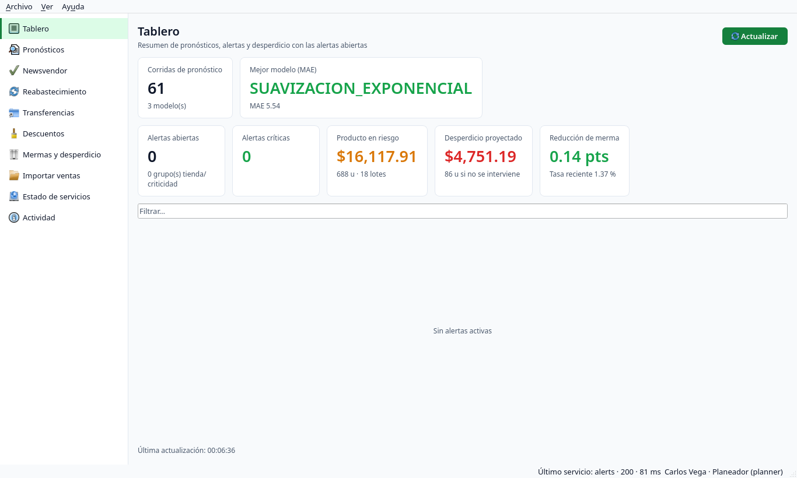

**Pronósticos.** Pestaña *Pronóstico*: elige tienda, SKU, método (*Automático (mejor modelo por serie)*,
media móvil, media móvil ponderada o suavización exponencial), horizonte, ventana, α e historia y pulsa
**Generar pronóstico** (ejecutar: planeador). *Comparar modelos* hace el backtest contra el pronóstico
ingenuo (MAE, WMAPE, sesgo) y *Drift* muestra la deriva y confiabilidad por tienda y producto.
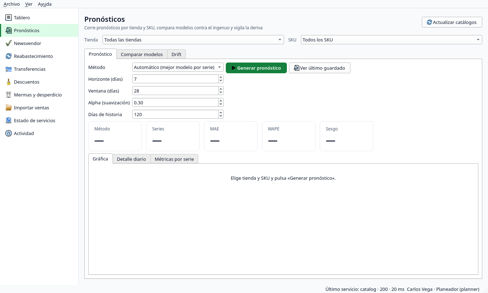

**Newsvendor.** Elige SKU, tienda y horizonte: muestra la **cantidad Newsvendor** (óptima según costo de
quedarse sin producto vs. costo de que sobre) frente a la política simple, el ratio crítico, el costo
esperado y el ahorro. Los costos los calcula el servidor a partir del catálogo.
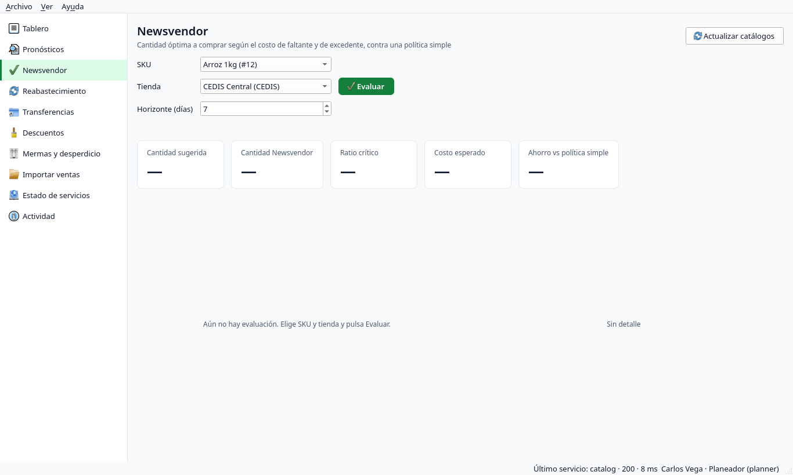

**Reabastecimiento.** Filtra por estado y tienda; **Generar órdenes** con el horizonte elegido; selecciona
una fila para ver la explicación; **Aprobar** (con cantidad opcional) o **Rechazar** con motivo. El motivo
queda en la bitácora local y en auditoría. **Ejecutar ciclo de planeación** requiere rol planeador.
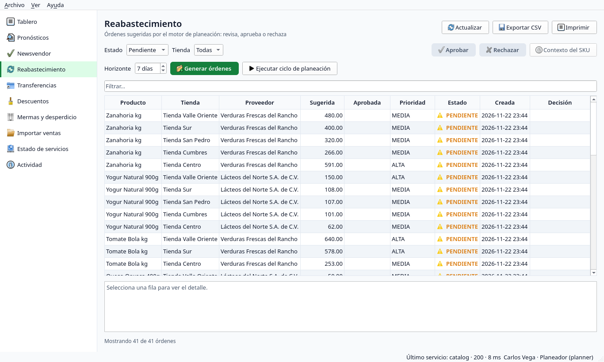

**Transferencias** (planeador). Detectar oportunidades, aprobar, rechazar y ejecutar.
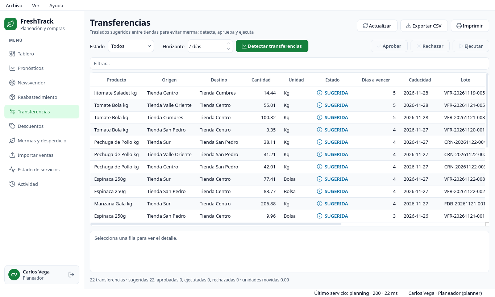

**Descuentos** (planeador). Generar sugerencias para lotes que caducan pronto; aprobar o rechazar los
que están en estado SUGERIDO.
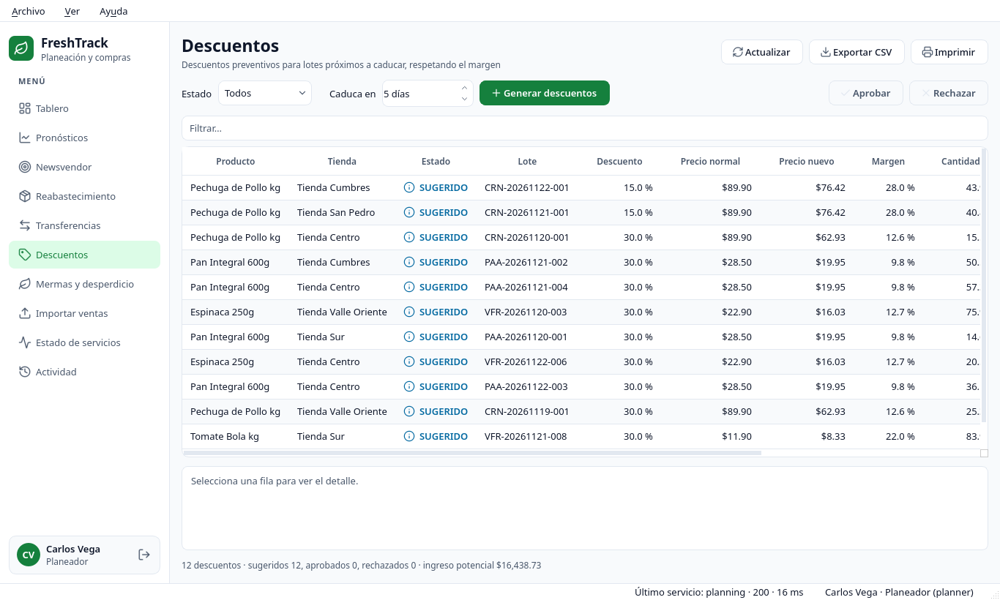

**Mermas y desperdicio.** Los seis indicadores (producto en riesgo, desperdicio proyectado, recuperado,
evitado estimado, merma reciente vs. histórico, CO₂e evitado) con su definición, y el triaje por lote.
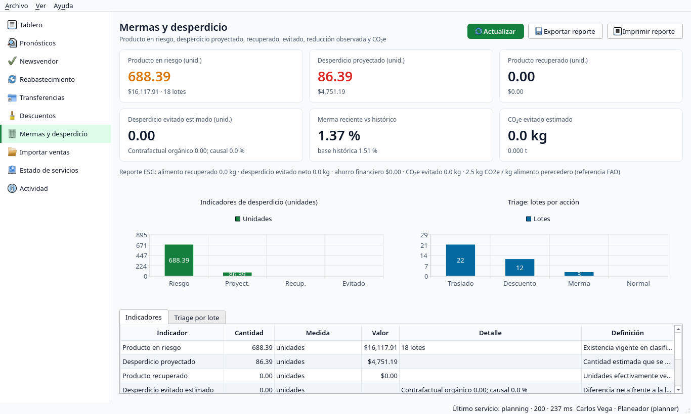

**Órdenes de compra** (comprador). Lista de OC; **Nueva orden de compra**: elige proveedor, captura los
lotes por tienda (o **Rellena los lotes con la sugerencia del Newsvendor**), revisa el total y **Crear
orden**. Para cada OC: **Descargar PDF**, **Imprimir PDF** y **Exportar CSV**.
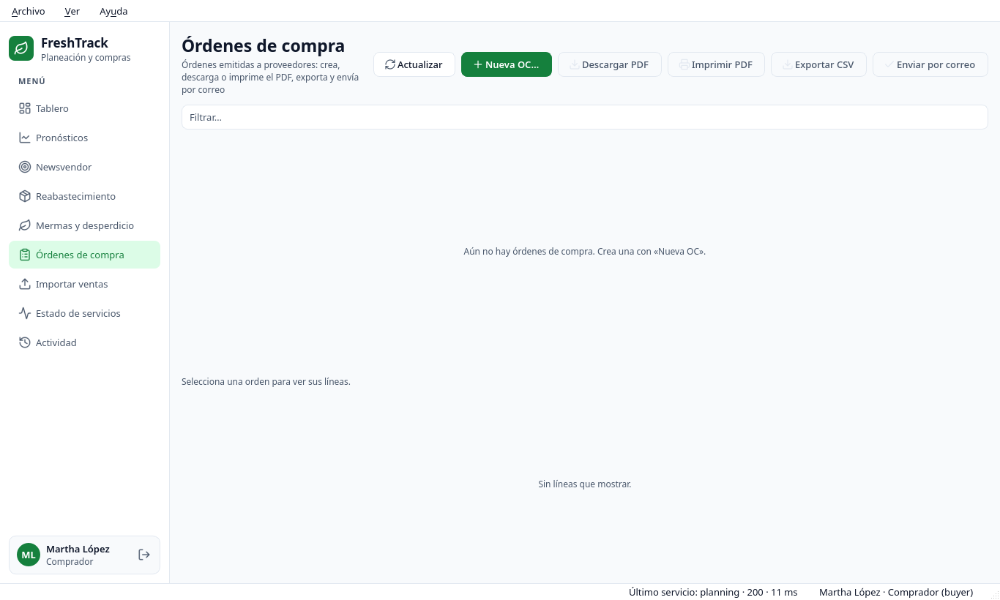

**Importar ventas.** Carga un CSV con columnas `folio_externo,id_locacion,id_sku,cantidad[,canal]`. La
vista previa marca las filas con error (cantidad negativa o no numérica, SKU faltante, folio demasiado
largo) y **no las envía**; las válidas se mandan en bloques de 500. Reimportar el mismo folio no duplica ventas.
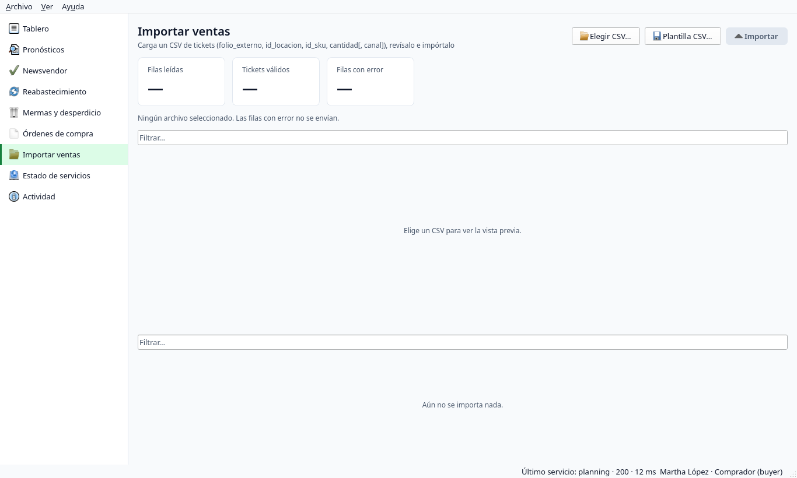

**Estado de servicios.** Los 8 servicios con estado (operando / degradado / caído), dependencias, versión
y hora de la última revisión.
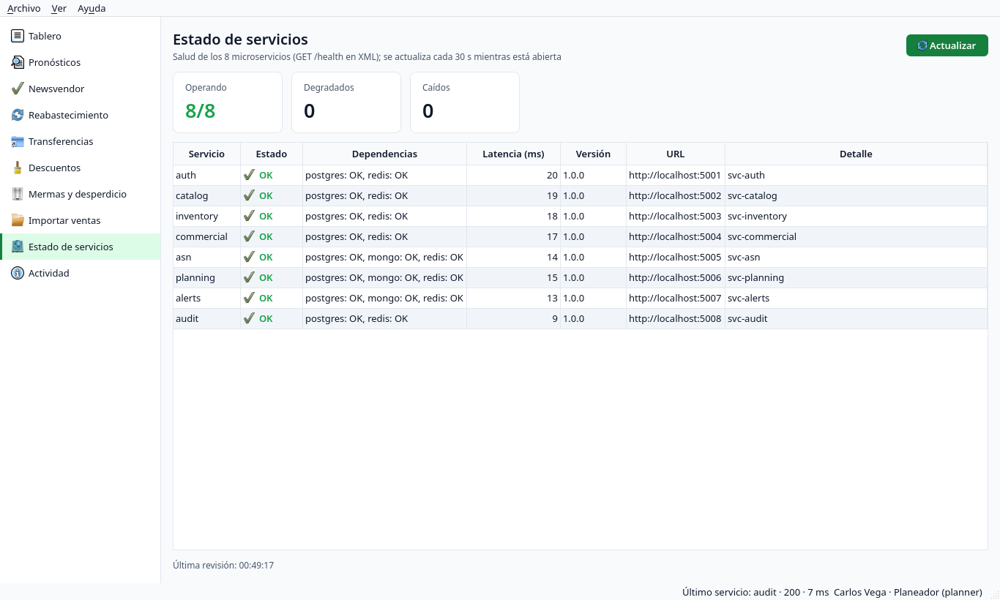

**Actividad.** Registro local de tus acciones, que también se envía a la auditoría central.
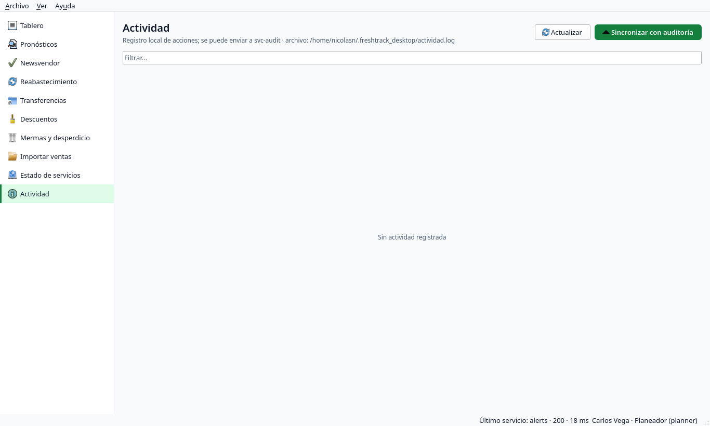

---

## 8. App Android (gerentes y almacén)

Para el personal de tienda en el piso de venta y el muelle. Solo pueden entrar **gerentes de tienda**,
**almacén** y **administrador**; con otra cuenta (p. ej. comprador) el acceso se rechaza. Instalación:
ver *Manual de instalación* §11.

### 8.1 Entrar y configurar

1. Abre **FreshTrack Mobile**. La pantalla dice «Bienvenido · Inicia sesión con tu cuenta de tienda».
2. Si el servidor no es el predeterminado: **icono de ajustes → Servidor** y escribe la URL HTTPS.
3. Ingresa correo y contraseña (hay botones de cuentas de prueba).
4. Para salir: pestaña **Más → Cerrar sesión**.

La sesión se guarda cifrada en el teléfono. Si un administrador la revoca, la app te regresa al login con
el aviso «Tu sesión fue revocada por un administrador».

### 8.2 Navegación

Barra inferior con cuatro pestañas y un botón naranja **Escanear**:

| Pestaña | Contenido |
|---|---|
| **Inicio** | Saludo, accesos rápidos (Recibir, FEFO, Merma, Conteo, Transferir, Descuentos, Evidencias), «Vencen pronto · surtir primero» (lotes ≤ 2 días), alertas abiertas, descuentos y transferencias sugeridas, y el impacto de los últimos 30 días: desperdicio evitado, alimento rescatado, emisiones evitadas y ahorro estimado. Si un servicio falla aparece «Servicio degradado» y el resto sigue funcionando |
| **Inventario** | Existencias de tu tienda; al tocar un producto se abre su cola FEFO |
| **Alertas** | Alertas abiertas; marcar como atendida. El teléfono recibe notificaciones de alertas nuevas (revisión cada 15 min) |
| **Más** | Recibir mercancía, Conteo cíclico, Descuentos por vencimiento, Evidencias, Estado de servicios, Ajustes, Cerrar sesión |

### 8.3 Escanear

Pulsa **Escanear** y apunta al código. La app reconoce etiquetas QR de FreshTrack (Hoja QR del ASN),
códigos GS1 y códigos de barras EAN/UPC: una etiqueta de embarque abre **Recepción**; un producto abre su
**cola FEFO**.

### 8.4 Recibir mercancía

1. Escanea la etiqueta QR del embarque (o **Más → Recibir mercancía**). La app valida la etiqueta y muestra proveedor, lote del proveedor, cantidad declarada, caducidad declarada y cadena de frío.
2. En **Lo que llegó** captura la cantidad real, la caducidad verificada y la temperatura.
3. **Inspección de calidad**: Conforme / Con observaciones / No conforme. **Acción**: Aceptar a FEFO / Cuarentena / Rechazar en muelle.
4. Opcional: **Tomar foto** del producto o del termómetro como evidencia.
5. **Registrar recepción.** Luego **Recibir otro** o **Terminar**. Si la señal falla y reintentas, la recepción no se duplica.

### 8.5 Consultar FEFO y solicitar transferencia

En **FEFO** (desde Inicio, Inventario o al escanear un producto) ves los lotes en el orden en que deben
salir. Toca un lote para ver acciones; **Solicitar** transferencia a otra tienda la deja como sugerida para
que el gerente o planeador la apruebe. En **Transferencias** se aprueban, rechazan y ejecutan las
sugeridas (aprobar: gerente y administrador; ejecutar: también almacén).

### 8.6 Registrar merma

**Inicio → Merma**: elige el **Lote afectado**, la cantidad y la **Causa**; opcionalmente **Tomar foto**;
**Registrar merma**. Si el almacenamiento de fotos no responde, la merma se puede registrar sin foto.

### 8.7 Conteo cíclico

**Más → Conteo cíclico**: elige el producto, captura lo contado por lote y **Enviar conteo**. Las
diferencias se ajustan en el inventario y se calcula la exactitud.

### 8.8 Descuentos por vencimiento

**Más → Descuentos por vencimiento**: lista de rebajas sugeridas; el gerente las **autoriza**. El
personal de almacén no ve el botón de autorizar.

### 8.9 Evidencias

**Más → Evidencias**: fotos tomadas en recepciones y mermas. Se guardan en un almacenamiento privado; al
abrir una, la app pide un enlace temporal válido 15 minutos.

### 8.10 Estado de servicios

**Más → Estado de servicios**: los 8 servicios del sistema con su estado (por ejemplo, «Caído (502)» si
uno está detenido).

---

## 9. Mensajes de error y qué hacer

| Mensaje (web, escritorio o móvil) | Qué significa | Qué hacer |
|---|---|---|
| «La cuenta está bloqueada temporalmente. Intenta en N minuto(s).» | Demasiados intentos fallidos | Espera; si olvidaste la contraseña pide al administrador que la restablezca |
| «Correo o contraseña incorrectos.» / «Esta cuenta está desactivada. Contacta al administrador.» | Credenciales inválidas o cuenta desactivada | Verifica los datos o contacta al administrador |
| «La sesión fue cerrada; el token ya no es válido.» (`token_revocado`) · «Tu sesión terminó o fue revocada» | Cerraste sesión en otro lado o un administrador revocó tu sesión | Inicia sesión de nuevo |
| «Token inválido, expirado o manipulado.» (`token_invalido`) / «La sesión no existe o expiró» (`sesion_inexistente`) | La sesión llegó a su límite de 8 h o ya no existe | Inicia sesión de nuevo |
| `sesion_no_verificable` | El servidor no pudo comprobar tu sesión (falla temporal de Redis y de la base) | Espera un momento y vuelve a entrar; avisa a soporte si persiste |
| «No tienes permiso para esta acción» / «El rol '…' no tiene permiso para esta operación.» (`acceso_denegado`, HTTP 403) | Tu rol no puede hacer esa operación | Pide a quien tenga el rol adecuado que la haga. No se modificó nada |
| `sucursal_no_autorizada` | Intentaste modificar datos de otra tienda | Solo puedes operar sobre tu tienda asignada |
| `proveedor_no_autorizado` / `proveedor_no_asignado` | Proveedor intentando operar recursos de otro proveedor, o usuario sin proveedor ligado | Pide al administrador que ligue tu usuario a tu proveedor |
| «Límite de solicitudes excedido… Intente nuevamente en N segundos.» (`limite_excedido`, 429) | Demasiadas peticiones en poco tiempo | Espera los segundos indicados |
| «El servicio X no está disponible» · «Servicio degradado» · «Sin conexión con el servidor» | Un servicio está detenido o no hay red | Las demás funciones siguen; usa **Reintentar** o vuelve más tarde. Revisa *Estado de servicios* |
| «MongoDB no está disponible» (503) | La base de alertas/documentos está caída | Inventario y ventas siguen funcionando; reintenta después |
| `almacenamiento_no_disponible` (503) | No se puede guardar la foto o el PDF | Registra la operación sin foto o reintenta más tarde |
| «El XML enviado no cumple su contrato…» / `xml_no_cumple_contrato` | Un dato no cumple el formato esperado (p. ej. un horizonte fuera de rango) | Corrige el valor; en «Detalles» se ve cuál campo falla |
| «La petición excedió el tiempo máximo» | El servidor tardó demasiado | Reintenta; los cálculos pesados (pronóstico de todas las tiendas) pueden tardar |
| «Ocurrió un error inesperado. Consulte el log con el correlation_id.» (500) | Error interno | Copia el `correlation_id` y entrégalo a soporte: con él se encuentra el detalle en los registros |
| Error 400 al enviar un formulario web después de mucho tiempo | El formulario perdió su token de seguridad (CSRF) | Recarga la página y vuelve a enviar |

En la app de escritorio y en la móvil el `correlation_id` se muestra en los errores y se puede seleccionar
para copiarlo.

---

## 10. Preguntas frecuentes

**¿Por qué no veo una pantalla que mi compañero sí ve?** El menú depende del rol (§4).

**¿Puedo borrar una venta, una merma o un registro de la bitácora?** No. La bitácora es inmutable y las
correcciones de inventario se hacen con movimientos (merma, conteo, ajuste) que también quedan registrados.

**¿Por qué el sistema no aprobó solo la orden de reabastecimiento?** Por diseño, todas las recomendaciones
requieren decisión humana.

**El pronóstico dice «deriva» o baja confiabilidad, ¿qué hago?** Vuelve a ejecutar el pronóstico de esa
tienda; si persiste, revisa si hubo cambios reales (promociones, cierres) que expliquen las ventas atípicas.

**¿Por qué la cantidad sugerida es mayor que lo que necesito?** Se redondea al pedido mínimo (MOQ) del
proveedor; la explicación de la orden advierte si eso puede generar sobreinventario o riesgo de caducidad.

**¿Por qué un traslado que esperaba no aparece?** Solo se proponen los que pasan las cuatro validaciones
(origen suficiente, destino lo necesita, llega antes de vencer, destino alcanza a venderlo). El mensaje
indica cuántas candidatas se descartaron.

**¿Por qué el desperdicio evitado es menor que lo que trasladé o rebajé?** Se descuenta lo que se habría
vendido de todos modos a precio normal (base orgánica) y solo cuenta lo que realmente se vendió antes de
caducar.

**¿Dónde veo los correos que envía el sistema?** En una instalación local, en http://127.0.0.1:8025
(Mailpit). Si está configurado el reenvío, también llegan al buzón real.

**Escaneé una etiqueta y dice que no es para mi tienda.** La etiqueta indica la tienda destino; se
recibe en la tienda correcta (el desvío solo lo autoriza un gerente o administrador).

**Olvidé mi contraseña.** Pide al administrador que la restablezca en *Usuarios y Roles* (ver §11).

**¿La app de escritorio o la móvil funcionan sin conexión?** No en esta versión: necesitan comunicarse con
el servidor (ver §11).

---

## 11. Funciones en integración

Al cierre de este manual se están incorporando las siguientes funciones, que **aún no forman parte de
esta versión** (commit `1926a17`):

- **Recuperación de contraseña desde la web** (mientras tanto, el administrador la restablece en *Usuarios y Roles*).
- **Centro de notificaciones en la web.**
- **«Último error registrado»** en el panel de monitoreo técnico.
- **App Android sin conexión**: cola de operaciones offline, sincronización al recuperar la red y registro del dispositivo.
