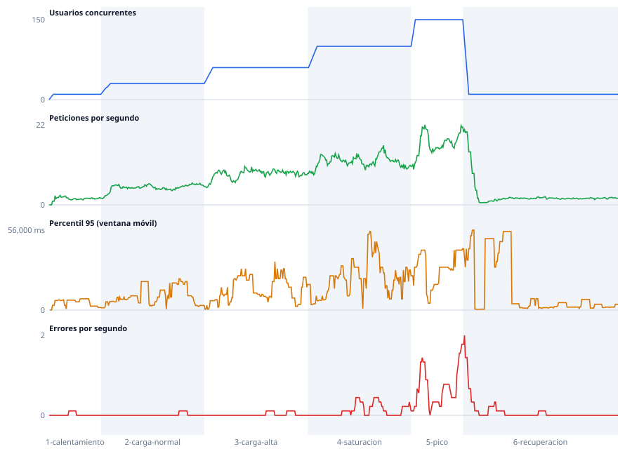

# Pruebas de carga con Locust — FreshTrack

**Fecha:** 24 de noviembre de 2026 · **Herramienta:** Locust 2.47 · **Duración:** 11 min, 6 escalones, hasta 150 usuarios concurrentes
**Datos crudos y reporte automático:** [`carga/escalonada/`](carga/escalonada/REPORTE.md) (CSV, HTML interactivo de Locust, gráfica SVG, CPU/memoria por contenedor)
**Cómo repetirla:** [`tests/carga/README.md`](../../tests/carga/README.md)

## 1. Entorno probado

| Elemento | Configuración |
|---|---|
| Host | VM de 2 vCPU y 7 GB de RAM; Locust corre en el mismo host que los contenedores |
| Despliegue | `docker-compose.yml` base: web Flask con **servidor de desarrollo**, 8 microservicios, PostgreSQL 3.1 GB, MongoDB, Redis |
| Datos | Volumetría masiva: 2,345 lotes en riesgo, 212 SKU, 3,300 existencias por tienda |
| Rate limit | Multiplicado ×1000 (`RATE_LIMIT_FACTOR`) para medir la capacidad real y no el tope del limitador |
| Código | Rama `avance2-postgresql-real` en `d2d2898`, **antes** del commit `1f7979c` "Postgres y redis optimizacion" y sin el overlay de producción (Gunicorn + tuning de Postgres) |

Estos números son la línea base **antes** de las optimizaciones. Conviene repetir la
prueba con el overlay de producción para medir la mejora.

## 2. Perfiles simulados

| Perfil | Peso | Endpoints reales |
|---|---:|---|
| Usuarios consultando | 6 | Web: inventario, productos, alertas, lotes, ventas, mapa |
| Usuarios registrando operaciones | 3 | `POST /commercial/checkout` (Saga + FEFO), `POST /commercial/shrinkage`, historial de ventas |
| Aplicaciones móviles enviando datos | 3 | Carrito POS en Redis (`PUT/GET cart`), stock por SKU, cola FEFO, catálogo |
| Aplicaciones de escritorio solicitando reportes | 1 | KPIs de pronóstico, backtest, órdenes de reabasto, desperdicio, resumen ASN, stock en XML |
| Sensores transmitiendo lecturas | 4 | Lectura de temperatura cada 5 s → documento en MongoDB (`POST /api/alertas/documentos`) |
| Conductores actualizando ubicación | 2 | Posición cada 10 s → bitácora de svc-audit; consulta de ASN en tránsito |
| Administradores consultando paneles | 1 | Dashboard, triaje, desperdicio evitado, bitácora, usuarios, contadores de auth |
| Procesos automáticos | 1 fijo | `POST alerts/scan` y `POST inventory/expiration/scan` cada 30 s |

La plataforma no tiene endpoints de telemetría ni de GPS. Sensores y conductores usan
los registros más cercanos que existen (documentos operativos en MongoDB y bitácora de
auditoría). Agregar endpoints dedicados queda como trabajo futuro.

## 3. Resultados por escalón

| Escalón | Usuarios | Peticiones/s | Errores | Mediana | p95 | p99 | CPU contenedores (de 200%) | CPU PostgreSQL |
|---|---:|---:|---:|---:|---:|---:|---:|---:|
| Calentamiento | 10 | 1.7 | 1.1% | 56 ms | 6.9 s | 7.0 s | 138% | 96% |
| Carga normal | 30 | 4.9 | 0.2% | 55 ms | 9.1 s | 14 s | 173% | 130% |
| Carga alta | 60 | 8.7 | 0.2% | 200 ms | 16 s | 42 s | 179% | 130% |
| Saturación | 100 | 12.1 | 1.0% | 155 ms | 23 s | 53 s | 174% | 116% |
| Pico | 150 | 17.3 | 3.5% | 150 ms | 30 s | 62 s | 177% | 121% |
| Recuperación | 10 | 1.7 | 1.5% | 44 ms | 2.9 s | 2.9 s | 108% | 74% |

**Globales:** 4,586 peticiones · 6.9 peticiones/s de promedio (17.3 máx. sostenido) ·
tiempo medio 3.2 s · mediana 140 ms · **p95 21 s · p99 54 s** · 67 errores (1.46%).

## 4. Análisis de los indicadores

**Usuarios concurrentes y peticiones por segundo.** El throughput crece casi en proporción
a los usuarios (1.7 → 17.3 RPS), pero las peticiones por usuario bajan de 0.17 a 0.115
porque cada usuario pasa más tiempo esperando respuestas lentas.

**Tiempo medio frente a percentiles.** La mediana se mantiene en 50–200 ms en todos los
escalones, pero el p95 y el p99 se disparan. La plataforma tiene dos poblaciones de
endpoints: los de API puntuales (Redis, catálogo, carrito, checkout), que son rápidos, y
las pantallas web y reportes analíticos, que son de decenas de segundos. El promedio
de 3.2 s esconde esa diferencia; el p95 de 21 s la muestra.

**Saturación.** El host ya está saturado desde la carga normal (30 usuarios): los
contenedores usan 173% de los 200% de CPU disponibles y **PostgreSQL consume solo 130%**.
El cuello de botella es la base de datos, impulsada por las pantallas pesadas. Los
microservicios de API apenas usan CPU (< 10% cada uno). En el pico de 150 usuarios el
p95 llega a 30 s y los errores a 3.5%.

**Errores.** Todos aparecen en el pico y vienen de la web:

| Tipo | Cantidad | Causa |
|---|---:|---|
| HTTP 500 en pantallas web | 25 | `QueuePool limit of size 5 overflow 10 reached`: el pool de SQLAlchemy de la web (5+10 conexiones) se agota y las peticiones esperan 30 s antes de fallar |
| HTTP 401 en lecturas de sensor | 21 | La web rechazó el token mientras ese mismo token seguía válido en svc-audit; apunta a la validación del token en la web bajo carga (no verificado) |
| Sesión web perdida / login fallido | 21 | Mismo agotamiento del pool durante el login y la carga de la sesión |

Ningún microservicio de API devolvió errores. La Saga de checkout no tuvo
compensaciones fallidas.

**Recuperación.** Al bajar de 150 a 10 usuarios, el sistema volvió a estabilizarse sin
errores en **18 s**, y el p95 cayó a 2.9 s. No quedan colas atoradas ni conexiones
colgadas: el sistema se recupera solo en cuanto baja la carga.

## 5. Endpoints más lentos

| Endpoint | p95 | Media | Qué hace (la causa exacta no se perfiló) |
|---|---:|---:|---|
| `GET svc-audit /audit/events` | 107 s | 52 s | Consulta la bitácora de auditoría completa |
| `GET web /triaje` | 95 s | 44 s | Evalúa los 2,345 lotes en cada carga (descuento ↔ traslado ↔ merma) |
| `GET web /mapa` | 93 s | 15 s | Agrega inventario y riesgo de todas las tiendas |
| `GET web /panel` | 75 s | 15 s | KPIs calculados en cada petición |
| `POST inventory/expiration/scan` | 74 s | 31 s | Proceso automático que recorre todas las existencias |
| `GET web /lotes` | 73 s | 25 s | Listado de lotes con existencias y estado |
| `GET planning /forecast/backtest` | 65 s | 52 s | Reporte de escritorio; recalcula el backtest completo |
| `GET web /productos` | 61 s | 29 s | Catálogo con existencias agregadas |

Los más rápidos fueron el carrito POS en Redis (~50 ms), el catálogo cacheado (~50 ms),
`GET asn` en MongoDB (~65 ms) y los contadores de auth (~30 ms).

## 6. Recomendaciones

1. **Servir la web con Gunicorn** (ya lo hace `docker-compose.prod.yml`) y **ampliar el
   pool de SQLAlchemy** de la web: es la causa directa de los 500.
2. **Cachear en Redis las pantallas analíticas** (`/panel`, `/mapa`, `/triaje`, backtest)
   con TTL corto: hoy recalculan sobre toda la volumetría en cada petición.
3. **Precalcular la evaluación de triaje** (vista materializada o job del ciclo de
   planeación) en vez de evaluarla en cada carga de la página.
4. **Paginar por llave** la bitácora (`audit/events`) y revisar sus índices.
5. **Separar Locust del host** o usar un host con más núcleos para la siguiente medición.
6. **Repetir esta prueba con el overlay de producción y el commit `1f7979c`** para
   cuantificar la mejora con el mismo escenario.
