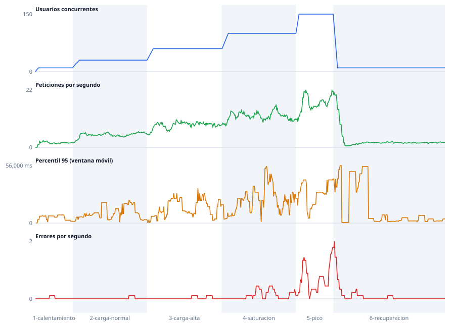

# Resultados — corrida `escalonada`

Duración: **11.0 min** · Escala de tiempo: 1.0 · Host con 2 núcleos (Locust corre en el mismo host que los contenedores).

## Resumen global

| Métrica | Valor |
|---|---|
| Usuarios concurrentes (máx.) | 150 |
| Peticiones totales | 4,586 |
| Peticiones por segundo (promedio de la corrida) | 6.9 |
| Peticiones por segundo (máximo sostenido, por escalón) | 17.3 |
| Tiempo medio de respuesta | 3,195 ms |
| Mediana | 140 ms |
| Percentil 95 | 21.0 s |
| Percentil 99 | 54.0 s |
| Errores | 67 (1.46%) |

## Por escalón de carga

Valores en estado estable (se descartan los primeros 15 s de rampa de cada escalón). p50/p95/p99 son la mediana de la ventana móvil de Locust.

| Escalón | Usuarios | RPS | Errores | p50 | p95 | p99 | CPU total contenedores |
|---|---:|---:|---:|---:|---:|---:|---:|
| 1-calentamiento | 10 | 1.7 | 1.1% | 56 ms | 6,850 ms | 7,000 ms | 138% / 200% |
| 2-carga-normal | 30 | 4.9 | 0.2% | 55 ms | 9,100 ms | 14.0 s | 173% / 200% |
| 3-carga-alta | 60 | 8.7 | 0.2% | 200 ms | 16.0 s | 42.0 s | 179% / 200% |
| 4-saturacion | 100 | 12.1 | 1.0% | 155 ms | 23.0 s | 53.0 s | 174% / 200% |
| 5-pico | 150 | 17.3 | 3.5% | 150 ms | 30.0 s | 62.0 s | 177% / 200% |
| 6-recuperacion | 10 | 1.7 | 1.5% | 44 ms | 2,900 ms | 2,900 ms | 108% / 200% |

## Saturación

**La carga normal (30 usuarios) ya opera saturada:** p95 de 9,100 ms y 173% de CPU de contenedores sobre 200% disponibles. Los criterios relativos de abajo comparan contra esa base, así que subestiman la saturación.

El sistema se satura en el escalón **5-pico** (~150 usuarios concurrentes):

- p95 30.0 s (> 3× la base de 9,100 ms)

## Recuperación

Tras bajar del pico a 10 usuarios, el sistema volvió a p95 ≤ 13.7 s sin errores (5 s seguidos) en **18 s**.

## Endpoints más lentos (por p95)

| Endpoint | Peticiones | Fallas | Media | p95 | p99 | Máx. |
|---|---:|---:|---:|---:|---:|---:|
| `GET [audit] GET events` | 5 | 0 | 51.6 s | 107.0 s | 107.0 s | 107.2 s |
| `GET [web] /triaje` | 9 | 2 | 43.9 s | 95.0 s | 95.0 s | 95.3 s |
| `GET [web] /mapa` | 31 | 0 | 15.2 s | 93.0 s | 103.0 s | 103.1 s |
| `GET [web] /panel` | 14 | 7 | 15.3 s | 75.0 s | 75.0 s | 74.8 s |
| `POST [inventory] POST expiration/scan` | 8 | 0 | 30.5 s | 74.0 s | 74.0 s | 73.9 s |
| `GET [web] /lotes` | 54 | 4 | 24.7 s | 73.0 s | 84.0 s | 83.6 s |
| `GET [planning] GET forecast backtest` | 7 | 0 | 52.2 s | 65.0 s | 65.0 s | 64.6 s |
| `GET [web] /productos` | 88 | 5 | 29.1 s | 61.0 s | 65.0 s | 65.5 s |
| `GET [web] /ventas` | 57 | 1 | 16.5 s | 48.0 s | 52.0 s | 52.5 s |
| `GET [web] /inventario` | 98 | 9 | 12.0 s | 46.0 s | 78.0 s | 77.9 s |
| `GET [web] /usuarios` | 3 | 1 | 14.2 s | 42.0 s | 42.0 s | 42.2 s |
| `GET [web] /alertas` | 97 | 8 | 7,573 ms | 39.0 s | 50.0 s | 49.5 s |

## Errores

| Tipo | Ocurrencias |
|---|---:|
| HTTP 500 | 25 |
| HTTP 401 | 21 |
| Sesión web perdida (redirección a /login) | 14 |
| Login web rechazado/fallido | 7 |

Detalle (top 10):

| Endpoint | Error | Ocurrencias |
|---|---|---:|
| `[web] POST lectura sensor (Mongo)` | CatchResponseError('401 token vencido/revocado') | 21 |
| `[web] /alertas` | CatchResponseError('500') | 8 |
| `[web] /inventario` | CatchResponseError('500') | 7 |
| `[web] /panel` | CatchResponseError('sesión perdida (redirige a /login)') | 6 |
| `[web] POST /login` | CatchResponseError('login web gerente: 500 ') | 5 |
| `[web] /productos` | CatchResponseError('500') | 4 |
| `[web] /lotes` | CatchResponseError('500') | 3 |
| `[web] POST /login` | CatchResponseError('login web admin: 500 ') | 2 |
| `[web] /triaje` | CatchResponseError('500') | 2 |
| `[web] /inventario` | CatchResponseError('sesión perdida (redirige a /login)') | 2 |

## Consumo por contenedor (CPU promedio / máx. · memoria máx.)

| Contenedor | 1-calentamiento | 2-carga-normal | 3-carga-alta | 4-saturacion | 5-pico | 6-recuperacion |
|---|---:|---:|---:|---:|---:|---:|
| db | 96% / 182% · 688 MB | 130% / 181% · 546 MB | 130% / 177% · 794 MB | 116% / 168% · 845 MB | 121% / 166% · 859 MB | 74% / 178% · 856 MB |
| svc_planning | 18% / 84% · 229 MB | 9% / 79% · 246 MB | 16% / 79% · 285 MB | 26% / 85% · 286 MB | 17% / 75% · 250 MB | 11% / 98% · 272 MB |
| app | 7% / 34% · 254 MB | 13% / 41% · 271 MB | 11% / 50% · 288 MB | 9% / 51% · 315 MB | 7% / 15% · 319 MB | 8% / 39% · 358 MB |
| mongo | 13% / 68% · 432 MB | 9% / 70% · 445 MB | 9% / 81% · 452 MB | 7% / 70% · 322 MB | 9% / 58% · 326 MB | 7% / 73% · 333 MB |
| svc_commercial | 0% / 1% · 68 MB | 2% / 10% · 77 MB | 3% / 7% · 68 MB | 7% / 17% · 77 MB | 9% / 17% · 70 MB | 1% / 8% · 88 MB |
| svc_inventory | 1% / 7% · 73 MB | 1% / 9% · 69 MB | 2% / 9% · 69 MB | 2% / 9% · 70 MB | 3% / 12% · 70 MB | 1% / 7% · 75 MB |
| redis | 1% / 1% · 14 MB | 2% / 7% · 14 MB | 3% / 11% · 14 MB | 1% / 2% · 14 MB | 1% / 2% · 14 MB | 1% / 9% · 23 MB |
| minio | 0% / 7% · 105 MB | 1% / 7% · 108 MB | 0% / 0% · 106 MB | 1% / 7% · 105 MB | 3% / 7% · 106 MB | 1% / 7% · 111 MB |
| svc_alerts | 0% / 7% · 68 MB | 2% / 35% · 68 MB | 2% / 31% · 69 MB | 0% / 7% · 69 MB | 1% / 8% · 69 MB | 1% / 25% · 69 MB |
| mail | 0% / 0% · 14 MB | 2% / 7% · 22 MB | 2% / 7% · 14 MB | 0% / 7% · 12 MB | 2% / 6% · 12 MB | 1% / 7% · 12 MB |
| svc_catalog | 0% / 7% · 66 MB | 1% / 8% · 66 MB | 0% / 0% · 65 MB | 1% / 9% · 66 MB | 1% / 7% · 73 MB | 0% / 8% · 66 MB |
| svc_audit | 0% / 7% · 64 MB | 1% / 7% · 65 MB | 1% / 4% · 65 MB | 1% / 7% · 72 MB | 1% / 9% · 64 MB | 1% / 8% · 71 MB |
| svc_auth | 1% / 7% · 71 MB | 0% / 7% · 66 MB | 1% / 7% · 66 MB | 0% / 3% · 65 MB | 1% / 6% · 65 MB | 1% / 8% · 65 MB |
| svc_asn | 1% / 7% · 67 MB | 1% / 7% · 68 MB | 0% / 1% · 68 MB | 1% / 8% · 76 MB | 1% / 5% · 67 MB | 0% / 7% · 72 MB |
| caddy | 0% / 0% · 31 MB | 0% / 0% · 31 MB | 0% / 0% · 31 MB | 0% / 1% · 34 MB | 0% / 0% · 34 MB | 0% / 0% · 34 MB |
